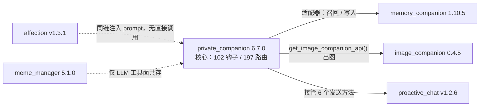
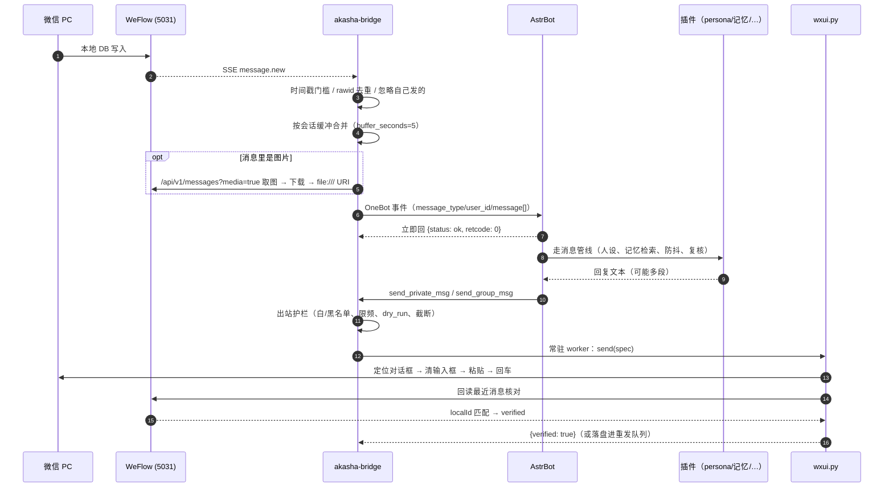
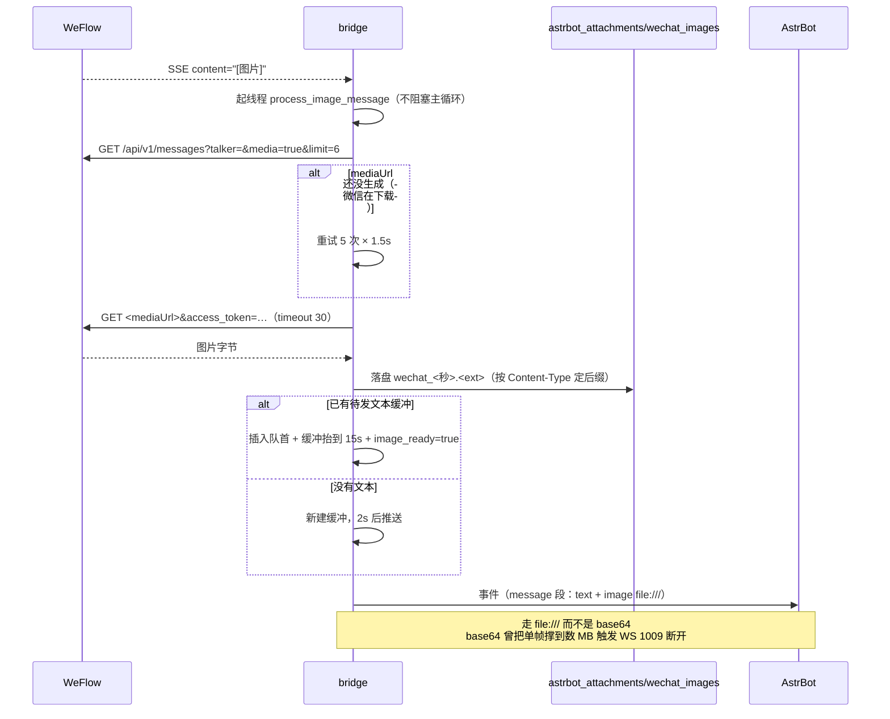
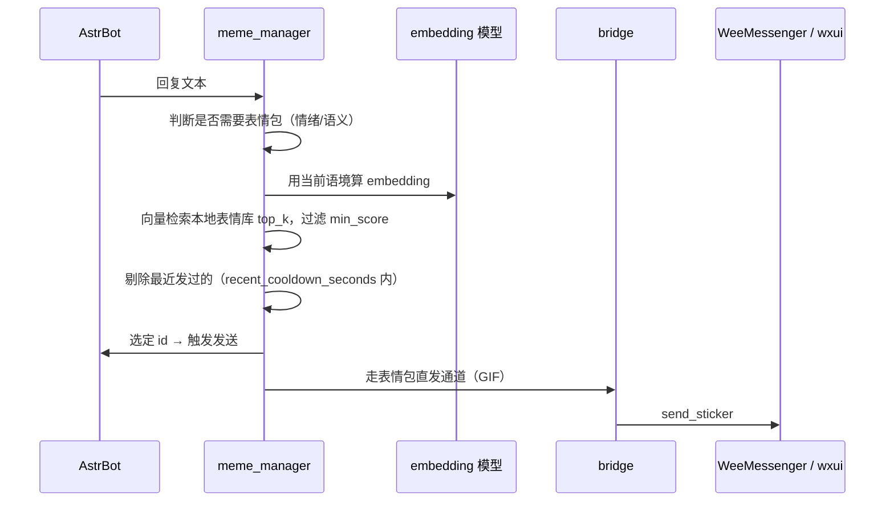
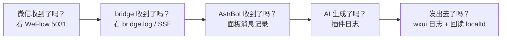
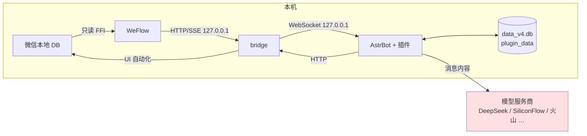

# 微信 AI 伴侣系统 · 项目书

> 版本：2026-10-16
> 适用仓库：`wechat-ai-stack`（本文件位于仓库根 `docs\PROJECT-BOOK.zh-CN.md`）

**怎么读这份文档**

- 想快速理解「这东西是怎么工作的」→ 第 1、2 章
- 想知道「某个组件对外提供什么接口、怎么配」→ 第 3 章（按组件分节）
- 想知道「一条消息从收到到发出经过了哪些环节」→ 第 4 章
- 想把它跑起来、或者它坏了 → 第 5、7 章
- 关心隐私与安全边界 → 第 8 章

**目录**

| 章 | 内容 |
|---|---|
| [1. 项目概述](#1-项目概述) | 这是什么、设计目标、不做什么、命名 |
| [2. 总体架构](#2-总体架构) | 分层图、端口与进程、两条主链路、关键设计决策 |
| [3. 组件详述](#3-组件详述) | WeFlow / akasha-bridge / AstrBot / 六个插件 / scripts / WeeMessenger |
| [4. 端到端时序](#4-端到端时序) | 收→回、图片进出、表情包、主动消息、发送提速 |
| [5. 部署与运维](#5-部署与运维) | 首次部署、启动顺序、日常运维、升级回滚 |
| [6. 配置总表](#6-配置总表) | 五个配置文件各管什么、怎么生效 |
| [7. 故障排查](#7-故障排查) | 分层定位法、症状对照表、日志位置 |
| [8. 数据流与隐私边界](#8-数据流与隐私边界) | 什么留在本机、什么会发给模型服务商 |
| [9. 已知限制与后续方向](#9-已知限制与后续方向) | 能力边界与演进计划 |
| [附录 A · 速查表](#附录-a--速查表) | 端口、路径、验证命令 |
| [附录 B · 术语表](#附录-b--术语表) | 名词解释 |

---

## 1. 项目概述

### 1.1 这是什么

一套**完全跑在单台 Windows 机器上**的微信 AI 伴侣系统。它把「微信」当作人的通道，把「大模型」当作大脑，
把「本地记忆库」当作长期记忆，让一个虚拟角色能够：

- 收发微信消息（读取用本地数据库，发送用 UI 自动化）；
- 记住你说过的话、你的偏好、你们之间的约定，并在之后的对话里自然使用；
- **主动**找你说话（早安晚安、天气、纪念日、随机关心）；
- 发图、发表情包，并能看懂你发来的图片；
- 维持一个稳定的人设（性格、说话风格、生活状态）。

除开对模型 API 的调用，其余一切都在本机完成，**不经过任何第三方服务器中转**。

### 1.2 设计目标

| 目标 | 具体含义 |
|---|---|
| 真实可用 | 不是 demo：能连续跑数天，能自我恢复（进程重启、断线重连、发送失败重试） |
| 记忆持久 | 对话摘要、事实、人设状态都落盘，重启不丢；有检索、有衰减、有去重 |
| 主动性强 | 不只在被 @ 时说话，会自己找话题、自己定时机、自己决定发不发 |
| 行为可控 | 白名单/黑名单/限频/dry-run 四道出站护栏；所有发送都有日志与回读校验 |
| 可维护 | 每个组件单独可重启、可探测；有单元测试、有运维脚本、有排障文档 |

### 1.3 不做什么

- **不做多用户/多账号**：整套系统只服务一个微信帐号。
- **不做云端部署**：所有状态在本机（`%APPDATA%`、仓库目录、SQLite 文件）。
- **不绕过微信协议**：不注入微信进程、不改微信内存、不伪造网络包。读=读本地数据库，写=模拟真人键盘操作。
- **不追求零延迟**：为保证「确实发出去了」，发送链路会做数据库回读校验，单条 2–10 秒是可接受代价。

### 1.4 命名

- **Akasha**（`akasha-bridge`）——桥接服务，取自「阿卡夏记录」。
- **奈奈山**——Web 控制面板的标题；面板是桥接服务内嵌的单页应用。
- 内部另有若干角色名/昵称，属于个人设定，不在文档中约定。

---

## 2. 总体架构

### 2.1 分层

```
┌─────────────────────────────────────────────────────────────────────────┐
│                           微信 PC 客户端 (4.x)                          │
│   本地数据库 (Documents\xwechat_files\wxid_*\db_storage)   +   UI 界面  │
└───────┬─────────────────────────────────────────────────┬───────────────┘
        │ 只读读库 (WCDB FFI)                              │ 键盘/剪贴板模拟
        ▼                                                 ▲
┌───────────────────────┐                        ┌────────┴──────────────┐
│  WeFlow  (Electron)   │                        │  scripts\wxui.py      │
│  127.0.0.1:5031       │                        │  (Windows-MCP + OCR   │
│  HTTP API + SSE 推送  │                        │   + 回读验证)          │
└───────┬───────────────┘                        └────────▲──────────────┘
        │ SSE / REST (话术：读消息、取图)                    │ 子进程 / 常驻 worker
        ▼                                                 │
┌─────────────────────────────────────────────────────────────────────────┐
│  akasha-bridge  (Python, 127.0.0.1:8766)                                │
│  ── SSE 接收 → 缓冲合并 → 去重 → 取图 → 构造 OneBot 事件                  │
│  ── OneBot v11 WS 客户端 → AstrBot                                      │
│  ── 出站护栏（白/黑名单、限频、dry-run）→ 发送后端 WxuiSender             │
│  ── 重发队列 + 常驻 worker + 内嵌 Web 面板                              │
└───────┬─────────────────────────────────────────────────▲───────────────┘
        │ 反向 WebSocket (OneBot v11)  ws://127.0.0.1:11229/ws             │
        ▼                                                 │ send_private_msg
┌─────────────────────────────────────────────────────────────────────────┐
│  AstrBot 4.28.2  (Python, 面板 127.0.0.1:6185)                          │
│  消息管线 / Provider 抽象 / 记忆 / 会话 / 插件系统 / 定时任务             │
│  ┌───────────────────────────────────────────────────────────────────┐  │
│  │ 六个自研插件                                                       │  │
│  │  private_companion  人格·陪伴·防抖·复核·人设·主动性（核心）        │  │
│  │  memory_companion   长期记忆的抽取、存储、检索、衰减               │  │
│  │  proactive_chat     主动消息的候选生成与调度                       │  │
│  │  image_companion    看图说话 / 参考图生成                          │  │
│  │  meme_manager        表情包语义检索与发送                          │  │
│  │  affection          好感度/亲密度数值系统                          │  │
│  └───────────────────────────────────────────────────────────────────┘  │
└───────┬─────────────────────────────────────────────────────────────────┘
        │ HTTPS
        ▼
   模型服务（DeepSeek / SiliconFlow / 火山方舟 / 即梦 等）
```

### 2.2 端口与进程

| 端口 | 进程 | 协议 | 作用 | 是否必需 |
|---|---|---|---|---|
| **5031** | `electron.exe`（WeFlow 树内） | HTTP + SSE | 微信消息**读取**的唯一入口 | ✅ 必需 |
| **8766** | `python main.py`（akasha-bridge） | HTTP | 桥接控制面板 + 手动发消息接口 | ✅ 必需 |
| **11229** | AstrBot `aiocqhttp` | WebSocket | OneBot v11 反向 WS，bridge 连它 | ✅ 必需 |
| **6185** | AstrBot WebUI | HTTP | AstrBot 管理面板 | ⭕ 建议 |
| **8790** | `scripts\jimeng_image_server.py` | HTTP | 即梦（火山）图片生成/编辑桥 | ⭕ 用了才需要 |
| 9877 | WeeMessenger（小信使） | HTTP | 可选的第三方发送后端 | ❌ 默认不用 |
| 11434 / 61000 | Ollama | HTTP | 本地图片描述模型（可选） | ❌ 可选 |
| — | 微信客户端 | — | 数据源与最终展示界面 | ✅ 必需 |

> ⚠️ 5031 是**单点**：它不监听，则整个系统的输入链路死掉（bridge 每 30 秒重试一次连接）。

### 2.3 两条主链路

**收（微信 → AI）**

```
别人发消息
  → 微信写入本地 DB
  → WeFlow 从 DB 读到并 SSE 推送 (message.new)
  → akasha-bridge 收集、按会话缓冲合并、去重
  → 若是图片/表情：回查 WeFlow 取 mediaUrl 并下载到本地，拼成 CQ 图片码
  → 构造 OneBot v11 消息事件
  → 经反向 WS 推给 AstrBot
  → AstrBot 交给插件管线（private_companion 为主）
     ├─ 记忆检索（memory_companion）
     ├─ 人设/关系状态拼装
     ├─ 调模型生成
     ├─ 智能防抖（判断这轮要不要立刻回）
     ├─ 被动回复复核（severe_only：只拦严重问题）
     └─ 出品消息段（可带图片/表情包）
  → AstrBot 反向调用 bridge 的 send_private_msg / send_group_msg
```

**发（AI → 微信）**

```
AstrBot 下发 send_private_msg
  → akasha-bridge 解析 target（数字 id → 微信昵称/wxid）
  → 出站护栏：黑名单 / 白名单 / 限频 / dry-run
  → 交给 WxuiSender
     ├─ 按联系人成组排队（同一人的分段连着发，避免来回切换会话）
     ├─ 常驻 worker 进程内复用 windows-mcp 客户端（省掉每条 3 秒的启动开销）
     ├─ wxui.py：
     │    ├─ 确认微信窗口可用（不能最小化、不能有前台冲突）
     │    ├─ 定位聊天（首次走侧边栏 OCR；同联系人后续走 warm 快路径）
     │    ├─ 清空输入框 → 剪贴板粘贴 → 回车
     │    └─ 回读 WeFlow 数据库，确认消息真的发出去了
     └─ 未确认送达 → 落重发队列（20s 轮询，先只读复查再重发，最多 5 次）
  → 微信界面上出现这条消息
```

### 2.4 关键设计决策与理由

| 决策 | 理由 |
|---|---|
| **读取走 WeFlow 而不是 hook 微信** | 微信 4.x 的 DB 是加密的；WCDB 原生库能直接读。hook 进程风险高、易随版本失效。WeFlow 把这件事封装成 HTTP API + SSE，边界干净。 |
| **发送走 UI 自动化而不是协议** | 没有稳定的微信 4.x 发送协议。UIA 模拟真人操作是唯一「不需要逆向协议、不需要额外帐号」的方式。代价是慢（每条 2–10 秒），用常驻 worker + warm 快路径把代价压到最小。 |
| **不用 AstrBot 自带的微信适配器** | AstrBot 官方的微信适配器面向协议/第三方网关（NapCat、Gewechat 等），需要额外帐号与协议服务；本机这套只能走「读库 + UIA」路线。于是自写 `akasha-bridge` 作 OneBot v11 的**服务端侧**，AstrBot 用 `aiocqhttp` 适配器当**客户端**连过来。 |
| **bridge 输出 OneBot v11 而不是自定义协议** | 直接复用 AstrBot 成熟的管线（消息段、防抖、插件 API、发送抽象），零改动接入。 |
| **消息发送必须回读校验** | UIA 的「回车成功」不等于「消息发出」。只有微信数据库里出现了这条记录，才算送达。这也是重发队列的判定依据。 |
| **分段发送按联系人成组** | 模型常把一句话拆成 3–4 条。若每条都「切会话 → 发 → 切回来」，既慢又容易被 OCR 抖动打乱。成组后同一联系人只定位一次。 |
| **图片走 `file://` URI 而不是 base64** | base64 曾把单帧撑到 11 MB，触发 WebSocket `1009 PayloadTooBig` 断开，表现为 AstrBot 侧超时。改用本地文件路径后协议帧只有几百字节。 |
| **出站护栏放在后端基类** | 白名单/黑名单/限频/dry-run 是安全底线，不能被上层绕过；放在 `WeMessengerSender._guard()` 里，所有后端（含 wxui）自动继承。 |
| **记忆与对话分离** | 对话历史（短期、易膨胀）与长期记忆（抽取后的事实/摘要，有检索与衰减）分开存。前者可以丢，后者要有取舍地留。 |

---

## 3. 组件详述

本章按数据流顺序介绍每个组件：**它是什么、对外提供什么接口、关键配置、怎么启动、怎么判断它坏了**。
逐行级别的完整规格（每个接口、每个配置键）见 `docs/interfaces/` 下的三份组件规格书：
[`weflow.md`](interfaces/weflow.md)、[`akasha-bridge.md`](interfaces/akasha-bridge.md)、
[`astrbot-plugins.md`](interfaces/astrbot-plugins.md)。

### 3.1 WeFlow —— 微信读取层

**是什么**：Electron 桌面应用（`weflow/`，v5.0.0 源码树）。用 FFI（`koffi`）加载 `wcdb_api.dll`
直接读微信 4.x 的本地 SQLite 数据库，并在本机开一个 HTTP API + SSE 推送。
它**只读不写**（未逐行审计确认，不要对外承诺），是整条输入链路的唯一数据源。

**技术要点**

| 项 | 值 |
|---|---|
| 监听 | `127.0.0.1:5031`（`electron/services/config.ts:237-238`） |
| 鉴权 | `httpApiToken`，支持 `Authorization: Bearer`、`?access_token=`、body 三种传法；只有 `/health` 免鉴权 |
| 核心逻辑 | `electron/services/wcdbCore.ts`（5001 行）；DB 访问在 worker 线程 `electron/wcdbWorker.ts` |
| 推送 | SSE `GET /api/v1/push/messages`，事件 `message.new` / `message.revoke` |
| 关键安全阀 | DLL 内置「构建日 + 15 天」时间闸门（见 3.1.2） |

**对外的接口（本系统实际用到的）**

| Method | Path | 用途 |
|---|---|---|
| GET | `/api/v1/sessions` | 会话列表（bridge 预填 id 映射、探测 5031 是否活着） |
| GET | `/api/v1/messages?talker=&media=true&limit=6` | 取某会话最近消息（含图片 `mediaUrl`）——bridge 靠它取图 |
| GET | `/api/v1/push/messages` | SSE 新消息推送——bridge 的主输入 |
| GET | `/api/v1/media/...` | 下载图片（在 `mediaUrl` 后追加 `access_token`） |
| GET | `/api/v1/contacts`、`/api/v1/group-members` | 联系人、群成员（辅助） |

完整的 17 个路由、消息字段表、错误码表见 **[`docs/interfaces/weflow.md`](interfaces/weflow.md)**。

**关键配置**：`%APPDATA%\weflow\WeFlow-config.json`

| 键 | 说明 |
|---|---|
| `httpApiToken` | 访问令牌；bridge 的 `access_token` 必须与它一致 |
| `httpApiPort` / `httpApiHost` | 默认 5031 / 127.0.0.1 |
| `dbPath` | 微信数据根（含 `wxid_*` 子目录），例如 `C:\Users\<你>\Documents\xwechat_files` |
| `myWxid` | 机器人自己的 wxid |
| `autoDownloadHighRes` / `autoDownloadWhitelist` | 高清图自动下载白名单——**不在名单里的会话取不到 `mediaUrl`** |

**启动**：只能用 `scripts\start-weflow50.cmd`。它替你做三件事：
① 清掉 `ELECTRON_RUN_AS_NODE`（否则 electron 以 Node 模式跑，不启窗口也不启 API）；
② 从已安装的 WeFlow 6.3.2 复制 `ffmpeg.exe`（缺失则 HEVC/`wxgf` 图片全部解不出）；
③ 把 cwd 切到树根（`imageDownloadService` 靠 `process.cwd()\resources\image\` 找 `img_helper.dll`）。

#### 3.1.1 WeFlow 的两种「起不来」

| 现象 | 码 | 原因 | 处理 |
|---|---|---|---|
| API 返 500，日志 `InitProtection rc=-101` | `-101` | DLL 的「构建日 + 15 天」时间闸门 | 打二进制补丁（见 3.1.2） |
| `wcdb_init rc=-1000` | `-1000` | mktime 年份上限 | 同上 |
| 5031 完全不监听，日志 `native runtime policy mismatch value=-105` | `-105` | 锚点文件被非正常关机写坏（**不是时间到期**） | `pwsh -File scripts\weflow-anchor-check.ps1 -Fix` |
| `-3001` / `-3002` | | 数据库目录/session.db 找不到 → 微信没登录或 `dbPath` 配错 | 登录微信、核对 `dbPath` |

#### 3.1.2 二进制补丁（本仓库已应用）

`weflow/resources/wcdb/win32/x64/wcdb_api.dll`（1,387,008 B，PE 2026-07-07）改 2 处 4 字节，
把可用期从 2026-09-30 推到 **2037-09-30**：

| # | 偏移 | 原字节 → 新字节 | 修掉的码 |
|---|---|---|---|
| ① | `0x80DC1` | `7F A2 BD 6A` → `FF 8C 6D 7F`（`InitProtection` 时间常量） | `-101` |
| ② | `0xE858D` | `7E 00 00 00` → `89 00 00 00`（`wcdb_init` 的 mktime `tm_year`） | `-1000` |

原始 DLL 备份为同目录 `wcdb_api.dll.pristine`。工具：
`python patches\weflow\apply_wcdb_patch.py --check|--apply|--revert weflow`。

> 官方的 6.3.2 DLL（1,651,712 B，PE 2026-10-01）**不可修**：带同样的时间闸门且做了控制流混淆，
> 对 `0x113d10–0x115600` 全部跳转 NOP 化只得到 `-103`，改系统时钟只得到 `-102`，改 PE
> `TimeDateStamp` 无效。所以本仓库直接带 5.0.0 源码树。
> **5.0.0 与 6.3.2 不能同时运行**（共用 `%APPDATA%\weflow` 与同一个 DB 句柄）。

---

### 3.2 akasha-bridge —— 桥接层

**是什么**：单个 Python 进程（`akasha-bridge/`），干四件事：

1. **接**：以 SSE 订阅 WeFlow，收新消息；
2. **整**：按会话缓冲合并、去重、取图、构造 OneBot v11 事件；
3. **转**：作为 WebSocket **客户端**连到 AstrBot 的 aiocqhttp，把事件推进去；同时接收 AstrBot 发来的 `send_*` 调用；
4. **发**：经出站护栏交给发送后端（默认 `wxui`），并负责重发与送达确认。

它还内嵌一个 Web 控制面板（`http://127.0.0.1:8766`）。

**模块结构**

| 模块 | 职责 |
|---|---|
| `main.py` | 入口、生命周期、WeFlow 自检重连、PID 单例 |
| `config.py` | 读 `config.json`，导出全局常量 |
| `state.py` | 全局共享状态（连接句柄、id↔联系人映射、运行时可变配置） |
| `bridge_core.py` | SSE 接收、缓冲合并、去重、取图、构造事件 |
| `ob_client.py` | 到 AstrBot 的 WS 客户端（心跳 15s、重连 5s、重连后补发离线事件） |
| `ob_protocol.py` | OneBot v11：事件构造、API 请求处理、离线队列、图片解码 |
| `senders.py` | 发送后端工厂：`uia` / `wxui` / `weemessenger` |
| `weemessenger_sender.py` | 后端基类 + **出站护栏唯一实现处** |
| `wxui_sender.py` | wxui 后端：按联系人成组调度、常驻 worker、重发队列 |
| `uia_sender.py` | 纯键盘/剪贴板发送（无外部依赖，作为兜底） |
| `image_forward.py` | 图片转发策略（direct/caption/both）与 CQ 码→消息段 |
| `web_panel.py` | 内嵌控制面板 + 全部面板 HTTP 接口 |

**对外接口（面板，`127.0.0.1:8766`）**

| Method | Path | 作用 |
|---|---|---|
| GET | `/` | 控制面板单页（仪表盘 + 设置） |
| GET | `/status` | 运行态、连接态、日志尾巴（面板每 3 秒轮询） |
| GET | `/senders` | 发送后端自检：后端名、dry_run、白/黑名单、重发队列、worker 状态 |
| GET | `/api/config` | 原样返回 `config.json`（**含明文密钥，注意**） |
| POST | `/send` | 手动发文本 `{"target": "...", "text": "..."}` |
| POST | `/send_image` | 手动发图片 `{"target": "...", "path": "..."}` |
| POST | `/start` `/stop` `/pause` `/resume` | 启停桥接 |
| POST | `/mode` | 循环切换群聊回复模式 `mention → all → batch` |
| POST | `/api/config` | 写配置（部分键即时生效，多数需重启） |

**对 AstrBot 的接口（OneBot v11）**

- 出：事件 `{"post_type":"message", "message_type":"private|group", "user_id"/"group_id", "message":[...], "message_id": <稳定整数>}`
- 入：`{"action":"send_msg|send_private_msg|send_group_msg", "params":{...}, "echo": n}` → 立即回 `{"status":"ok","retcode":0,"data":{},"echo":n}`

> `message_id` 必须由 rawid **稳定映射**成整数（`int(rawid) % 2147483647`）。
> 若为 `None`，aiocqhttp 会写成字符串 `"None"`，AstrBot 侧的防抖会把 60 秒内同一人的后续消息全当重复丢掉。

**可靠性设计**

| 机制 | 参数 | 作用 |
|---|---|---|
| 消息缓冲合并 | `buffer_seconds`（默认 5） | 把短时间内的连发合并成一轮，避免逐条回复 |
| 缓冲保鲜 | TTL 120 s | 超时消息丢弃，避免旧消息突然被回 |
| rawid 去重 | `processed_ids` | 同一条消息不会处理两次 |
| 启动门槛 | `timestamp < start_timestamp` 丢弃 | 不处理机器人启动前的历史消息 |
| 离线队列 | ≤30 条 / TTL 600 s | AstrBot 不在线时不丢事件，重连后补发 |
| 重发队列 | 20 s 轮询 / 最多 5 次 | 发送未确认时落盘重试；重发前先只读复查，已送达则绝不重发 |

**关键配置**（`akasha-bridge/config.json`，完整表见 `docs/interfaces/akasha-bridge.md` 第 6 节）

```jsonc
{
  "weflow_base_url": "http://127.0.0.1:5031",
  "access_token": "<FILL_ME>",            // = WeFlow 的 httpApiToken
  "bot_wxid": "<FILL_ME>",               // 自己的 wxid
  "bot_nicknames": ["<你的昵称>"],        // 用于识别「这是机器人自己发的」
  "astrbot_ob_url": "ws://127.0.0.1:11229/ws",
  "astrbot_attachments": "<AstrBot 附件目录>",
  "web_port": 8766,
  "buffer_seconds": 5,
  "group_reply_mode": "all",              // mention | all | batch

  "sender_backend": "wxui",               // uia | wxui | weemessenger
  "wxui_python": "<bridge venv 的 python.exe>",
  "wxui_script": "<仓库>/scripts/wxui.py",
  "wxui_timeout": 90,
  "wxui_queue_interval": 20,
  "wxui_queue_max_attempts": 5,
  "wxui_group_gather_seconds": 1.2,       // 换人前等待同一人的后续分段
  "wxui_warm_worker": true,               // 常驻 worker（强烈建议开）

  "send_whitelist": [],                   // 非空=只允许名单内
  "send_blacklist": [],
  "send_min_interval_contact": 2.0,
  "send_min_interval_global": 1.0,
  "send_dry_run": true,                   // 先 true 演练
  "send_max_text_length": 2000
}
```

**启动**：`akasha-bridge\start.bat`（内部 `python main.py`）。正常日志：

```
✅ WeFlow API 正常
✅ 已连接到 WeFlow 推送
[OB11] 已连接 AstrBot
```

**怎么知道它坏了**

| 现象 | 含义 |
|---|---|
| 每 30 秒刷 `❌ 无法连接 WeFlow（30s 后重试）` | 5031 挂了 |
| `❌ 未配置 access_token：WeFlow 消息接收暂停` | 配置缺 `access_token` |
| `[OB11] 连接断开，5 秒后重连` | AstrBot 侧 11229 没在监听 |
| `/senders` 里 `worker_alive: false` | 常驻 worker 没起来（会自动回退逐条起进程，变慢但不致命） |

---

### 3.3 AstrBot —— 框架层

**是什么**：开源聊天机器人框架（AGPL-3.0，v4.28.2）。本系统把它当作**消息管线 + Provider 抽象 + 插件宿主**，
所有业务逻辑都在自研插件里，AstrBot 本体不改。

| 项 | 值 |
|---|---|
| 版本 | `astrbot==4.28.2`（`pip install`，不在仓库内） |
| 面板 | `http://127.0.0.1:6185` |
| 消息入口 | `aiocqhttp` 适配器，监听 `11229`，等 bridge 用反向 WS 连进来 |
| 配置 | `astrbot/data/cmd_config.json`（模型提供方、API key、适配器开关） |
| 数据 | `astrbot/data/data_v4.db`（对话/会话）、`astrbot/data/plugin_data/`（插件数据） |
| 插件目录 | `astrbot/data/plugins/` |

**为什么用反向 WS**：AstrBot 的 `aiocqhttp` 适配器默认作为服务端监听，等外部 OneBot 实现连上来。
bridge 正好扮演那个「外部 OneBot 实现」，于是无需改 AstrBot 一行代码就接入了完整管线。

**这里需要填的只有模型配置**（`cmd_config.json`）：

```jsonc
{
  "provider": [ /* 各模型平台的 api_key / base_url / model */ ],
  "platform_settings": { "aiocqhttp": { "ws_reverse_port": 11229 } }
}
```

---

### 3.4 AstrBot 自研插件 —— 业务逻辑所在层

**是什么**：AstrBot 只是消息管线 + Provider 抽象 + 插件宿主；**本系统的业务逻辑全部在这六个插件里，AstrBot 本体一行未改**。

**插件怎么被加载**（`astrbot/data/plugins/` 下每个目录就是一个插件）

| 组成 | 作用 |
|---|---|
| `metadata.yaml` | 插件名 / 显示别名 / 版本 / 依赖的 AstrBot 版本 / `pages` 面板声明 |
| `_conf_schema.json` | 配置 schema，AstrBot 面板据此渲染配置表单（`private_companion` 达 848 KB 级、748 个顶层键） |
| `main.py` + `@filter.*` | 事件钩子：插件靠装饰器挂到 AstrBot 的生命周期 / 消息 / LLM 请求与响应链上 |
| `pages/<面板名>/` | 可选：插件自带的前端静态页（`companion-panel`、`记忆面板`、`pages/app`） |
| `page_api.py` | 有面板的插件用它注册后端路由（`private_companion/page_api.py:1468` 调 `context.register_web_api`） |

- 钩子是唯一注册途径：全库 `register_llm_tool` / `add_llm_tools` **零命中**，LLM 工具也走 `@filter.llm_tool(name=...)`（唯一例外是 `meme_manager/main.py:938` 的 `@llm_tool(name="search_memes")`，由 `astrbot.api` 导入）。
- 没有 `pages/` 的插件（image_companion / proactive_chat / affection）不在 AstrBot 面板里露面。
- 作者并非同一人：`private_companion` / `memory_companion` / `image_companion` 为 `menglimi`，`proactive_chat` 为 `DBJD-CR`、`affection` 为 `middcom,dream,deepseek`、`meme_manager` 为 `anka`（均见各自 `metadata.yaml`）。
- 下文文件引用一律相对于**该插件自己的目录**（`astrbot/data/plugins/<插件名>/`）；跨插件引用写作 `<插件名>/文件名:行号`。
- 排重：`private_companion` **没有** `mixins/`，只有 `meme_manager` 有（盘点 §8-1）。

---

#### 3.4.1 `astrbot_plugin_private_companion` —— 我会永远陪着你（`6.7.0`）

一句话：整个系统的陪伴核心 —— 角色状态、日程、关系、私聊/群聊理解、主动消息编排、运行诊断。

| 项 | 值 |
|---|---|
| 钩子数 | **102**（`main.py` 101 个 `@filter.*` + `atrelay.py:740` 1 个） |
| 面板路由数 | **197**（`page_api.py:1244 route_bindings()`，路由表 1248–1444） |
| 关键源文件 | `main.py`(21599+ 行)、`page_api.py`(31924 行)、`message_pipeline.py`、`proactive.py`、`memory_companion_adapter.py` |
| 数据落盘 | `plugin_data/astrbot_plugin_private_companion/`：`companions.json`(3.55 MB)、`req041_relationship.db`、`generated_photos/`、`reaction_expression_library/` |

**对外提供**：面板前缀 `/astrbot_plugin_private_companion/page`（`page_api.py:223`），197 条路由分总览 / 日程 / 用户与身份 / 群与安全 / 生图与参考图 / QQ空间 / 衣柜书架 / 创作 / 人格 / Provider-TTS 等组；跨插件入口 `main.py:619 get_private_companion_api()`。消费的外部服务：QQ 空间直连、外部 OpenAI 兼容生图端点与 ComfyUI、桌面宠物桥 `http://127.0.0.1:18120`（`desktop_pet_bridge.py:40-41`）、TTS 实时字幕 `http://127.0.0.1:18081/show`（`tts_enhancement.py:602`）。

**关键配置**（748 个顶层键里只列最关键的）：`LLM_PROVIDER_ID`、`target_user_ids`、`quiet_hours`、`idle_minutes`、`max_daily_messages`、`photo_action_config.photo_generation_backend`(`"auto"`)、`voice_action_config.enable_tts_enhancement`(`false`)、`qzone_config.enable_qzone_integration`；敏感键 `QZONE_COOKIE` / `EXTERNAL_IMAGE_API_KEY` / `standalone_webui_access_token` 由 `page_api.py:311` 挡在普通配置读接口之外。

**与 bridge / WeFlow**：盘点内没有本插件直连 bridge 或 WeFlow 的代码，出站经 AstrBot 的 `aiocqhttp` 适配器（`metadata.yaml` 的 `support_platforms`）交给 bridge（跨层见 3.2）；插件侧的发送面是 22 个 LLM 工具，如 `pc_send_to_private_user`(`main.py:13388`)。另注：`atrelay.py:740` 的 `on_llm_response` 挂在转发链上，但其函数体本次未读（**未确认**）。

---

#### 3.4.2 `astrbot_plugin_memory_companion` —— 我会牢牢记住你（`1.10.5`）

一句话：长期记忆中枢 —— 主链注入、历史对话导入、连续对话记忆、知识图谱、自然衰减与迁移。

| 项 | 值 |
|---|---|
| 钩子数 | **11**（`main.py`，含 7 个 `memory_companion_*` LLM 工具与命令组 `mcomp`） |
| 面板路由数 | **68**（`page_api.py:175 _route_specs()`） |
| 关键源文件 | `main.py`（含 `get_memory_companion_bridge()`）、`page_api.py`、`core/`(52 py)、`unified_profile_contract.py` |
| 数据落盘 | `plugin_data/astrbot_plugin_memory_companion/`：`memory_companion.db`(3.76 MB，wal 2.27 MB)、`req041_scoped.db`(1.03 MB)、`historical_chat_imports/`、`memory_audits/` |

**对外提供**：面板前缀 `/{插件名}/page`（`page_api.py:32 PAGE_API_PREFIXES`），68 条路由覆盖记忆 / 核心记忆 / ACL 矩阵 / 画像 / 时间线 / 知识图谱 / 历史导入 / 运维审计与衰减；跨插件入口 `main.py:25 get_memory_companion_bridge()` 与 `main.py:29 get_active_bridge()`；主链注入点 `main.py:93 on_llm_request(priority=-20)`。消费的外部服务：LLM provider（画像与摘要，走 AstrBot provider id）、QQ 历史消息接口（`historical_chat_import.qq_*`，具体实现文件**未确认**）。

**关键配置**：`memory_capture.enabled`、`scope_control.private_recall_enabled` / `group_recall_enabled`、`memory_injection.top_k` 与 `max_chars`、`retrieval.embedding_enabled`、`core_memory.enabled`、`private_companion_bridge.accept_external_records`、`maintenance.memory_decay_enabled`、`memory_tools.enable_note_tools`。

**与 bridge / WeFlow**：本插件不出站发送，由陪伴插件侧的 `private_companion/memory_companion_adapter.py:352 _memory_companion_bridge()` 解析并调用它做双向读写；盘点内无 WeFlow 耦合。另注：插件内未见自建 token 鉴权（`page_api.py` 前 300 行无 `token`/`auth` 命中）→ **未确认**。

---

#### 3.4.3 `astrbot_plugin_image_companion` —— 我会画给你看（`0.4.5`）

一句话：生图 / 改图 / 参考图库 / 多后端（ComfyUI 等），是陪伴插件的图像能力扩展，**自身不提供独立页面或脱离主插件的运行入口**。

| 项 | 值 |
|---|---|
| 钩子数 | **2**（`main.py:605-606`：命令 `画图工作流` + 管理员限定） |
| 面板路由数 | **0**（无 `pages/`，无 `register_web_api`） |
| 关键源文件 | `main.py`(`get_image_companion_api()` L100)、`image_runtime.py`、`comfyui_service.py`、`generation_*.py`、`proactive_routes.py` |
| 数据落盘 | `plugin_data/astrbot_plugin_image_companion/`：`image_generation_state.json`(3.45 MB)、`reference_imports/` |

**对外提供**：唯一接口 `main.py:100 get_image_companion_api()`；契约常量在陪伴插件侧 `private_companion/companion/integrations/image_companion_bridge.py:35-47`（api family `image.generation`、`image.generation-api.v1`、任务 `image.task.v1`、结果 `image.result.v1`、参考图导入 TTL 90 s / 最多 4 张 / 单张 ≤20 MB / 输出 ≤50 MB）。无自有面板，配置入口在陪伴面板（`GET /extensions/image/status`、`POST /image_api/test` 等）。消费的外部服务：ComfyUI（`comfyui.base_url`/`api_key`）、外部 OpenAI 兼容生图 API、自定义生图工具。

**关键配置**：`enabled`(`true`)、`comfyui.base_url`、`comfyui.api_key`（**敏感**）、`engine.mode`、`image.photo_generation_backend`、`image.photo_reference_*`、`migration.reuse_private_companion_settings`。

**与 bridge / WeFlow**：出图请求由陪伴插件经 image_companion_bridge 发起，本插件按契约回传结果；出图落地的投递在陪伴插件侧（`private_companion/private_image.py:1871 _deliver_generated_image_to_event`），盘点内无 bridge/WeFlow 直连。生成请求的**函数级**调用点（`generation_engine.py` 内部）未逐行确认 → **未确认**。

---

#### 3.4.4 `astrbot_plugin_proactive_chat` —— 主动消息 (Proactive Chat)（`v1.2.6`）

一句话：私聊/群聊主动消息 —— 上下文感知、持久化、动态情绪、免打扰时段、TTS，并自带独立 WebUI（元信息作者 `DBJD-CR`，repo 指向 Pancakes-Labs）。

| 项 | 值 |
|---|---|
| 钩子数 | **4**（`main.py:240 on_astrbot_loaded`、`:246` 私聊、`:252` 群聊、`:258 after_message_sent`） |
| 面板路由数 | **0**（无 `pages/`；独立 FastAPI WebUI 在 `admin/`） |
| 关键源文件 | `main.py`、`core/plugin_lifecycle.py`、`core/`(15 py)、`admin/`(24 py)、`utils/`(3 py) |
| 数据落盘 | `plugin_data/astrbot_plugin_proactive_chat/`：`.telemetry_id`(36 B)、`notifications_cache.json`(94 B) |

**对外提供**：无 AstrBot 面板路由；自带独立 WebUI，配置为 `web_admin {enabled, host, port, password}`，实现在 `admin/`，其 host/port 与路由清单、以及会话数据的落盘位置本次均未抽取 → **未确认**。被陪伴插件的运行时桥包装的 6 个方法：`check_and_chat`、`prepare_llm_request`、`generate_llm_response`、`send_proactive_message`、`send_chain_with_hooks`、`finalize_and_reschedule`（`private_companion/proactive_chat_runtime_bridge.py:253-279`）。消费的外部服务：APScheduler（定时）、FastAPI/uvicorn（WebUI）、TTS provider。

**关键配置**：`friend_settings.enable`、`group_settings.enable`、`group_settings.group_idle_trigger_minutes`、`web_admin.enabled`、`web_admin.password`（**敏感**）、`notification_settings.poll_interval_seconds`、`telemetry_config.enabled`。

**与 bridge / WeFlow**：它的出站被陪伴插件接管（`private_companion/main.py:9318 bridge_proactive_chat_outbound`、`private_companion/main.py:10078 finalize_proactive_chat_outbound_bridge`），最终仍由 AstrBot 出站链发到 bridge；盘点内无 WeFlow 耦合。

---

#### 3.4.5 `astrbot_plugin_affection` —— 情绪管理（`v1.3.1`）

一句话：弗洛伊德双驱情绪模型（力比多 vs 攻击性），以注入 prompt 的方式影响回复基调（作者 `middcom,dream,deepseek`）。

| 项 | 值 |
|---|---|
| 钩子数 | **8**（`main.py`：1 个注入 + 1 个等待期分析 + 6 个命令，其中 4 个管理员限定） |
| 面板路由数 | **0**（无 `pages/`、无 `register_web_api`） |
| 关键源文件 | `main.py`、`unconscious.py`、`decay.py`、`emotion_tables.py`、`storage.py`、`utils.py`（顶层无子目录） |
| 数据落盘 | `plugin_data/astrbot_plugin_affection/<会话或用户 ID>/`（实测目录如 `1437982857/`、`default_bot/`，按 ID 命名，属隐私；目录内具体文件名未展开） |

**对外提供**：全部交互走命令与注入 —— `main.py:226 on_llm_request(priority=10) inject_emotion_prompt`、`main.py:287 on_waiting_llm_request(priority=10)` 在等待主 LLM 期间后台更新潜意识数值、`main.py:302` 命令 `mystatus`，以及 4 个管理员命令 `reset_emotion` / `reset_current` / `reset_all_emotions` / `set_emotion`。定时衰减由 `decay.py:59 asyncio.create_task(self._run_loop())` 启动。消费的外部服务：潜意识分析用的 LLM（`unconscious_llm.provider_id`）。

**关键配置**：`initial_affection`(`50`)、`initial_libido_other`(`25`)、`initial_aggression_other`(`25`)、`modify_sensitivity`(`30`)、`emotion_lock_turns`(`5`)、`unconscious_llm.provider_id`、`decay_duration_hours`(`2.0`)、`idle_threshold_hours`(`6.0`)。无 API key / cookie。

**与 bridge / WeFlow**：不发送、不落聊天记录，只挂在 LLM 请求链上做注入，盘点内无 bridge/WeFlow 耦合。另注：它与陪伴插件的情绪模型（`domains/affect/*`、`emotion_relationship_config`）存在语义重叠，但盘点内未见两者互相调用的代码 → **未确认**。

---

#### 3.4.6 `meme_manager` —— 表情包管理器（`5.1.0`）

一句话：表情包管理 —— WebUI 面板、资源广场、语义检索、AI 智能发送、自动收集、云端同步（作者 `anka`）。

| 项 | 值 |
|---|---|
| 钩子数 | **20**（`main.py` 8 个 + `mixins/commands.py` 11 个 + `mixins/event_handlers.py:1583` 1 个） |
| 面板路由数 | **≥24（未穷举，未确认）**（`mixins/web_api.py:106 _register_web_apis()`） |
| 关键源文件 | `main.py`、`mixins/web_api.py`、`mixins/commands.py`、`backend/`(24 py)、`pages/app/` |
| 数据落盘 | `plugin_data/meme_manager/`：`packs/<pack_id>/`（`manifest.json`、`memes/<category>/`、`previews/`）、`semantic_indexes/<pack_id>/*.faiss`、`community_cache.json`(10,935 B)、`registry.json`(1,247 B) |

**对外提供**：面板前缀 `/meme_manager/`（`mixins/web_api.py:84 PLUGIN_NAME`、`:523 route_path`、`:553 register_web_api`），实测路由含 `emoji`、`emoji/batch_move`、`category/*`、`auto-collect/inbox*`、`semantic/*`、`sync/*`；LLM 工具 `search_memes`(`main.py:938`)；命令组 `表情管理`（`mixins/commands.py:24`）。消费的外部服务：S3 兼容云存储（依赖 `boto3`/`botocore`）、GitHub 加速代理 `community.github_accelerator_url`、`image_host/`(16 py) 图床、本地 `faiss-cpu` 向量索引、vision/embedding provider（走 AstrBot provider id）。

**关键配置**：`semantic.enabled`、`semantic.top_k` 与 `min_score`、`auto_collect.enabled` 与 `manual_review`、`storage.provider`、`storage.providers`（**敏感**，具体键未确认）、`community.github_accelerator_url`、`webui.preview_concurrency`。

**与 bridge / WeFlow**：与陪伴插件**无直接 Python 调用**，只通过 LLM 工具面共存（`search_memes`(`main.py:938`) vs `pc_find_reaction_image`(`private_companion/main.py:12916`)）；盘点内无 bridge/WeFlow 耦合。

---

#### 3.4.7 六者怎么协作，以及隐私边界



- **核心是 private_companion**：它用 `private_companion/memory_companion_adapter.py:352 _memory_companion_bridge()` 解出对端的 `memory_companion/main.py:25 get_memory_companion_bridge()` 做双向读写；用 `private_companion/companion/integrations/image_companion_bridge.py:35-47` 按 `image.generation-api.v1` 契约取 `image_companion/main.py:100 get_image_companion_api()` 出图；用 `private_companion/proactive_chat_runtime_bridge.py:246 _build_wrappers()` 包装对端 6 个发送方法。image_companion 的配置与调试入口也全部落在陪伴面板里。
- **桥的失效机制要注意**：`private_companion/companion/integrations/external_bridge_resolver.py:14 _NEGATIVE_TTL=float("inf")`（负向结果永久缓存），只能靠 `private_companion/main.py:1796 on_plugin_loaded` / `private_companion/main.py:1803 on_plugin_unloaded` 失效——插件被加载的顺序变了不会自愈。
- **affection 与 meme_manager 是旁路**：前者只在 LLM 请求链注入情绪提示，后者只提供 `search_memes` 工具，盘点内都没有对陪伴插件的直接调用。
- **盘点范围之外**：陪伴插件还预留了 content_companion（`content_companion_bridge.py:34`）与 reality_companion（`companion/integrations/reality_companion_bridge.py:27`）的桥，但本实例 `plugins/` 下只有上述 6 个插件。
- **隐私边界**：六份落盘清单（盘点 §1.6 / 2.6 / 3.6 / 4.6 / 5.6 / 6.6）显示高隐私数据全部在 `astrbot/data/plugin_data/<插件名>/` 下 —— `companions.json`、`memory_companion.db`、`req041_relationship.db`、`image_generation_state.json`、`affection/<用户ID>/`、`meme_manager/packs/`；插件目录本身只有代码与面板静态资源，**未混入真实 wxid、聊天记录或记忆库**（基于落盘路径实测，未做逐字节敏感串扫描）。

---

### 3.5 scripts —— 工具与发送执行层

**是什么**：一堆独立可执行的 Python / PowerShell 脚本。其中最重要的是 `wxui.py`——**真正把字打进微信窗口的东西**。

#### 3.5.1 `wxui.py`（发送执行器）

**职责**：给定「联系人 + 文本/图片」，在微信窗口里完成一次可靠投递，并回读数据库确认。

**子命令**

| 子命令 | 作用 |
|---|---|
| `send` | 发文本 |
| `send-image` | 发图片 |
| `verify` | 只做回读校验（不发送），用于重发前的复查 |
| `info` | 报告微信窗口句柄、是否可操作、会话是否可用 |
| `worker` | **常驻模式**：从 stdin 读 JSON 请求行，复用同一个 windows-mcp 客户端 |

**单次发送的步骤**

1. `wait_for_session`：确认微信窗口存在、未最小化、没有前台冲突（别人正在用电脑时拒绝）；
2. `open_chat`：定位到目标会话
   - 冷路径：截图 → OCR 侧边栏 → 模糊匹配名字 → 点击那一行 → OCR 聊天头部确认；
   - **warm 快路径**：刚给同一联系人成功发过、窗口矩形没变 → 直接认为当前对话框就是目标，跳过侧边栏 OCR 与点击；
3. `clear_input`：清空输入框（快路径下只需一次 delete）；
4. 把文本/图片放进剪贴板 → `Ctrl+V` → 回车；
5. `verify`：回读 WeFlow 的最近消息，确认出现了内容匹配的新消息 → 返回 `verified: true` 与 `localId`。

**worker 协议**（bridge ↔ wxui.py 之间，行式 JSON）

```jsonc
// 请求（stdin 一行）
{"id": 12, "cmd": "send", "spec": {"target": "文件传输助手", "text": "你好", "commit": true}}
// 响应（stdout 一行）
{"id": 12, "ok": true, "data": {"verified": true, "localId": 105, "claimed": "chat already open", "warm_worker": true}}
```

**配置文件** `scripts/wxui-config.json`

| 键 | 默认 | 说明 |
|---|---|---|
| `verify_timeout_s` / `verify_timeout_image_s` | 12 / 20 | 回读确认的最长等待 |
| `verify_poll_s` | 0.6 | 回读轮询间隔 |
| `warm_reuse_s` | 45 | warm 会话记忆有效期（秒） |
| `warm_header_recheck_s` | 10 | 多久之内连聊天头部都不重新 OCR |
| `warm_skip_session_probe` | true | warm 命中时跳过会话探测 |
| `after_paste_wait_text` | 0.3 | 粘贴后等多久按回车 |
| `input_fast_clear` | true | warm 且输入框确定为干净时走快速清空 |

**性能实测**（3 条连发到同一联系人）

| 场景 | 单条耗时 |
|---|---|
| 冷启动（每条新起进程） | 8.7 s |
| 常驻 worker + warm 快路径 | **1.98 s**（省 67%） |

细节与分阶段计时见 `docs/WXUI-SEND-SPEED-FIX.md`。

#### 3.5.2 其它脚本

| 脚本 | 用途 |
|---|---|
| `start-weflow50.cmd` | WeFlow 唯一受支持的启动入口 |
| `start-all.ps1` | 按序拉起 WeFlow / bridge / AstrBot（可 `-SkipWeChat -SkipWeFlow -SkipAstrBot`） |
| `preflight.ps1` | 五端口 + 关键配置体检 |
| `weflow_sessions.py` | 列会话，验证 5031 |
| `weflow_last_messages.py <wxid> [n]` | 看某会话最近 n 条（含 mediaUrl） |
| `weflow_add_autodownload.py [--apply]` | 把联系人加入高清图自动下载白名单 |
| `weflow_imgdiag.js` | 在 Electron 运行时里诊断图片 hook 为什么静默失败 |
| `probe_weflow_policy_version.py` | 直接问 DLL 的策略版本（`-101` 表示被时间闸门拒绝） |
| `weflow-anchor-check.ps1 [-Fix]` | `-105` 锚点体检/修复 |
| `wechat_dat_decode.py` | 绕过 WeFlow，直接 XOR 解密微信 `.dat` 图片 |
| `jimeng_image_server.py` | 即梦（火山方舟）图片生成/编辑的本地 HTTP 桥（`8790`） |
| `build_share_package.ps1` | 生成脱敏后的分享包（本项目的打包工具） |

---

### 3.6 WeeMessenger（小信使）—— 可选发送后端

第三方开源项目（MIT，`weemessenger/`）。它提供一个 HTTP 指令接口，驱动微信 UI 发送消息。
本系统把它实现为 `WeMessengerSender` 后端（`sender_backend: "weemessenger"`），**默认不用**——
在微信 4.x 上，它的「搜索联系人」路径容易命中「搜索网络结果」，导致文本静默丢失。

保留它的价值：① 作为 `wxui` 的对照实现；② 它的 `send_sticker` 通道是当前唯一的表情包**直发**路径
（`meme_manager` 在需要发表情包 GIF 时会走它）。

## 4. 端到端时序

### 4.1 收到一条微信消息，AI 回复



**时序上的三个关键点**

1. AstrBot 会在**处理消息之前**先回 OneBot 响应——所以一次回复慢，不会导致上游超时重发。
2. bridge 是**串行**逐段发送的：一段发完（含回读确认）才发下一段，因此分段越多总耗时越长。
3. 每段的送达结果**不体现在 OneBot 响应里**（`retcode` 恒为 0），真实结果只在日志与 `wxui_pending.jsonl`。

### 4.2 图片（用户 → 机器人）



> **踩坑记录**：图片必须插到**同批次文本之前**并重置缓冲计时器。
> 否则 AI 可能读到十几分钟前的旧图当成本次输入。

### 4.3 图片（机器人 → 用户）

| 输入形态 | 处理 |
|---|---|
| `base64://…` | 线程池解码 → 临时文件（按魔数定后缀） |
| `file://<path>` / 绝对路径 | 直接用 |
| 裸文件名 | 依次在 `astrbot_attachments/`、`astrbot_attachments/wechat_images/` 找 |
| 未找到 | 记 warning，跳过该段（不报错） |

发送走发送后端的 `send_image`；**未确认送达时先把图片复制到 `wxui_queue_assets/` 再入队**——
因为上游给的常常是发完就删的临时文件。重发前先做一次只读回读校验，已送达则绝不重发。

### 4.4 表情包（`meme_manager`）



**去重的作用**：没有近期冷却时，同一张表情包会在相邻两轮被反复选中（实测 `meme:5f49dff0f4f1`
在 16:37:36 与 16:37:55 连续两轮出现）。现在由 `semantic.recent_cooldown_seconds`（默认 1800 秒）
与 `semantic.recent_max_items`（默认 12）控制。

### 4.5 主动消息（`proactive_chat`）

定时/条件触发 → 用「人格 + 最近上下文 + 记忆」生成一句话 → 经 bridge 发送；
发送前同样过一轮**主动消息复核**（`enable_proactive_response_review`），命中严重 flag 就改写或丢弃。

### 4.6 发送耗时优化（为什么现在快）

| 阶段 | 优化前 | 优化后 |
|---|---|---|
| 起 windows-mcp 进程 | 每条 2.9–4.0 s | **一次**（常驻 worker） |
| 会话可用性探测 | 每条 0.6 s | warm 命中时跳过 |
| 侧边栏 OCR + 点行 | 每条 0.4–2.5 s | warm 命中时跳过（只认「矩形没变 + 刚成功发过」） |
| 清空输入框 | 2.1 s（3 次输入调用） | warm 且输入框确定为干净时 1 次 delete |
| 粘贴后等待 | 0.5 s | 0.3 s |
| **合计** | **≈8.7 s** | **≈2.0 s** |

安全不变式（优化没有牺牲正确性）：① 只有**回读确认送达**才会写下「这个窗口现在是对的」的信任标记；
② 信任标记有 45 秒有效期且窗口矩形一变立即失效；③ 每次发送仍然回读 WeFlow 校验，
发错人不会被算成功；④ 发不出去照样进 `wxui_pending.jsonl` 重发；
⑤ worker 死了自动回退到原来的逐条起进程路径。

---

## 5. 部署与运维

### 5.1 首次部署

`deploy\init.ps1` 做 7 件事：

| 阶段 | 内容 |
|---|---|
| 1. 环境检查 | 找 Python 3.12、node、npm；缺 Python 直接报错退出 |
| 2. AstrBot 依赖 | 在 `astrbot\.venv` 里装 `astrbot==4.28.2` 及其依赖（可能几分钟） |
| 3. bridge 依赖 | 在 `akasha-bridge\.venv` 里装 `requirements.txt` |
| 4. WeFlow 依赖 | 在 `weflow\` 里 `npm install`（首次要下载 Electron，200–300 MB） |
| 5. 生成配置 | 由 `*.example.json` 生成 `akasha-bridge\config.json`、`astrbot\data\cmd_config.json`（已存在则不覆盖） |
| 6. 补丁检查 | 检查 `weflow\resources\wcdb\win32\x64\wcdb_api.dll` 是否已打时间闸门补丁，未打则提示 |
| 7. 收尾 | 打印人工步骤清单 |

**脚本管不到、必须你手动做的四件事**

1. 登录**微信 PC 版**，并确认 AstrBot 面板能看到适配器在线；
2. 在 `akasha-bridge\config.json` 里填 `access_token`（= WeFlow 的 `httpApiToken`）、`bot_wxid`、`bot_nicknames`；
3. 在 `astrbot\data\cmd_config.json` 里填**模型 API key**；
4. 准备 `ffmpeg.exe`（缺失的话 HEVC / `wxgf` 图片解不出来），放到 `weflow\node_modules\ffmpeg-static\ffmpeg.exe`。

### 5.2 启动顺序（顺序不能乱）

```
微信 PC 版登录
   ↓
scripts\start-weflow50.cmd          → 等 5031 可访问（wcdb.log 出现 open ok handle=1）
   ↓
akasha-bridge\start.bat             → 面板 8766；日志出现「已连接到 WeFlow 推送」
   ↓
astrbot\.venv\Scripts\python.exe astrbot\main.py   → 11229 + 面板 6185
   ↓
pwsh -File scripts\preflight.ps1    → 五端口 + 关键配置体检
```

一键版本：`pwsh -File scripts\start-all.ps1`（可加 `-SkipWeChat -SkipWeFlow -SkipAstrBot` 只拉起缺的那部分）。

> ⚠️ `start-all.ps1` 只负责**启动**，不会杀掉已在跑的进程。重启某个服务时要先手动 `Stop-Process`，
> 否则端口占用会让新进程静默失败（脚本只看端口是否在听）。

### 5.3 日常运维

| 想做什么 | 命令 / 位置 |
|---|---|
| 体检 | `pwsh -File scripts\preflight.ps1` |
| 看 bridge 状态与日志尾巴 | `http://127.0.0.1:8766/status` |
| 看发送后端与重发队列 | `http://127.0.0.1:8766/senders` |
| 手动发一条 | 面板的「主动发送」，或 `POST /send` |
| 改配置 | 面板「设置」页（即时生效项有限）或直接改 `config.json` 后重启 bridge |
| 看 AstrBot 日志 | `astrbot\data\logs\` 或控制台 |
| 看 WeFlow 日志 | `wcdb.log`（工作目录下） |
| 清空重发队列 | 停止 bridge → 删除 `akasha-bridge\wxui_pending.jsonl` → 启动 |

### 5.4 升级与回滚

- **WeFlow**：不要升级到 6.x（6.3.2 的 DLL 补不了）。要换版本就整个替换 `weflow\` 并重跑
  `apply_wcdb_patch.py --check`。
- **AstrBot**：`pip install -U astrbot` 有风险，插件是按 4.28.2 的 API 写的。
- **插件 / bridge 脚本**：都是纯源码，改坏了用 `git checkout` 即可回到上一版。
- **DLL 补丁回滚**：`python patches\weflow\apply_wcdb_patch.py --revert weflow`（或直接从
  `wcdb_api.dll.pristine` 复制回去）。

---

## 6. 配置总表

| 配置文件 | 属于 | 关键内容 | 生效方式 |
|---|---|---|---|
| `akasha-bridge\config.json` | bridge | WeFlow 地址与 token、机器人身份、OneBot 地址、发送后端、护栏、转发策略 | 多数需重启；`group_reply_mode` 与图片描述类键即时生效 |
| `scripts\wxui-config.json` | 发送器 | 回读超时与轮询、warm 记忆窗口、粘贴等待、快速清空 | 每次调用即时读取 |
| `weflow-config`（`%APPDATA%\weflow\WeFlow-config.json`） | WeFlow | `httpApiToken`、端口、`dbPath`、`myWxid`、高清图白名单 | 重启 WeFlow |
| `astrbot\data\cmd_config.json` | AstrBot | 模型平台与 key、适配器端口 | 重启 AstrBot（部分项面板改即时生效） |
| `astrbot\data\plugins\<插件>\_conf_schema.json` + 面板 | 插件 | 各插件全部开关 | 面板保存即时生效 |

**容易踩的三个配置坑**

1. `access_token` 两边必须一致（WeFlow 的 `httpApiToken` ↔ bridge 的 `access_token`）；
2. `sender_backend` 默认是 `weemessenger`，**不是** `wxui`——不显式写 `wxui` 就会用错的通道；
3. `send_dry_run` 默认为 `true`：干跑只写日志，会让你误以为「发出去了但对方没收到」。

---

## 7. 故障排查

### 7.1 按链路分层定位



**每一层的判定方法**

| 层 | 正常标志 | 坏了看什么 |
|---|---|---|
| WeFlow | `wcdb.log` 有 `open ok handle=1`；`weflow_sessions.py` 能列出会话 | `InitProtection rc=-101`（补丁掉了）、`policy mismatch -105`（锚点坏了） |
| bridge 接收 | `bridge.log` 出现「已连接到 WeFlow 推送」，发消息时出现处理记录 | 反复「无法连接 WeFlow（30s 后重试）」= 5031 挂了 |
| 转发 AstrBot | `/status` 里 `ob_connected: true` | 反复 `[OB11] 连接断开，5 秒后重连` = 11229 没在听 |
| 生成 | AstrBot 面板能看到消息与回复 | 插件加载报错、模型 key 无效（看 AstrBot 日志） |
| 发送 | `wxui` 日志「✅ 已验证送达 …（localId=…）」 | 「⚠ 文字未验证送达（已交重发队列）」+ `/senders` 的 `pending_retries` 上涨 |

### 7.2 症状 → 处理

| 症状 | 最可能原因 | 处理 |
|---|---|---|
| 微信有消息，AI 完全没反应 | WeFlow 挂了 / token 不一致 / bridge 没起来 | 依次看 5031 → bridge 日志 → `/status` |
| 日志反复 30 秒重试连 WeFlow | 5031 没监听 | 起 WeFlow；看 `wcdb.log` |
| `WeFlow 启动后立刻退出`，日志 `-101` | DLL 时间闸门 | `apply_wcdb_patch.py --apply weflow` |
| 日志 `-105` | 锚点文件损坏（非时间问题） | `scripts\weflow-anchor-check.ps1 -Fix` |
| 图片全变「[图片: （图片内容无法描述）]」 | 取图失败：高清图白名单没加 / `ffmpeg.exe` 缺失 | `weflow_add_autodownload.py --apply`；放好 `ffmpeg.exe` |
| AI 读到十几分钟前的旧图 | 图片插入顺序或缓冲计时器不对 | 见 4.2 的踩坑记录（`image_ready` + 重置计时器） |
| 发出去了但对方没收到 | `send_dry_run` 还是 true / 后端选错 / 被白名单拦 | 看 `/senders`；看 wxui 日志 |
| 发送很慢（每条 8 秒以上） | 常驻 worker 没起来 | `/senders` 看 `worker_alive`；确认 `wxui_warm_worker: true` |
| 消息重复发 | 复核 severe 集合 / 表情包冷却配置 | 见 `docs/` 内重复问题排查记录 |
| 发送时报「user is using the desktop」 | 你正在用鼠标/键盘，或锁屏了 | 这是刻意的安全设计，等你不操作 |
| AstrBot 报 `WebSocket API call timeout` | 单帧 payload 过大（历史上是 base64 图片） | 确认图片走 `file:///` 而非 base64 |

### 7.3 日志位置

| 组件 | 位置 |
|---|---|
| WeFlow | `weflow\wcdb.log`（工作目录） |
| akasha-bridge | `akasha-bridge\bridge.log`（相对 cwd！所以必须用 `start.bat` 启动，它先 `cd` 到脚本目录） |
| wxui 发送器 | 同上（经 bridge 转发其 stdout） |
| AstrBot | 控制台 + `astrbot\data\logs\` |
| 插件 | 同上（AstrBot 日志里带插件名前缀） |

---

## 8. 数据流与隐私边界



**明确的边界**

| 项 | 事实 |
|---|---|
| 微信群发/对外 API | 没有；所有通信都在 `127.0.0.1` 回环 |
| 消息内容会离开本机吗 | **会**——生成回复、图片描述、embedding 都要发给模型服务商，这是系统工作的前提 |
| 本地数据 | 微信 DB 由 WeFlow **只读**访问；AstrBot 侧数据在 `astrbot\data\`（`data_v4.db`、`plugin_data\`） |
| 密钥存放 | 明文在 `akasha-bridge\config.json` 与 `astrbot\data\cmd_config.json`；本仓库只提供 `.example` 模板 |
| 面板安全 | **无鉴权**，仅靠回环绑定；`GET /api/config` 会原样返回明文密钥——不要把这个端口暴露到局域网 |
| 发送安全阀 | 白名单、黑名单、发送限频、`dry_run`、文本截断、窗口占用检测（你正在用电脑时拒绝发送） |

**建议的最小加固**：给 bridge 的 `config.json` 加上 `send_whitelist`，只在名单内的联系人才允许发送。

---

## 9. 已知限制与后续方向

**限制**

1. 只能单账号、单机、Windows；
2. 微信窗口必须保持一个可交互的状态（不能最小化到托盘后被锁屏挡住）；
3. 输入链路的可靠性上限由「UI 自动化 + 回读校验」决定，不是协议级可靠；
4. 分段回复是串行的，段数越多整体越慢（单段约 2 秒，热路径）；
5. WeFlow 5.0.0 与新版微信客户端的兼容性会随时间衰减；
6. 依赖模型 API 的质量与配额。

**后续方向**

- 发送侧：把「清空输入框 + 粘贴 + 回车」压缩成更少的输入调用（受 windows-mcp 工具能力限制，目前
  `MultiEdit` 只能批量填多个控件，不能批量化快捷键序列）；
- 读取侧：把桥接逻辑实现成 AstrBot 的原生适配器，去掉独立进程；
- 可靠性：为发送增加协议级的消息 ID 回执（目前靠回读数据库内容匹配）；
- 记忆：为长期记忆加入「主体归属」校验，防止把用户的话记成机器人自己的经历。

---

## 附录 A · 速查表

**端口**：5031 WeFlow · 8766 bridge 面板 · 11229 OneBot WS · 6185 AstrBot 面板 · 8790 即梦桥

**关键路径**

| 作用 | 路径 |
|---|---|
| 发送执行器 | `scripts\wxui.py`（`worker` 子命令 = 常驻模式） |
| 发送器配置 | `scripts\wxui-config.json` |
| bridge 配置 | `akasha-bridge\config.json` |
| bridge 面板 | `akasha-bridge\web_panel.py`（路由都在这一个文件里） |
| 重发队列 | `akasha-bridge\wxui_pending.jsonl` + `wxui_queue_assets\` |
| 插件目录 | `astrbot\data\plugins\` |
| WeFlow DLL | `weflow\resources\wcdb\win32\x64\wcdb_api.dll`（原始备份 `.pristine`） |
| 补丁工具 | `patches\weflow\apply_wcdb_patch.py` |

**一次性验证命令**（按顺序全绿即链路通）

```powershell
curl.exe "http://127.0.0.1:5031/api/v1/sessions?limit=1&access_token=<token>"
python scripts\weflow_sessions.py
curl.exe "http://127.0.0.1:8766/status"
curl.exe "http://127.0.0.1:8766/senders"
python scripts\wxui.py info
```

**术语表**

| 词 | 含义 |
|---|---|
| WeFlow | 读微信本地库并暴露 HTTP/SSE 的桌面应用 |
| bridge / akasha | WeFlow ↔ AstrBot 之间的桥接进程 |
| OneBot v11 | 机器人框架之间通用的消息协议标准（AstrBot 与 bridge 之间用的就是它） |
| wxui | UI 自动化发送器（把消息真的打进微信窗口） |
| warm / 热路径 | 短时间内重复给同一联系人发送时跳过窗口定位的快速通道 |
| 回读校验 | 发完去数据库里查有没有这条消息，据此判定「真的到了」 |
| 防抖（debounce） | 把用户连发的几句话合并成一轮，避免机器人抢话 |
| 复核（review） | 回复发出前用模型再审一遍，命中问题就改写或丢弃 |


---

## 附录 B · 术语表

| 术语 | 含义 |
|---|---|
| **OneBot v11** | 一套聊天机器人接口规范。这里的用法是「bridge 作为协议服务端，AstrBot 作为客户端接入」。 |
| **反向 WebSocket** | 由 AstrBot 侧（aiocqhttp 适配器）监听端口、由 bridge 主动连上去，因此叫「反向」。 |
| **WCDB** | 微信使用的 SQLite 封装库；`wcdb_api.dll` 是它的原生 API 层，WeFlow 通过 FFI 调用它读库。 |
| **UIA** | UI Automation，Windows 的无障碍/自动化接口。本项目用它定位微信窗口与控件。 |
| **windows-mcp** | 提供截图/点击/输入/剪贴板等原子操作的工具进程；`wxui.py` 通过它操作微信界面。 |
| **warm 快路径** | 刚给某个联系人成功发过消息、且窗口没被移动/抢占时，跳过侧边栏 OCR 与逐行点击，直接往当前对话框粘贴。 |
| **常驻 worker** | 长期存活的 `wxui.py worker` 进程，复用同一个 windows-mcp 客户端，省掉每条消息 3 秒的进程启动开销。 |
| **dry-run** | 只记日志不真发的演练模式（`send_dry_run`）。 |
| **重发队列** | 未确认送达的出站消息落盘为 `wxui_pending.jsonl`，后台线程周期复查/重发。 |
| **severe_only 复核** | 被动回复的二次审核模式：只拦「严重」问题（如与上一条消息语义重复、露内部提示词），其余放过以减少延迟。 |
| **智能防抖** | 收到消息后先等一小会（默认 3 秒），看对方是否还在继续打字；本地快速判定「这句话说完了」则直接放行，不再等满窗口。 |
