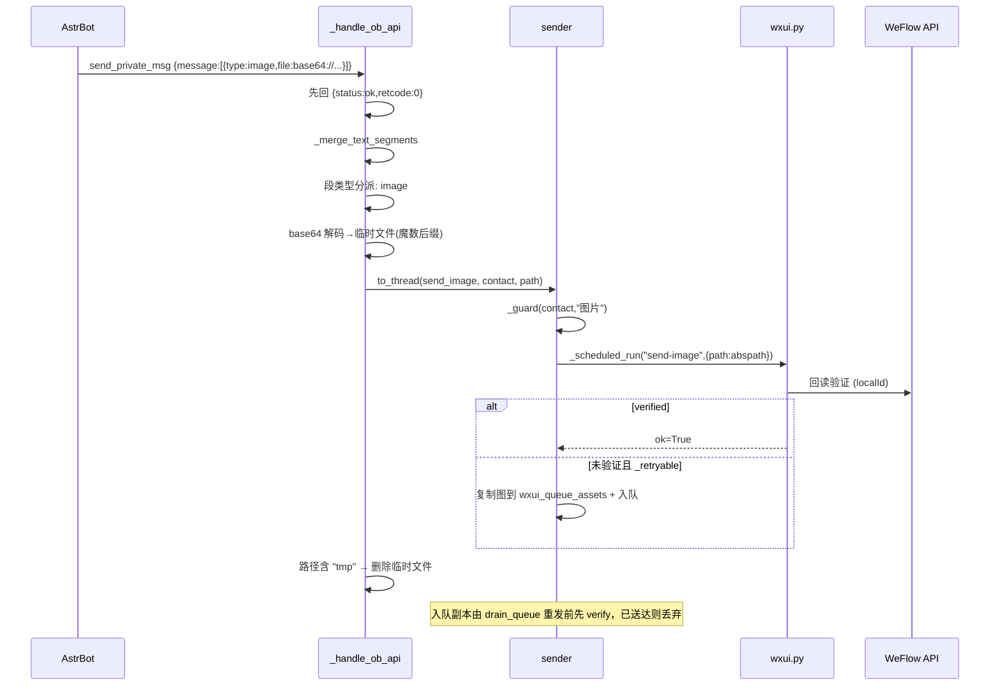
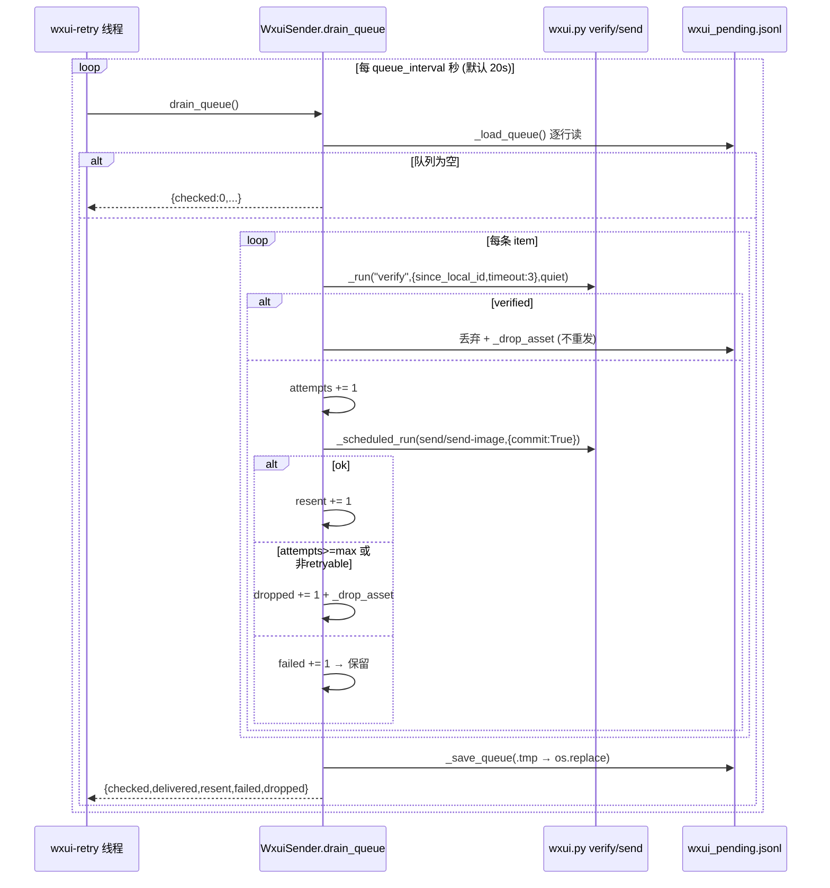

# akasha-bridge 接口与流程规格

> 盘点时间：2026-10-16。盘点对象：`akasha-bridge/`。只读盘点，未修改任何文件。
> 所有条目均标注 `文件名:行号`；凡无法从代码确证者一律写「未确认」。
> 已读：main.py、bridge_core.py、web_panel.py、ob_protocol.py、ob_client.py、senders.py、config.py、state.py、wxui_sender.py、uia_sender.py、weemessenger_sender.py、image_forward.py、config.example.json、config.json、README.md、requirements.txt、LICENSE、start.bat、ob_id_map.json、tests/ 全部 4 个测试文件。未读：`.venv/`、`__pycache__/`、`bridge.log`、`wxui_queue_assets/`。

---

## 1. 组件概览

### 1.1 启动与监听

| 项 | 值 | 依据 |
|---|---|---|
| 入口 | `python main.py`（`start.bat` 先 `cd /d "%~dp0"`） | `main.py:168`、`start.bat:2` |
| HTTP 监听 | `127.0.0.1:<web_port>`，**仅回环地址**，默认 `8766` | `main.py:161`、`config.py:29`、`config.json:17` |
| HTTP 服务线程 | 主线程 `serve_forever()`；bridge 与 WS 客户端均为 daemon 线程 | `main.py:161-163`、`main.py:39,43` |
| WeFlow SSE | 出站 HTTP 长连接，`GET /api/v1/push/messages?access_token=...` | `bridge_core.py:374,381` |
| OneBot WS | bridge 作 **客户端** 连接 AstrBot aiocqhttp 服务端 | `ob_client.py:44-57` |
| 运行日志 | `bridge.log`（**相对 cwd**，非脚本目录）+ 标准输出 | `config.py:95-103` |
| 日志器名 | `ob11-bridge` | `config.py:104`（`uia_sender.py:27` 用 `weflow-bridge`，历史遗留不一致） |
| PID 文件 | `<bridge>/bridge.pid`，启动前若旧 PID 存活**且**端口在监听则 `sys.exit(1)` | `main.py:195,221-236` |
| 版本串 | `Bridge 版本: 2026-06-03 OB11` | `main.py:242` |

启动顺序（`main.py:168-244`）：
1. `state._self_id_int = state._self_id_of(config.BOT_WXID or "wechat_bot")` → `main.py:170`
2. `state.group_reply_mode = config.GROUP_REPLY_MODE` → `main.py:171`
3. `state.load_ob_id_map()`（恢复 id↔联系人，`ob_id_map.json`）→ `main.py:174`
4. `prefill_id_map()` 枚举 WeFlow 会话补齐映射（失败仅告警）→ `main.py:176-180`
5. 同步运行时可变的图片/描述配置到 `state` → `main.py:183-193`
6. PID 冲突检查与写入 → `main.py:221-236`
7. `_start_bridge()` → `main.py:243`（内部：`create_sender()` `main.py:36`；`ob11-client` 线程 `main.py:39`；`bridge` 线程 `main.py:43`）
8. `start_web()`（阻塞）→ `main.py:244`

`_bridge_loop()`（`main.py:102-157`）先 `CoInitialize`（`main.py:104`，UIA/剪贴板需要 COM），随后自检 `GET /api/v1/sessions?limit=1&access_token=<token>`（`main.py:125-128`，timeout 5）：200 → 进 SSE；401 → 等 30 s 重试；连接错误 → 等 30 s 重试；SSE 断开 → 等 10 s 重连（`main.py:131-154`）。未配置 token 时**不退出**，仅暂停接收（`main.py:116-119`）。

### 1.2 模块职责

| 模块 | 职责（一句话） | 关键入口行 |
|---|---|---|
| `main.py` | 入口、生命周期（start/stop）、WeFlow 自检重连、Web 服务启动、PID 单例 | `main.py:30,48,102,160` |
| `config.py` | 读 `config.json`，导出全局常量，配置 logging | `config.py:15,20,95` |
| `state.py` | 全局共享状态：运行标志、OneBot 连接、id 映射、运行时可变配置 | `state.py:23-33,46,80,103,121-137` |
| `bridge_core.py` | 核心：SSE 接收、缓冲合并、去重、取图、构造 OneBot 事件推送 | `bridge_core.py:93,372,149,257` |
| `ob_client.py` | 维护到 AstrBot 的 WebSocket 客户端连接、心跳、重连、离线补发 | `ob_client.py:23,39` |
| `ob_protocol.py` | OneBot v11 协议：事件构造、API 请求处理、离线队列、图片解码 | `ob_protocol.py:60,225,294,314,371` |
| `senders.py` | 发送后端工厂（`uia`/`wxui`/`weemessenger`） | `senders.py:21` |
| `weemessenger_sender.py` | 后端基类 + WeeMessenger HTTP 指令通道实现，**出站护栏（白名单/黑名单/限频/dry_run/截断）唯一实现处** | `weemessenger_sender.py:50,181` |
| `wxui_sender.py` | 文本/图片走 `scripts/wxui.py`（Windows-MCP + OCR + WeFlow 回读验证），含按联系人成组调度、常驻 worker、重发队列 | `wxui_sender.py:42,352,527` |
| `uia_sender.py` | 纯键盘/剪贴板 UIA 发送（含 `BaseSender` 契约） | `uia_sender.py:30,39` |
| `image_forward.py` | 图片转发策略（direct/caption/both）与 CQ 图片码→消息段拆分 | `image_forward.py:29,45,65` |
| `web_panel.py` | Web 控制面板（内嵌单页 HTML）+ 全部面板 HTTP 接口 | `web_panel.py:20,402` |

### 1.3 线程清单

| 线程名 | 位置 | 说明 |
|---|---|---|
| `ob11-client` | `main.py:39` | asyncio 事件循环，跑 OneBot WS 客户端 |
| `bridge` | `main.py:43` | SSE 接收 + 缓冲推送主循环 |
| `wxui-grouped` | `wxui_sender.py:355` | 出站按联系人成组调度器 |
| `wxui-retry` | `wxui_sender.py:530` | 重发队列轮询（默认每 20 s） |
| `wxui-worker-read` | `wxui_sender.py:270` | 常驻 worker stdout 读取 |
| 匿名 daemon | `bridge_core.py:166,177,243` | 图片/表情/暂存图片的下载与描述 |

---

## 2. HTTP 接口清单

### 2.0 通用约定

- 基址：`http://127.0.0.1:<web_port>`（默认 `8766`，`config.py:29`）。**未确认**可绑定其他地址：`HTTPServer(("127.0.0.1", ...))` 硬编码（`main.py:161`）。
- 鉴权：**无任何鉴权**（`web_panel.py:402-588` 无鉴权代码）。唯一防护是回环绑定（`main.py:161`）。
- CORS：所有 JSON 响应带 `Access-Control-Allow-Origin: *`（`web_panel.py:583`）；`log_message` 被覆写为空，不写访问日志（`web_panel.py:587-588`）。
- 响应编码：`application/json; charset=utf-8`（`web_panel.py:582`）；静态页 `text/html; charset=utf-8` + `Cache-Control: no-cache, no-store, must-revalidate`（`web_panel.py:463-464`）。
- 请求体解析：仅 `do_POST` 读 `Content-Length` + `rfile.read`，不做大小上限（`web_panel.py:508-509,543-545`）。

### 2.1 GET 路由

#### `GET /senders` — 发送链路自检（`web_panel.py:414-431`）

```json
{
  "backend_config": "wxui",
  "backend_active": "WxuiSender",
  "dry_run": false,
  "whitelist": [],
  "blacklist": [],
  "image_mode": "uia",
  "weemessenger": {"url":"http://127.0.0.1:9877/health","ok":true,"status":200,"body":"..."}
}
```
- `weemessenger` 字段：实例存在且**有 `health` 属性**时调 `inst.health()`；`UiaSender` 无 `health` → 恒为 `null`（`web_panel.py:426-430`、`uia_sender.py:39-62`）。异常时写 `{"ok": false, "error": "..."}`（`web_panel.py:429-430`）。
- `health()` 结构见 `weemessenger_sender.py:225-232` 与 `wxui_sender.py:592-615`（额外 `pending_retries`/`retry_queue`/`group_gather_seconds`/`warm_worker`/`worker_alive`/`worker_requests`/`hwnd`/`rect`/`session_ok`/`control_state`）。
- 面板 JS 中**没有** `fetch('/senders')`，该接口目前只供外部脚本/curl 使用——具体调用方**未确认**。

#### `GET /status` — 面板仪表盘轮询（`web_panel.py:432-453`）

```json
{
  "running": true, "paused": false, "send_method": "WxuiSender", "sender_backend": "wxui",
  "dry_run": false, "whitelist": [], "ob_url": "ws://127.0.0.1:11229/ws",
  "ob_connected": true, "weflow_connected": true, "group_reply_mode": "all",
  "log": "<bridge.log 末尾 200 行>"
}
```
- `send_method` 映射（`web_panel.py:403-411`）：`WeMessengerSender`→`"WeeMessenger 指令"`，`UiaSender`→`"UIA 纯键盘"`，其余用类名（`WxuiSender` 原样显示）。
- `log` 读 **cwd 相对** `"bridge.log"`，失败静默为空（`web_panel.py:435-440`）。
- 面板轮询：`setInterval(refreshDashboard, 3000)`（`web_panel.py:396`）。

#### `GET /api/config` — 读取配置原文（`web_panel.py:454-460`）

成功 `200`：**原样返回 `config.json` 全部键值**（含 `access_token`、`image_caption_api_key` 明文）。失败 `500`：`{"error": "<异常字符串>"}`。

#### `GET <其他任意 path>` — 面板单页（`web_panel.py:461-466`）

返回 `200` + `PAGE`（内嵌 HTML，标题 `Akasha 奈奈山`）。**未注册 404**：任何未匹配路径都返回面板页。

### 2.2 POST 路由

| 路由 | 请求 | 成功响应 | 错误响应 | 行号 |
|---|---|---|---|---|
| `/start` `/stop` `/pause` `/resume` | 无 body | `200 {"ok": true}` | — | `web_panel.py:469-484` |
| `/mode` | 无 body | `200 {"ok": true, "group_reply_mode": ...}` | — | `web_panel.py:485-500` |
| `/send` | `{"target": str, "text"?: str, "message"?: str}` | `200 {"ok": bool, "target": str, "dry_run": bool}` | `409/400/500` | `web_panel.py:501-518,537` |
| `/send_image` | `{"target": str, "path"?: str, "image_path"?: str}` | 同上 | `400/409/500` | `web_panel.py:519-525` |
| `/send_sticker` | `{"target": str, "path"?: str, "sticker_path"?: str}` | 同上 | `400/409/500` | `web_panel.py:526-535` |
| `/api/config` | 任意配置键 JSON | `200 {"ok": true}` | `500 {"ok": false, "error": ...}` | `web_panel.py:541-576` |
| 其他 | — | — | `404 {"ok": false}` | `web_panel.py:577-578` |

**`/send` 系列细节**（`web_panel.py:501-540`）：
- `Content-Length` 缺省视为 0，空 body 按 `"{}"` 解析。
- `target` 空 → `400 {"ok": false, "error": "缺少 target（微信昵称或群名）"}`。
- `sender_instance is None` → `409 {"ok": false, "error": "bridge 未启动，发送器未初始化"}`。
- `/send`：`text = payload.get("text") or payload.get("message") or ""`，空文本由后端判失败。
- `/send_image`：文件不存在 → `400 {"ok": false, "error": "图片路径不存在: <path>"}`。
- `/send_sticker`：文件不存在 → `400`；后端无 `send_sticker` → `400 {"ok": false, "error": "当前发送后端不支持表情包"}`（当前三后端都继承该方法，该分支实际不触发）。
- 统一返回 `{"ok": bool, "target": target, "dry_run": bool}`；异常 → `500`。
- **所有出站都经过后端的白名单/黑名单/限频/dry_run 护栏**（实现 `weemessenger_sender.py:181-216`）。

**`/mode` 语义**：按 `["mention","all","batch"]` 顺序**循环切换**（`web_panel.py:486-488`），写回 `config.json` 的 `group_reply_mode`（`indent=4` + 末尾换行），写失败只记 error 仍返回 `{"ok": true}`。

**`POST /api/config` 语义**（`web_panel.py:541-576`）：
1. 读入 body JSON（无 schema 校验）；
2. `current.update(new_cfg)`——**部分字段覆盖**；
3. 缺 `_comment` 则补默认串；
4. 写回文件；
5. 运行时同步：`group_reply_mode`；图片相关键 `image_forward_mode`/`image_caption_provider`/`image_caption_model`/`image_caption_api_key`/`image_caption_api_base`/`image_caption_prompt`/`ollama_base_url`/`ollama_timeout` 直接 `setattr(state, key, value)`——**这几项免重启生效**；
6. **其余键（含 `sender_backend`、`wxui_*`、`send_*`、`web_port`、`astrbot_ob_url`）只落盘，需重启才生效**（对比 `main.py:170-193`）。

### 2.3 面板静态页与表单

- HTML/CSS/JS 全部内嵌在 `PAGE`（`web_panel.py:20-399`），无外部资源除 Google Fonts（离线环境会阻塞渲染）。
- 两个 tab：`page-dashboard`、`page-settings`；`switchTab` 进 settings 时触发 `loadConfig()`。
- 仪表盘元素：`bridgeStatus`/`statusText`/`obStatus`/`weflowStatus`/`sendMethod`/`modeStatus`/`guardInfo`/`log`；护栏文案 `护栏: [DRY-RUN ]白名单(n|空=不限!)`。
- 主动发送表单：`sendTarget` + `sendText` → `POST /send`。**面板只提供文本主动发送**，没有 `/send_image`、`/send_sticker` 的 UI。
- 设置表单字段（键→控件类型）：`weflow_base_url`(text)、`access_token`(**password**)、`bot_nicknames`(text)、`bot_wxid`(text)、`astrbot_ob_url`(text)、`astrbot_attachments`(text)、`buffer_seconds`(number)、`group_reply_mode`(select)、`web_port`(number)、`image_forward_mode`(select)、`image_caption_provider`(select)、`image_caption_model`(text)、`image_caption_api_key`(**password**)、`image_caption_api_base`(text)、`image_caption_prompt`(textarea)、`ollama_base_url`(text)、`ollama_timeout`(number)。
- 面板**不暴露** `sender_backend`/`wxui_*`/`weemessenger_*`/`send_*`——这些只能改 `config.json` 文件。

### 2.4 下游 HTTP 依赖（bridge 作为客户端）

| 目标 | method + path | 参数 | 依据 |
|---|---|---|---|
| WeFlow 自检 | `GET <weflow_base_url>/api/v1/sessions` | `limit=1`、`access_token` | `main.py:125-128` |
| WeFlow 会话列表预填 | `GET <weflow_base_url>/api/v1/sessions` | `access_token` | `bridge_core.py:57-59` |
| WeFlow 消息（含媒体） | `GET <weflow_base_url>/api/v1/messages` | `access_token`、`talker`、`media=true`、`limit=6` | `bridge_core.py:454-460` |
| WeFlow SSE | `GET <weflow_base_url>/api/v1/push/messages` | `access_token`；header `Accept: text/event-stream`、`Cache-Control: no-cache`；`timeout=None` | `bridge_core.py:374-381` |
| WeFlow 图片下载 | `GET <mediaUrl>(&|?)access_token=...` | timeout 30 | `bridge_core.py:512-516` |
| WeeMessenger 指令 | `POST <http_base>/` | JSON body | `weemessenger_sender.py:157` |
| WeeMessenger 健康 | `GET <http_base>/health` | timeout 5 | `weemessenger_sender.py:227-230` |
| 描述模型（openai） | `POST <image_caption_api_base>/chat/completions` | Bearer key；`model`/`messages`/`max_tokens=1500`；timeout 60 | `bridge_core.py:750-772` |
| 描述模型（ollama） | `POST <ollama_base_url>/api/generate` | `model`/`prompt`/`images`/`stream=false`；timeout `ollama_timeout` | `bridge_core.py:791-799` |

---

## 3. WebSocket / 长连接接口

### 3.1 连接与握手

- 地址：`config.ASTRBOT_OB_URL`，代码缺省 `ws://127.0.0.1:19777`（`config.py:33`），示例/运行值 `ws://127.0.0.1:11229/ws`。
- 角色：bridge 是**客户端**，AstrBot 侧 `aiocqhttp` 是服务端。
- 连接参数（`ob_client.py:44-57`）：
  - `max_size=None`（**必须**：AstrBot 会把图片转 base64 内联，实测单帧可达 11 MB，默认 1 MiB 会以 `1009 PayloadTooBig` 断开，表现为 AstrBot `WebSocket API call timeout`）；
  - `additional_headers`: `X-Self-ID: <state._self_id_int>`、`X-Client-Role: Universal`、`User-Agent: OneBot/11`。
  - **未确认**是否支持 `Authorization`/token 握手：代码未发送任何 token 头。
- 连接成功：置 `state._ob_ws`、`state._ob_ws_ready`，随后先补发离线事件。
- 关闭：`main.py:61-75` 通过 `run_coroutine_threadsafe(ws.close())` 主动断开并清 `_ob_ws_ready`。

### 3.2 心跳与重连

| 项 | 值 | 依据 |
|---|---|---|
| 心跳 | 每 15 s `await ws.ping()`，异常即退出心跳协程 | `ob_client.py:69-76` |
| 重连间隔 | 5 s（固定，无退避） | `ob_client.py:101` |
| 断开日志 | `[OB11] 连接断开，5 秒后重连` / `无法连接 AstrBot (...)，5 秒后重试` | `ob_client.py:92,94` |
| 重连后动作 | `flush_offline_events(ws)` 补发离线事件 | `ob_client.py:64` |
| 收帧处理 | `json.loads` → `asyncio.create_task(_handle_ob_api(data))` | `ob_client.py:79-83` |

### 3.3 消息类型

**方向 A：bridge → AstrBot（事件推送）**

- 触发：`push_event(event)`（`ob_protocol.py:294`），`run_coroutine_threadsafe(_send_event(...), state._ob_ws_loop)`，`future.result(timeout=5)`。
- 唯一消息类型：OneBot v11 消息事件，`post_type = "message"`（`ob_protocol.py:232`）。
- 失败（无连接 / 超时 / 异常）→ `queue_offline_event(event)` 并返回 `False`。

**方向 B：AstrBot → bridge（API 请求）**

- 请求结构：`{"action": str, "params": {...}, "echo": any}`。
- 响应结构：`{"status": "ok", "retcode": 0, "data": {}, "echo": <原样回显，仅当 echo 非空>}`。
- 响应时序：**处理消息之前先回响应**，否则 AstrBot 超时；若 WS 暂时不可用，最多 10 次 × 0.5 s 重试；仍未成功则记 warning，消息**仍继续本地处理**。
- 注意：`retcode` 恒为 0、`status` 恒为 `ok`，**不区分发送成功/失败**——真实送达结果只体现在日志与重发队列。

### 3.4 离线补发队列

| 项 | 值 | 依据 |
|---|---|---|
| 结构 | `_OFFLINE_QUEUE: list[tuple[float, dict]]` | `ob_protocol.py:262` |
| 容量 | `_OFFLINE_QUEUE_MAX = 30`，超出丢**最旧** | `ob_protocol.py:264,277-280` |
| TTL | `_OFFLINE_QUEUE_TTL = 600.0` s | `ob_protocol.py:265,334-336` |
| 入队 | `queue_offline_event` 先按 TTL 清理，再 append | `ob_protocol.py:268-282` |
| 补发 | `flush_offline_events(ws)`：FIFO 顺序发送，中途失败则**本条及其后全部回队**（保序） | `ob_protocol.py:314-348` |
| 约束 | 必须在 ob_client 自己的事件循环里 `await`（同循环内用 `run_coroutine_threadsafe` 阻塞等待会死锁） | `ob_protocol.py:316-319` |

---

## 4. 送达协议（ob_protocol.py）

### 4.1 使用的 OneBot action

`_handle_ob_api` 只处理 3 个 action（`ob_protocol.py:89`）：

| action | 目标字段 | 说明 |
|---|---|---|
| `send_msg` | `params.user_id`（缺省 0） | 非群路径 |
| `send_private_msg` | `params.user_id` | 同上 |
| `send_group_msg` | `params.group_id` | 群路径（`is_group=True`） |

- 目标解析：`contact = state._ob_id_to_contact.get(target_id, str(target_id))`——映射来自 `ob_id_map.json` / 运行时 `remember_ob_contact`。**未命中时会把数字 id 当联系人名去发**（兜底行为）。
- 未实现的 action：仅 `log.debug(f"[OB11] 未处理 API: {action}")`，且**响应早已发出**（`retcode: 0`）——调用方无法感知不支持。
- 所有发送都通过 `asyncio.to_thread(...)` 调后端（阻塞的 UI 自动化不能占事件循环）：`ob_protocol.py:107,152,166`。

### 4.2 分段与段类型

- 分段上限：`SEGMENT_MAX_SENDS = 4`（`ob_protocol.py:30`）。
- `_merge_text_segments(message)`（`ob_protocol.py:33-57`）：仅当 **text 段数 > 4** 时，保留前 3 段、把第 4 段起的文本拼进第 4 段，多余 text 段丢弃；非 text 段原位保留。

| 段类型 | 行为 | 行号 |
|---|---|---|
| `text` | `send_text(contact, text)`，空串跳过；失败记「⚠ 文字未验证送达（已交重发队列）」 | `:104-113` |
| `image` + `base64://` | 去前缀 → 线程池解码为临时文件（后缀按魔数嗅探） | `:123-131` |
| `image` + `file://`/文件名 | 去 `file://`；绝对路径存在则直接用；否则在 `ASTRBOT_ATTACHMENTS/<file>` 与 `ASTRBOT_ATTACHMENTS/wechat_images/<file>` 中查找 | `:132-147` |
| `image` 发送后 | 若路径含 `"tmp"` 则删除临时文件 | `:157-163` |
| `face` | 降级为发送文本 `"[表情]"` | `:165-167` |
| 其他（`record`/`video` 等） | 忽略 | `:169` |

### 4.3 事件结构（`make_message_event`，`ob_protocol.py:225-256`）

公共字段：`time`(int 秒)、`self_id`、`post_type="message"`、`message_id`(非 None 时)、`message_type`、`user_id`、`message`(段数组)、`raw_message`(仅拼接 text 段)、`sender={"user_id":…, "nickname":…}`。

群消息额外：`message_type="group"`、`group_id`、`group_name`。私聊：`message_type="private"`、`user_id`。

构造侧（`bridge_core.py:303-349`）：
- 群内发言人 id：`sender_wxid = session_id_data + "_" + (sender_in_group or source_name)`，再 `state._wxid_to_int(...)` → `user_id`。
- 群 `group_id = state._group_id_int(session_id_data)`（必须用稳定 `@chatroom`，不能用会改名的群昵称）。
- mention 模式：段数组前置 `{"type":"at","data":{"qq": str(state._self_id_int)}}` + 空格文本段；正文形如 `{sender}在群{group}中说：{文本}`，文本中的 `@<昵称>` 被剥离。
- batch 模式：使用已预格式化的 `成员"{sender}"在群"{group}"中对你说：{content}`。
- 私聊：`text_to_segments(combined)`。

### 4.4 去重与顺序保证

| 机制 | 说明 | 依据 |
|---|---|---|
| 时间戳门槛 | `data["timestamp"] < self.start_timestamp` 直接丢弃 | `bridge_core.py:398-400` |
| rawid 去重 | `processed_ids` 集合，命中即 `continue` | `bridge_core.py:401-404` |
| 内容级忽略 | `should_ignore`：`sourceName ∈ BOT_NICKNAMES`、`talkerId == BOT_WXID`、`msgType==34`(语音)、内容含 `[语音]`、内容为空 | `bridge_core.py:111-124` |
| 自回复去重 | **形同虚设**：判定读 `_sent_recently[content]`（120 s 窗口），但全仓库**没有任何写入点** | `bridge_core.py:106,182` |
| message_id 稳定化 | `onebot_message_id(rawid) = int(数字串) % 2147483647`；无 digits 时 `int(time*1000) % max`。**不可省略**，否则 aiocqhttp 写字符串 `"None"`，插件防抖会把 60 s 内同一人的后续消息全当重复丢掉 | `ob_protocol.py:208-222` |
| 批次 message_id | 取本批次**最后一个非空 rawid** | `bridge_core.py:300-301` |
| 事件顺序 | 缓冲按 key 保序 `\n` 合并；离线队列 FIFO；补发失败余下全部回队保序 | `bridge_core.py:296`、`ob_protocol.py:333-343` |
| 缓冲保鲜 | 推送前丢弃 `> BUFFER_MESSAGE_TTL_SECONDS = 120.0` 的消息 | `bridge_core.py:270-279,431` |
| 活计时器保护 | `_arm_flush_locked` 在 `processing=True` 时**不挂**计时器；已有存活计时器不复位；否则递增 `timer_version` 后挂新计时器 | `bridge_core.py:433-450` |
| 补计时器 | 推送结束后若条目里又进了新消息（如图片迟到），补挂 1.0 s 计时器 | `bridge_core.py:363-370` |

---

## 5. 发送后端抽象

### 5.1 接口契约

基类：`uia_sender.py:30-36`

```python
class BaseSender:
    def send_text(self, contact: str, text: str) -> bool: ...
    def send_image(self, contact: str, image_path: str) -> bool: ...
```

`WeMessengerSender.send_sticker(contact: str, gif_path: str) -> bool` 是**可选扩展能力**。

行为语义（四实现统一）：
- 返回 `bool`，`True` = 已投递（wxui 后端 = 已从微信 DB 回读确认）；`False` = 未送达或被护栏拦截。
- **不抛异常**：空文本/文件不存在返回 `False`；内部网络/UI 异常一律捕获记日志返回 `False`。
- dry_run 语义：`_post` 只记日志并返回 `True`——dry_run 下"发送成功"是假成功，调用方只能靠 `dry_run` 字段区分。
- 文本截断：`text[:max_text_length]`，默认 2000。
- 拦截与限频统一在 `_guard`：空目标 → False；黑名单命中 → False；白名单非空且未命中 → False；否则 `sleep(max(global 缺口, contact 缺口))`。

### 5.2 四个实现对照

| 后端 | 类 | `send_text` | `send_image` | `send_sticker` | 关键配置键 |
|---|---|---|---|---|---|
| `weemessenger`（含 `weemessenger+uia`/`hybrid`） | `WeMessengerSender` | HTTP 指令 `{type:send_message,...}` | `image_mode=="sticker"`→表情包通道；否则**懒加载 `UiaSender`** 用剪贴板贴图 | 走 WeeMessenger `{type:send_sticker, sticker_data: base64}` | `weemessenger_http_base`、`weemessenger_timeout`、`weemessenger_image_mode`、`ui_handoff_wait` |
| `uia` | `UiaSender` | 内置纯键盘/剪贴板模拟 | 剪贴板贴图 | **无** | 无专属配置；构造参数仅 `search_enabled=True` |
| `wxui` | `WxuiSender(WeMessengerSender)` | **继承父类**，但父类 `_post` 被覆写为走调度器 + `scripts/wxui.py` | 走 wxui `send-image`（剪贴板贴图 + 焦点保护 + 回读验证） | 继承父类（WeeMessenger 通道） | `wxui_script`、`wxui_python`、`wxui_timeout`、`wxui_retry_queue`、`wxui_queue_interval`、`wxui_queue_max_attempts`、`wxui_group_gather_seconds`、`wxui_warm_worker` |

工厂（`senders.py:21-73`）：`backend = (config.SENDER_BACKEND or "weemessenger").lower()` → `"uia"` | `"wxui"` | 三别名 | 其他抛 `ValueError`。注意异常文案只列了 `weemessenger / uia`，**漏了 wxui**（文档瑕疵）。
`wxui` 分支传入父类参数：`whitelist/blacklist/min_interval_contact/min_interval_global/dry_run/max_text_length/image_mode/ui_handoff_wait`；**未传 `settle_seconds`** → `settle_seconds=0.0`。

### 5.3 WxuiSender 排队 / 重试 / 分组调度语义

**构造与默认值**：

```python
def __init__(self, script: str, python_exe: str = "", wxui_timeout: float = 90.0,
             retry_queue_path: str = "", queue_interval: float = 20.0,
             queue_max_attempts: int = 5, group_gather_seconds: float = 1.2,
             warm_worker: bool = True, **kwargs) -> None:
```

归一化：`python_exe or sys.executable`；`wxui_timeout = max(10.0, …)`；`retry_queue_path or <bridge>/wxui_pending.jsonl`；`queue_asset_dir = <bridge>/wxui_queue_assets`；`queue_interval = max(5.0, …)`；`queue_max_attempts = max(1, …)`；`group_gather_seconds = max(0.0, …)`；`warm_worker = bool(...)`。`script` 不存在只记 error 不抛。`dry_run=False` 时启动队列线程，随后启动调度器。

**按联系人成组调度**（`group_gather_seconds` 默认 1.2 s）：
1. 出站动作封装 `job = {subcmd, spec, event, ok, data}`，按 `target` 入 `_sched_queues[target]`（`OrderedDict[str, deque]`）并 `notify_all`。
2. 调用方阻塞 `job["event"].wait(timeout=self.wxui_timeout + 120)`；超时返回 `(False, {"retryable": True, "error_kind": "timeout", ...})`。
3. `_sched_loop`：取 `next(iter(_sched_queues))` 的联系人队首；`same_turn = (contact == self._sched_current and self._sched_turn_sent > 0)`；`_sched_turn_sent = turn_sent+1 if same_turn else 1`；UI 动作在锁外执行；异常不会杀死调度线程。
4. `assume_current=same_turn` 下传：同一联系人本轮第 2 条起走快路径，只 OCR 聊天头部，头部不匹配会自动回退全量侧边栏扫描。
5. 发完一条后给 `group_gather_seconds` 聚集窗口：等到同一人下一条就继续；等不到则 `pop` 该联系人、`_sched_current=""`、`_sched_turn_sent=0`。

**重试队列**（`queue_interval` 默认 20.0 s、`queue_max_attempts` 默认 5、`retry_queue_path` 默认 `<bridge>/wxui_pending.jsonl`）：
- 入队条件：`not ok and self._retryable(data)`。
- `_retryable(data)`：`data` 空 → True；`data["retryable"] is True` → True；`error_kind ∈ {timeout, spawn, no-output}` → True；`error` 文本包含以下任一子串 → True：
  `session unavailable`、`not capturable`、`desktop input refused`、`user is using the desktop`、`minimized/hidden`、`not read back`、`could not locate target row`、`did not take focus`、`not WeChat`、`could not bring WeChat`、`WeChat window not found`。
- 入队条目结构：`{"kind": "send"|"send-image", "spec": {...}, "target": str, "created": float, "attempts": 0, "since_local_id": int, "last_error": str}`，以 JSON Lines **追加**写。
- 图片入队前先复制到 `wxui_queue_assets/<毫秒>-<pid><ext>`，并把 `spec.path` 指向副本——因为上游图片多为发完即删的临时文件。
- 队列线程：`while not self._queue_stop.wait(self.queue_interval): self.drain_queue()`。
- `drain_queue()`：
  1. 对每条先做**只读**回读校验 `self._run("verify", {**spec, "since_local_id": since, "timeout": 3}, target, quiet=True)`；`vdata["verified"]` 为真 → 计 `delivered`，`_drop_asset` 后丢弃（**绝不重发**）；
  2. 未送达 → `attempts += 1`，用 `_scheduled_run(subcmd, {**spec, "commit": True}, target)` 重发；
  3. 成功计 `resent`；失败且（`attempts >= queue_max_attempts` 或 非 `_retryable`）→ 计 `dropped` 并 `_drop_asset`；否则计 `failed` 并回写队列；
  4. 返回 `{"checked": n, "delivered": n, "resent": n, "failed": n, "dropped": n}`。
- 文件操作：`_save_queue` 写 `.tmp` 后 `os.replace`（原子）；`_load_queue` 逐行 `json.loads`，坏行跳过；`_drop_asset` 只删队列目录内的副本。

**常驻 worker**（`warm_worker` 默认 `True`）：
- 启动：`Popen([python_exe, script, "worker"], stdin=PIPE, stdout=PIPE, stderr=DEVNULL, text=True, bufsize=1, cwd=HERE)`；stdout 由 `wxui-worker-read` 线程搬进 `queue.Queue`；`_worker_kill` 关 stdin + kill。
- 请求协议（行式 JSON）：请求 `{"id": <自增序号>, "cmd": <send|send-image|verify>, "spec": {..., "commit": True}}` + `\n`；读取响应时**按 `id` 匹配**，不匹配的行丢弃；`verify` 的 `timeout` 会被抬到 `min(timeout+2, 10)` 秒。
- 回退：`warm_worker` 为假 / worker 起不来 / 写失败 / 超过 `wxui_timeout` 无响应 / 进程退出 / 响应非法 → 一律返回 `None`，调用方落到 `_run_oneshot`（逐条起进程）路径，行为与旧版一致。
- 成功响应会带 `data["warm_worker"] = True` 与去掉 `_stdout_tail`。
- `stop()`：置队列表停止标志 + 通知调度器 + `_worker_kill("bridge 停止")`（避免重启留下孤儿进程）。

**`_run` 的 `ok` 语义**：`verify` 子命令的 `ok=True` 只表示"检查执行了"，真实结论在 `data["verified"]`；`send`/`send-image` 的 `ok=True` 表示**已从微信 DB 回读确认送达**。

**`scripts/wxui.py`** 由测试断言其契约：存在 `worker` 子命令与 `worker_loop(cfg)`/`worker_dispatch(cfg, client, subcmd, spec)`；两条发送命令都有 `--assume-current`；`spec.get("assume_current", assume_current)`；快路径跳过侧边栏 OCR 但校验聊天头部；`warm_reuse_s`/`warm_header_recheck_s`/`verify_poll_s` 在 `scripts/wxui-config.json` 中为正且 `warm_header_recheck_s <= warm_reuse_s`。

---

## 6. 配置文件

### 6.1 加载机制

- 路径：`CONFIG_FILE = <bridge>/config.json`，导入即读——**文件缺失或 JSON 非法会导致 import 失败、进程起不来**。
- 三个键**无默认值**，缺键直接 `KeyError`：`weflow_base_url`、`access_token`、`bot_nicknames`。
- 生效方式：`web_port`/`astrbot_ob_url`/`sender_backend`/`wxui_*`/`weemessenger_*`/`send_*` 需**重启**；`group_reply_mode` 与图片描述相关 8 键可**即时生效**。

### 6.2 键清单（含默认值）

**WeFlow / 机器人**

| 键 | 默认值 | 含义 |
|---|---|---|
| `weflow_base_url` | （必填） | WeFlow HTTP API 基址 |
| `access_token` | （必填） | WeFlow Access Token |
| `bot_nicknames` | （必填） | 机器人昵称列表，群聊 @ 检测与自消息过滤 |
| `bot_wxid` | `""` | 机器人自身 wxid |
| `astrbot_attachments` | `""` | AstrBot 附件目录 |
| `buffer_seconds` | `5` | 消息缓冲合并秒数 |
| `web_port` | `8766` | 面板 HTTP 端口 |
| `group_reply_mode` | `"mention"` | `mention`/`all`/`batch` |
| `astrbot_ob_url` | `"ws://127.0.0.1:19777"` | AstrBot aiocqhttp WebSocket 地址 |

**图片描述与转发**

| 键 | 默认值 | 含义 |
|---|---|---|
| `image_forward_mode` | `"direct"` | `direct`(原图)/`caption`(仅描述)/`both` |
| `image_caption_provider` | `"ollama"` | `ollama` 或 `openai` |
| `image_caption_model` | `"llava:7b"` | 描述模型名 |
| `image_caption_api_key` | `""` | openai 兼容模式的 Bearer key |
| `image_caption_api_base` | `""` | openai 兼容 base |
| `image_caption_prompt` | `"请用中文简短描述这张图片的内容"` | 提示词 |
| `ollama_base_url` | `"http://127.0.0.1:61000"` | ollama 基址 |
| `ollama_timeout` | `60` | ollama 请求超时秒 |

**发送后端**

| 键 | 默认值 | 含义 |
|---|---|---|
| `sender_backend` | `"weemessenger"` | `uia`/`wxui`/`weemessenger` |
| `weemessenger_http_base` | `"http://127.0.0.1:9877"` | WeeMessenger 指令服务基址 |
| `weemessenger_timeout` | `30` | 指令请求超时秒 |
| `weemessenger_image_mode` | `"uia"` | `uia`/`sticker` |
| `ui_handoff_wait` | `3.0` | 图片走 UIA 前等待秒 |
| `wxui_script` | `""` | `scripts/wxui.py` 路径 |
| `wxui_python` | `""` | 运行该脚本的解释器 |
| `wxui_timeout` | `90` | 单次 wxui 调用超时（下限 10.0） |
| `wxui_retry_queue` | `""` | 重发队列 jsonl 路径 |
| `wxui_queue_interval` | `20` | 重发轮询间隔秒（下限 5.0） |
| `wxui_queue_max_attempts` | `5` | 重发尝试上限（下限 1） |
| `wxui_group_gather_seconds` | `1.2` | 换人前聚集同一联系人后续分段的窗口秒 |
| `wxui_warm_worker` | `True` | 常驻 worker 开关 |

**出站护栏**

| 键 | 默认值 | 含义 |
|---|---|---|
| `send_whitelist` | `[]` | 非空时只允许名单内的微信昵称/群名 |
| `send_blacklist` | `[]` | 黑名单优先于白名单 |
| `send_min_interval_contact` | `2.0` | 同一联系人两次发送最小间隔秒 |
| `send_min_interval_global` | `1.0` | 全局两次发送最小间隔秒 |
| `send_dry_run` | `True` | 只写日志不真发 |
| `send_max_text_length` | `2000` | 文本截断长度 |

### 6.3 敏感键

| 键 | 敏感原因 | 面板控件 |
|---|---|---|
| `access_token` | WeFlow 全权 API 凭证；出现在自检 URL、SSE URL、图片下载 URL 中 | password 输入框 |
| `image_caption_api_key` | 模型服务密钥 | password 输入框 |
| `bot_wxid` / `bot_nicknames` | 个人标识（非密钥，但可关联真人） | text 输入框 |
| `astrbot_attachments` | 暴露本机绝对路径（含用户名） | text 输入框 |
| `wxui_python` / `wxui_script` | 同上，绝对路径 | 面板不暴露 |

`config.json` 中另有 `_comment`/`_readme`/`_required_fields`/`_image_forward_note`/`_image_caption_note`/`_send_note`/`_wxui_retry_note`/`_wxui_group_note`/`_image_mode_note`/`_guard_note` 共 10 个下划线说明键，`config.py` 完全不读取。

### 6.4 配置与示例/文档的不一致（需处理）

| 项 | 实际代码 | `config.json` | `config.example.json` | README.md |
|---|---|---|---|---|
| `buffer_seconds` | 5 | 0 | 5 | 5 |
| `group_reply_mode` | mention | all | mention | 未给默认，只列两模式 |
| `send_dry_run` | True | false | 缺 | 缺 |
| `image_caption_provider` / `ollama_base_url` | ollama / `127.0.0.1:61000` | openai / `127.0.0.1:11434` | ollama / `127.0.0.1:61000` | 缺 |
| 发送后端键 | `sender_backend`+`wxui_*`+`weemessenger_*` | 齐全 | **完全缺失** | 仍是已废弃的 `send_method`/`weflow_send_api` |
| OneBot 地址 | 默认 19777 | 11229/ws | 11229/ws | 19777 |
| 图片转发键 | `image_forward_mode` 等 | 齐全 | 无 `image_forward_mode` | 缺 |
| 许可证 | — | — | — | MIT（`README.md`、`LICENSE`）与 AGPL-3.0 目标不符 |
| 文件结构 | — | — | — | README 列出的 `CLAUDE.md` 在目录中**不存在**；`bridge_core.py`/`image_forward.py`/`wxui_sender.py`/`weemessenger_sender.py` 未列出 |
| 依赖 | 实际 import：requests、websockets、uiautomation、pyperclip、pygetwindow(?)、Pillow(?)、PIL | — | — | `requirements.txt` 含 `pyautogui`（在已读代码中未见使用，**未确认**） |

---

## 7. 图像通道

### 7.1 入向（微信 → AstrBot）

| 阶段 | 行为 | 依据 |
|---|---|---|
| 触发 | SSE 消息 `content == "[图片]"` → 起线程 `process_image_message`；`content in ("[动画表情]","[表情]")` → 起线程 `process_emoji_message` | `bridge_core.py:159-179` |
| mention 模式先图后文 | 群 + mention 且未 @ → 暂存 `_pending_mention_images[session_id]`，等后续同人 @ 文本时合并 | `bridge_core.py:161-165,170-176` |
| 暂存消费 | 收到该 session 的文本时若暂存 < 15 s：起 `_inject_cached_image` 线程并把缓冲延迟抬到 **15 s** | `bridge_core.py:236-250` |
| 取图 | `GET /api/v1/messages?access_token&talker=<sessionId>&media=true&limit=6`（timeout 10）→ 挑 `mediaType ∈ ("image","sticker","emoji")` 且有 `mediaUrl`，优先 `isSend` 为假 | `bridge_core.py:452-477` |
| 竞态重试 | `attempts=5`、`delay=1.5`：只要最新一条是媒体却还没 `mediaUrl` 就等待再查 | `bridge_core.py:479-506` |
| 下载 | `mediaUrl` 追加 `access_token`（`&`/`?` 自适应），timeout **30** | `bridge_core.py:512-516` |
| 落盘 | `<astrbot_attachments>/wechat_images/wechat_<unix秒>.<ext>`，`ext` 由 `Content-Type` 决定：含 `png`→`.png`、`gif`→`.gif`、`webp`→`.webp`，否则 `.jpg` | `bridge_core.py:521-534` |
| 失败兜底 | 任一步失败 → `None` → 降级为文本 `"[图片: （图片内容无法描述）]"` | `bridge_core.py:508-510`、`image_forward.py:57-58` |
| 注入缓冲 | 已有文本条目：`messages.insert(0, text)` + `message_ts.insert(0, now)` + `image_ready=True` + `_arm_flush_locked(..., 2.0)`（**修复 2026-10-16「AI 读到十几分钟前旧图」的关键**） | `bridge_core.py:608-617` |
| 无文本跟随 | 新建条目，2 s 定时推送 | `bridge_core.py:618-639` |
| batch 模式 | 群共享 key `__batch__<群名>`；有文本则插到队首并 `_arm_flush_locked(..., 5.0)`；无文本则新条目 + 5 s 定时 | `bridge_core.py:576-607` |
| 普通单图 | 新建条目 + 2 s 定时 | `bridge_core.py:621-639,732-737` |

**格式限制**：入向不做格式校验或转码，直接按字节落盘；全部走 `direct` 时图片以 `file:///` URI 转给 AstrBot，**不使用 base64**——历史上 base64 曾把每帧撑到数 MB 导致 WebSocket 1009 断开。

### 7.2 转发策略（image_forward.py）

| 函数 | 契约 |
|---|---|
| `IMAGE_FORWARD_MODES` / `DEFAULT_IMAGE_FORWARD_MODE` | `("direct","caption","both")` / `"direct"` |
| `_CQ_IMAGE_RE` | `\[CQ:image,file=([^\[\]]+)\]`（只匹配自己生成的 CQ 码） |
| `normalize_forward_mode(value) -> str` | strip+lower，非法/空回退 `direct` |
| `file_uri(path) -> str` | `Path(abspath).as_uri()`，空格转 `%20` |
| `build_image_marker(path) -> str` | `[CQ:image,file=<file_uri>]` |
| `build_image_payload(image_path, caption, mode="direct", caption_placeholder="（图片内容无法描述）") -> str` | direct→marker（无路径则 `[图片: 描述]`）；caption→`[图片: 描述]`；both→marker+`[图片: 描述]` |
| `text_to_segments(text) -> list[dict]` | CQ 码拆分 text/image 交替段；无 CQ 码返回单个 text 段 |
| `_image_payload(image_path, mode)`（bridge_core） | **direct 模式不调用描述模型**；caption/both 才调 `caption_image_via_ollama` |
| `caption_image_via_ollama(image_path)` | openai：`POST {base}/chat/completions`，`max_tokens=1500`，timeout 60，content 为空时回退 `reasoning_content`；ollama：`POST {base}/api/generate`，timeout `ollama_timeout`。失败返回 `None` |

### 7.3 出向（AstrBot → 微信）

| 输入形态 | 处理 |
|---|---|
| `base64://<b64>` | 线程池解码 → `tempfile.NamedTemporaryFile(delete=False)`，后缀按魔数嗅探 |
| 魔数→后缀 | `GIF87a/GIF89a`→`.gif`；`\x89PNG\r\n\x1a\n`→`.png`；`\xff\xd8\xff`→`.jpg`；`BM`→`.bmp`；`RIFF....WEBP`→`.webp`；其他→`.png` |
| `file://<path>` / 绝对路径 | 去前缀；绝对且存在则直用 |
| 裸文件名 | 依次找 `<astrbot_attachments>/<file>` 与 `<astrbot_attachments>/wechat_images/<file>` |
| 未找到 | 记 warning，跳过该段（不报错） |
| 发送 | `asyncio.to_thread(inst.send_image, contact, img_path)`，失败记「已交重发队列」 |
| 清理 | 发送后若路径含 `"tmp"` 删除临时文件（`finally` 块） |
| 落盘位置（队列副本） | 需重发的图片复制到 `<bridge>/wxui_queue_assets/<毫秒>-<pid><ext>`；送达/放弃后删除副本，原图不动 |

**格式限制汇总**：入向不限制；`weemessenger_image_mode="sticker"` 时仅支持 GIF；`uia` 模式支持 png/jpg/gif；`UiaSender.send_image` 的上限/校验**未确认**。

---

## 8. 关键流程时序

### 8.1 外部 HTTP 发一条文本消息到微信

```mermaid
sequenceDiagram
    participant C as 调用方
    participant W as WebHandler
    participant S as WxuiSender
    participant Q as 调度器 (wxui-grouped)
    participant X as wxui.py
    participant WF as WeFlow API
    C->>W: POST /send {target,text}
    W->>W: target 非空校验
    W->>S: send_text(target,text)
    S->>S: 父类护栏: 黑/白名单+限频
    S->>S: 截断 max_text_length
    S->>S: _post({type:send_message,...})
    S->>Q: _scheduled_run("send",spec,target)
    Q->>Q: 按 target 入队; same_turn→assume_current
    Q->>X: worker/oneshot 调用 (+--spec 含 commit)
    X->>WF: GET /api/v1/messages 回读验证
    WF-->>X: localId / 未读到
    X-->>Q: {verified, localId, attempts}
    Q-->>S: (ok,data)
    alt ok=False 且 _retryable
        S->>S: _enqueue → wxui_pending.jsonl
    end
    S->>S: _settle()
    S-->>W: ok
    W-->>C: 200 {"ok":ok,"target":...,"dry_run":...}
```

### 8.2 收到微信消息并转发给 AstrBot

```mermaid
sequenceDiagram
    participant WF as WeFlow SSE
    participant B as WeFlowBridge
    participant Buf as pending_buffers
    participant OB as ob_protocol.push_event
    participant A as AstrBot (WS)
    WF-->>B: data: {timestamp,rawid,sessionId,content,...}
    B->>B: 时间戳门槛 + rawid 去重
    B->>B: should_ignore
    B->>Buf: add_to_buffer 去重/mention/batch; 挂 buffer_seconds 定时
    Note over Buf: mention 先图后文 → buffer_delay=15s
    Buf->>B: 定时到期 process_sender
    B->>B: TTL 丢弃 >120s; 取最后 rawid→message_id
    B->>B: 构造事件 (群: at段+昵称前缀; 私: text_to_segments)
    B->>OB: push_event(event)
    alt 有 WS 且 5s 内送达
        OB->>A: 事件 JSON
    else 无连接/超时
        OB->>OB: 入离线队列(≤30条,TTL 600s)
    end
    B->>Buf: processing=False; 若期间有新消息补 1.0s 计时器
    A-->>B: {action,params,echo}
    B->>A: {status:ok,retcode:0,data:{},echo} 先回后处理
```

### 8.3 图片发送与验证（AstrBot 回复带图）



### 8.4 重试队列排空



---

## 9. 测试清单（tests/）

所有测试通过 `sys.path.insert(0, <bridge 父目录>)` 直接导入被测模块；运行方式：`cwd=akasha-bridge`，`python -m unittest discover -s tests -t tests`。tests/ 目录**无 `__init__.py`**。

| 测试文件 | 覆盖内容 | 关键断言/用例 |
|---|---|---|
| `tests/test_buffer_lifecycle.py` | 缓冲生命周期两条不变式（2026-10-16 事故回归） | `ArmFlushLockedTest`：空闲时挂计时器、`processing=True` 时不挂、已有存活计时器不复位（`timer_version` 保持 7）；`ProcessSenderTtlTest`：超 TTL 消息丢弃、全过期则不推送、新鲜消息保留、**推送期间新到的消息必须补计时器** |
| `tests/test_image_forward.py` | 图片转发策略 direct/caption/both 与段拆分 | `NormalizeModeTest`、`FileUriTest`、`BuildPayloadTest`、`TextToSegmentsTest`、`BridgeCoreWiringTest`、`DirectModeSkipsCaptionModelTest` |
| `tests/test_offline_queue.py` | 离线补发队列（AstrBot 不在线不丢事件） | 无客户端时入队、按序发出并清空（`seq` 0,1,2）、发送失败保留队列、过期（>TTL）不补发、超上限丢最旧（保留 `seq` 从 5 起） |
| `tests/test_wxui_grouping.py` | 出站按联系人成组 + assume_current 快路径 + 常驻 worker 装配 | `SchedulerOrderTest`、`SpecInjectionTest`、`WxuiFastPathSourceTest`、`ConfigWiringTest`、`WarmWorkerWiringTest` |

**未覆盖（测试空白）**：WebHandler 全部 HTTP 路由无测试；面板 JS 无测试；`main.py` 生命周期/PID 单例无测试；`config.py` 缺键行为无测试；`caption_image_via_ollama` 的两个 provider 分支无测试；`prefill_id_map`/`remember_ob_contact` 落盘无测试；`uia_sender.py` 无测试；`_merge_text_segments` 无直接单测。

---

## 10. 风险清单（可核查事实）

| 级别 | 事实 | 依据 |
|---|---|---|
| 高 | 面板 HTTP 接口**零鉴权**，且 `GET /api/config` 原样回传 `access_token` 与 `image_caption_api_key`；响应带 `Access-Control-Allow-Origin: *`，任何本机页面/浏览器脚本可读取密钥 | `web_panel.py:402-588`、`:456-458`、`:583` |
| 高 | `config.json` 已含两枚明文密钥（WeFlow token、模型 key），分发前必须换成占位值 | `config.json:9,25` |
| 高 | `ob_id_map.json` 是**真实联系人名**快照（含个人昵称/群名），随仓库分发将泄露隐私 | `ob_id_map.json:1-19` |
| 中 | 运行期数据文件在目录内：`bridge.log`、`bridge.pid`、`wxui_pending.jsonl`、`wxui_queue_assets/` — 需 `.gitignore` | 目录清单 |
| 中 | 许可证冲突：仓库内为 MIT，与开源目标（若将来开源）不一致 | `LICENSE:1` |
| 中 | `README.md` 严重过时（`send_method`/`weflow_send_api` 已不存在、端口 19777、缺 `sender_backend`/`wxui_*`/`image_forward_*` 说明、列出不存在的 `CLAUDE.md`） | `README.md:47-48,94-95,113-114,133` |
| 中 | `config.example.json` 缺全部发送后端/护栏/转发策略键，照它配置会落到 `sender_backend="weemessenger"` 默认值（微信 4.x 下文本会静默丢失） | `config.example.json:1-21`、`config.py:51` |
| 低 | 死代码/未接线字段：`_sent_recently`（判定存在但无写入点 → 自回复去重实际不生效）、`_recent_seen`、`_sse_event_keys`、`chat_histories`、`contact_map`、`_pending_image`（只写不读） | `bridge_core.py:102-108,182` |
| 低 | `ob_client.py:14` 导入 `ServerConnection, serve` 但从未使用 | `ob_client.py:14` |
| 低 | `senders.py:72` 的 `ValueError` 文案漏列 `wxui`；`web_panel.py:403-411` 的 `send_method` 映射漏 `WxuiSender` | `senders.py:71-73`、`web_panel.py:408-411` |
| 低 | `config.py` 与 `state.py` 的默认值多处不一致（`group_reply_mode`、描述 provider、`ollama_base_url`、`wxui_group_gather_seconds` 均重复硬编码两份） | `config.py:30,36,46,71` vs `state.py:122,125,136,133` |
| 低 | 日志器名不统一（`ob11-bridge` vs `weflow-bridge`），`bridge.log` 与 `/status` 都依赖 cwd | `config.py:104`、`uia_sender.py:27`、`config.py:100`、`web_panel.py:437` |

### 「未确认」项汇总

1. 是否有外部调用方使用 `GET /senders`。
2. AstrBot 侧是否要求 WS token/`Authorization` 握手（代码未发送）。
3. `uia_sender.py:71-317` 的具体 UI 操作细节与图片尺寸/格式校验。
4. `wxui_sender.py:177-244`（`_run` 收尾段与 `_run_oneshot` 全部细节）未逐行审阅。
5. `scripts/wxui.py`、`scripts/wxui-config.json` 的实际实现。
6. `requirements.txt` 的 `pyautogui`、`pygetwindow`、`Pillow` 在已审阅代码中未见使用。
7. `akasha-bridge` 之外的调用方对本 bridge 的使用方式。

---

**盘点完成**：覆盖 9 个要求维度，全部条目带 `文件名:行号`，未修改任何文件。
