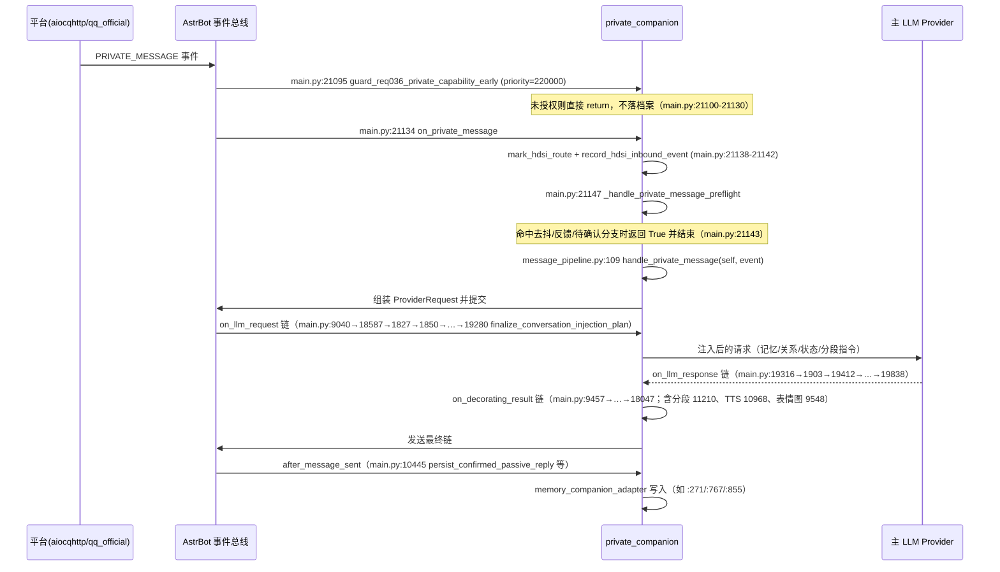

# AstrBot 自研插件对外接口与集成点盘点

> **盘点对象**：`<REPO_ROOT>\astrbot\data\plugins\` 下 6 个插件（private_companion / memory_companion / image_companion / proactive_chat / affection / meme_manager）。
> **方式**：只读静态扫描（行号均为本会话实测输出）。未读取 `.venv`、`__pycache__`；未修改任何文件。
> **约定**：下文 `ROOT` = 上述 plugins 目录；`P` = `ROOT\astrbot_plugin_private_companion`。所有路径可拼接回绝对路径。凡本会话未直接观察到的事实一律标「未确认」，不做推测填充。

---

## 0 总表

| 插件 | 版本 | 作用（metadata description/desc 归纳） | 钩子数（实测装饰器） | 面板路由数 | 关键文件 |
|---|---|---|---|---|---|
| astrbot_plugin_private_companion | 6.7.0 | 独立持续型 AI 陪伴核心：角色状态/日程/关系/私聊与群聊理解/主动消息编排/运行诊断 | `main.py` 101 个 `@filter.*` + `atrelay.py` 1 个 = **102** | **197**（`page_api.py:1244 route_bindings()`，route 列表 1248–1444） | `main.py`（21599+ 行）、`page_api.py`（31924 行）、`message_pipeline.py`、`proactive.py`、`proactive_engine.py`、`proactive_message.py`、`segmented_message.py`、`memory_companion_adapter.py`、`companion/`、`domains/`、`page_backend/` |
| astrbot_plugin_memory_companion | 1.10.5 | 长期记忆中枢：主链注入、历史对话导入、连续对话记忆、知识图谱、衰减、迁移、双界面 | **11**（`main.py`） | **68**（`page_api.py:175 _route_specs()`） | `main.py`（含 `get_memory_companion_bridge()`）、`page_api.py`、`core/`（52 py）、`unified_profile_contract.py` |
| astrbot_plugin_image_companion | 0.4.5 | 生图/改图/参考图库/多后端（ComfyUI 等），作为陪伴插件的图像能力扩展 | **2**（`main.py:605-606`） | **0**（无 `pages/`；无 `register_web_api`） | `main.py`（`get_image_companion_api()` L100）、`image_runtime.py`、`comfyui_service.py`、`generation_*.py`、`proactive_routes.py` |
| astrbot_plugin_proactive_chat | v1.2.6 | 私聊/群聊主动消息：上下文感知、持久化、动态情绪、免打扰、TTS、独立 WebUI | **4**（`main.py`） | **0**（无 `pages/`；自带独立 FastAPI WebUI，见 `admin/`、`web_admin` 配置） | `main.py`、`core/plugin_lifecycle.py`、`core/`（15 py）、`admin/`（24 py）、`utils/`（3 py） |
| astrbot_plugin_affection | v1.3.1 | 弗洛伊德双驱情绪模型（力比多 vs 攻击性），影响回复基调 | **8**（`main.py`） | **0** | `main.py`、`unconscious.py`、`decay.py`、`emotion_tables.py`、`storage.py`、`utils.py` |
| meme_manager | 5.1.0 | 表情包管理：WebUI 面板、资源广场、语义检索、AI 智能发送、自动收集、云端同步 | **8**（`main.py`）+ 11（`mixins/commands.py` 权限/命令）+ 1（`mixins/event_handlers.py:1583`）= **20** | **≥24（未穷举，未确认）**（`mixins/web_api.py:106 _register_web_apis()`） | `main.py`、`mixins/web_api.py`、`mixins/commands.py`、`backend/`（24 py）、`pages/app/` |

---

## 1 astrbot_plugin_private_companion（`我会永远陪着你`，6.7.0）

### 1.1 元信息
来源：`P/metadata.yaml`、`P/requirements.txt`。

| 字段 | 值 |
|---|---|
| name | `astrbot_plugin_private_companion` |
| display_name | `我会永远陪着你` |
| author / author_url | `menglimi` / https://github.com/menglimi |
| version | `6.7.0` |
| category / tags | `AI 增强` / 陪伴、生活模拟、AI 增强、记忆管理、主动行为、多模态、可视化管理 |
| repo | https://github.com/menglimi/astrbot_plugin_private_companion |
| astrbot_version | `>=4.22.0` |
| support_platforms | `aiocqhttp`、`qq_official` |
| pages | `- name: companion-panel / title: 陪伴面板` |
| description（节选） | 「面向 AstrBot 的独立持续型 AI 陪伴核心。统一管理角色状态、日程、关系、私聊与群聊理解、主动消息编排及运行诊断；Memory 可独立选装协同，Content、Image、ComfyUI 等扩展未安装时对应能力不启用。」 |
| help（指令全集） | metadata 内以「私聊发送：陪伴 …」与「群聊发送：陪伴群 …」两大段列出（状态/查看主动判定/撤回消息/重置插件/增添状态/查看今日日程/日期列表·添加·删除/可做事项/昵称/语气/参考图（含参考图库 添加·列表·预览·删除·清空）/衣柜（倾向·添加·添加图片·修改·删除·清空）/清空记忆/梦境/画像/记忆/表达学习/气氛/片段/长期记忆/日记/创作/答疑 等；群聊：状态·撤回消息·黑话·群友·话题·片段·插话反馈·关系网·LLM状态·关闭LLM·开启LLM·开启·关闭） |
| requirements.txt | `aiohttp>=3.9,<4`、`Pillow>=10,<13`、`chinese-calendar>=1.9.2`、`lunarcalendar>=0.0.9`、`markdown-it-py>=3,<5` |

目录规模：顶层约 230 个 `.py`；子目录 `companion/`(12)、`data/`(4)、`docs/`(222)、`domains/`(13)、`page_backend/`(5)、`pages/`(32 文件)、`scripts/`(24)、`storage/`(8)、`tests/`(497 py)。
**注意：顶层不存在 `mixins/` 目录**（任务描述中的 `private_companion\mixins\` 不存在）；全部钩子集中在 `main.py` 与 `atrelay.py`。

### 1.2 注册与钩子（`P/main.py` + `P/atrelay.py`，共 102 个）

分类计数（`main.py`）：
`on_decorating_result` ×28 · `on_llm_request` ×21 · `event_message_type` ×11 · `on_llm_response` ×8 · `command` ×3 · `on_agent_done` ×3 · `llm_tool` ×22 · `on_agent_begin` ×2 · `on_llm_tool_respond` ×1 · `on_plugin_loaded` ×1 · `on_plugin_unloaded` ×1。
`atrelay.py`：`on_llm_response` ×1（`:740`）。

#### 生命周期与插件发现
| 位置 | 装饰器原文 | 处理函数 | 触发时机 / 语义 |
|---|---|---|---|
| main.py:1796 | `@filter.on_plugin_loaded()` | `_on_external_plugin_loaded(self, metadata, *args, **kwargs)` | 任意插件加载后；用于**失效**外部桥接解析缓存（配合 `companion/integrations/external_bridge_resolver.py` 的负缓存永久化） |
| main.py:1803 | `@filter.on_plugin_unloaded()` | `_on_external_plugin_unloaded` | 任意插件卸载后；同上失效缓存 |

#### 群聊/私聊事件入口（优先级从高到低=越早）
| 位置 | 装饰器原文 | 处理函数 | 语义 |
|---|---|---|---|
| main.py:21095 | `@filter.event_message_type(PRIVATE_MESSAGE, priority=220000)` | `guard_req036_private_capability_early` | 私聊最早的准入闸门；未授权事件直接 `return`（不 `stop_event`），并把「预建私聊档案」压缩到最小 |
| main.py:21134 | `@filter.event_message_type(PRIVATE_MESSAGE)` | `on_private_message(self, event, *args, **kwargs)` | 私聊主入口；`mark_hdsi_route` → `record_hdsi_inbound_event` → `_handle_private_message_preflight()`（main.py:21147，返回 True 表示已消费）→ 否则 `handle_private_message(self, event)`（`message_pipeline.py:109`） |
| main.py:21332 | `@filter.event_message_type(GROUP_MESSAGE, priority=210000)` | `guard_blocked_group_member_early` | 已静默成员的群消息丢弃；会 `event.stop_event()` 并打标 `_private_companion_member_safety_blocked` |
| main.py:21371 | `@filter.event_message_type(GROUP_MESSAGE, priority=200000)` | `capture_group_observation_early` | 在其它回复插件拦截传播**之前**抢先记录允许观察的群消息 |
| main.py:21460 | `@filter.event_message_type(GROUP_MESSAGE, priority=190000)` | `review_group_member_safety_early` | 群成员安全审查 |
| main.py:21504 | `@filter.event_message_type(GROUP_MESSAGE, priority=180000)` | `guard_req036_group_portrait_queries` | 群画像查询准入 |
| main.py:21562 | `@filter.event_message_type(GROUP_MESSAGE)` | `on_group_message` | 群聊主入口 → `message_pipeline.py:1250 handle_group_message` |
| main.py:9030 | `@filter.event_message_type(ALL, priority=230000)` | `preserve_addressed_user_message` | 抢在 AstrBot 原生命令处理前保留「被点名用户消息」 |
| main.py:9052 | `@filter.event_message_type(ALL, priority=11000)` | `prepare_tts_streaming_boundary` | TTS 流式边界准备 |
| main.py:9072 | `@filter.event_message_type(ALL, priority=9500)` | `handle_reactive_poke` | 被动戳一戳响应 |
| main.py:9223 | `@filter.event_message_type(ALL, priority=10000)` | `observe_recall_enhancement_events` | 撤回增强观察 |

#### LLM 请求链（`on_llm_request`，priority 大→小 = 先执行；负数在末尾）
| 位置 | 装饰器原文 | 处理函数 |
|---|---|---|
| main.py:9040 | `@filter.on_llm_request(priority=230000)` | `restore_addressed_user_request` |
| main.py:18587 | `@filter.on_llm_request(priority=220000)` | `guard_req036_private_capability_before_llm` |
| main.py:1827 | `@filter.on_llm_request(priority=110000)` | `enforce_model_replacement_request_hook` |
| main.py:1850 | `@filter.on_llm_request(priority=109000)` | `inject_hdsi_experiment_prompt` |
| main.py:18285 | `@filter.on_llm_request()` | `inject_tts_enhancement_request_fallback` |
| main.py:19311 | `@filter.on_llm_request()` | `inject_humanized_state` |
| main.py:18599 | `@filter.on_llm_request(priority=-30000)` | `enforce_p4_live_confinement_before_enrichment` |
| main.py:18658 | `@filter.on_llm_request(priority=-30000)` | `inject_unified_relationship_expression` |
| main.py:18822 | `@filter.on_llm_request(priority=-22000)` | `prepare_p5_memory_attestation` |
| main.py:18851 | `@filter.on_llm_request(priority=-21000)` | `sanitize_sensitive_screen_tools` |
| main.py:18861 | `@filter.on_llm_request(priority=-20500)` | `sanitize_deepseek_tool_call_history` |
| main.py:18891 | `@filter.on_llm_request(priority=-20400)` | `append_group_cycle_privacy_boundary` |
| main.py:18944 | `@filter.on_llm_request(priority=-20000)` | `sanitize_incompatible_web_search_tools` |
| main.py:18982 | `@filter.on_llm_request(priority=-240000)` | `flush_conversation_injection_plan` |
| main.py:11728 | `@filter.on_llm_request(priority=-253000)` | `inject_llm_controlled_segmenting_instruction`（注入「可控分段」标记指令） |
| main.py:19006 | `@filter.on_llm_request(priority=-249000)` | `sanitize_historical_image_blocks_before_provider` |
| main.py:19032 | `@filter.on_llm_request(priority=-250000)` | `sanitize_gif_inputs_before_provider` |
| main.py:19192 | `@filter.on_llm_request(priority=-251000)` | `annotate_photo_tool_prompt_format` |
| main.py:19214 | `@filter.on_llm_request(priority=-252000)` | `intercept_native_astrbot_group_context` |
| main.py:19243 | `@filter.on_llm_request(priority=-259000)` | `enforce_private_request_scope_isolation` |
| main.py:19280 | `@filter.on_llm_request(priority=-260000)` | `finalize_conversation_injection_plan`（该链最后一步，收口注入计划） |

#### LLM 响应链（`on_llm_response`）
| 位置 | 装饰器原文 | 处理函数 |
|---|---|---|
| main.py:19316 | `@filter.on_llm_response(priority=120000)` | `replace_sensitive_conversation_response` |
| main.py:1903 | `@filter.on_llm_response(priority=100000)` | `settle_pending_message_debounce_hook` |
| main.py:19412 | `@filter.on_llm_response()` | `normalize_tts_enhancement_response` |
| main.py:19739 | `@filter.on_llm_response()` | `record_external_llm_token_usage` |
| main.py:19816 | `@filter.on_llm_response()` | `record_group_expression_rule_usage` |
| main.py:19838 | `@filter.on_llm_response()` | `capture_llm_timer_directive` |
| main.py:1861 | `@filter.on_llm_response(priority=-99950)` | `finalize_hdsi_trial_response` |
| main.py:1871 | `@filter.on_llm_response(priority=-100000)` | `clear_model_replacement_context_hook` |
| atrelay.py:740 | `@filter.on_llm_response()` | atrelay 转发链相关（函数体本次未读，未确认） |

#### 出站改写链（`on_decorating_result`，28 个；priority 大 = 先执行）
| 位置 | 装饰器原文 | 处理函数 | 语义 |
|---|---|---|---|
| main.py:9457 | `priority=20000` | `consume_group_member_safety_hidden_marker` | 消费群成员安全「隐藏标记」 |
| main.py:12507 | `priority=200` | `attach_group_reply_quote` | 群聊引用回复 |
| main.py:9318 | `priority=10000` | `bridge_proactive_chat_outbound` | 接管 proactive_chat 出站 |
| main.py:11210 | `priority=100` | `apply_segmented_llm_reply_scope` | 分段回复作用域（切分前置） |
| main.py:10968 | `priority=300` | `apply_tts_enhancement_before_send_hook` | 发送前 TTS 增强 |
| main.py:10116 | `@filter.on_decorating_result()` | `stop_passive_input_status_before_private_send` | 私聊发送前结束「输入中」状态 |
| main.py:10125 | `priority=-10000` | `suppress_recent_duplicate_outbound_text` | 近重复文本抑制 |
| main.py:10457 | `@filter.on_decorating_result()` | `strip_outbound_control_blocks_before_send` | 去控制块 |
| main.py:10503 | `priority=-29999` | `final_strip_outbound_control_blocks_before_send` | 控制块兜底清理 |
| main.py:10558 | `@filter.on_decorating_result()` | `strip_plaintext_tool_calls_before_send` | 去明文工具调用 |
| main.py:10600 | `@filter.on_decorating_result()` | `cancel_reply_if_trigger_recalled_before_send` | 触发消息被撤回则取消回复 |
| main.py:10625 | `@filter.on_decorating_result()` | `suppress_forbidden_outbound_before_send` | 违禁词拦截 |
| main.py:10659 | `@filter.on_decorating_result()` | `suppress_framework_error_leak_before_send` | 框架错误泄漏拦截 |
| main.py:10671 | `@filter.on_decorating_result()` | `rewrite_atrelay_delivery_receipt_before_send` | atrelay 回执改写 |
| main.py:10721 | `@filter.on_decorating_result()` | `suppress_group_question_wakeup_collision_reply` | 群提问唤醒冲突抑制 |
| main.py:10782 | `@filter.on_decorating_result()` | `suppress_smart_silence_reply_before_send` | 智能沉默 |
| main.py:10896 | `@filter.on_decorating_result()` | `record_empty_passive_result_before_send` | 记录空被动结果 |
| main.py:10941 | `priority=-19000` | `suppress_empty_photo_tool_followup_before_send` | 空生图后续抑制 |
| main.py:10978 | `@filter.on_decorating_result()` | `strip_group_internal_identity_anchors` | 去群内身份锚点 |
| main.py:11005 | `@filter.on_decorating_result()` | `suppress_group_silent_control_reply` | 群静默控制回复抑制 |
| main.py:11156 | `priority=-1000` | `strip_unexpected_private_passive_reply` | 意外私聊被动回复裁剪 |
| main.py:11417 | `@filter.on_decorating_result()` | `remember_group_bot_reply_context_before_send` | 记住群内机器人回复上下文 |
| main.py:11490 | `priority=-9000` | `final_tts_markup_guard_before_send` | TTS 标记最终守卫 |
| main.py:9548 | `priority=-18000` | `attach_reaction_expression_image_before_send` | **表情包/反应图附加**（见 §1.7 流程④） |
| main.py:10078 | `priority=-20000` | `finalize_proactive_chat_outbound_bridge` | 主动消息出站收尾 |
| main.py:18030 | `@filter.on_decorating_result()` | `redact_outbound_secrets_before_send` | 出站密钥脱敏 |
| main.py:18047 | `priority=-21000` | `record_daily_review_outbound_case_before_send` | 日报用例采样 |
| main.py:10433 | `priority=-30000` | `capture_final_outbound_chain_for_persistence` | 捕获最终出站链用于落盘 |

#### Agent 生命周期 / 工具响应
| 位置 | 装饰器原文 | 处理函数 |
|---|---|---|
| main.py:10378 | `@filter.on_agent_begin(priority=100000)` | `begin_final_response_persistence` |
| main.py:15706 | `@filter.on_agent_begin()` | `enforce_memo_reminder_tool_boundary` |
| main.py:10392 | `@filter.on_agent_done(priority=-100000)` | `prepare_final_response_persistence` |
| main.py:10406 | `@filter.on_agent_done(priority=1000000)` | `restore_intercepted_astrbot_group_history` |
| main.py:15750 | `@filter.on_agent_done()` | `complete_official_llm_timer_lifecycle` |
| main.py:15720 | `@filter.on_llm_tool_respond()` | `capture_future_task_result` |

#### `after_message_sent`（发送后结算，10 个）
| 位置 | 装饰器原文 | 处理函数 |
|---|---|---|
| main.py:7957 | `priority=-105000` | `settle_req041_group_affinity_after_send` |
| main.py:7975 | `priority=-110000` | `finish_req041_read_chain` |
| main.py:10445 | `priority=-100000` | `persist_confirmed_passive_reply` |
| main.py:10360 | `priority=6000` | `cleanup_reaction_expression_delivery_tracker_after_send` |
| main.py:10330 | `priority=7000` | `release_deferred_reaction_tts_after_send` |
| main.py:10299 | `priority=8000` | `release_tts_reply_remainder_after_send` |
| main.py:10153 | `priority=8500` | `remember_confirmed_outbound_text` |
| main.py:10168 | `priority=9000` | `settle_reaction_expression_attachment_after_send` |
| main.py:10255 | `priority=9500` | `release_reaction_expression_segmented_remainder_after_send` |

#### LLM 工具（`@filter.llm_tool(name=...)`，22 个；这是给模型的可调用面）
| 位置 | 工具名 |
|---|---|
| main.py:12686 | `pc_qzone_view_feed` |
| main.py:12731 | `pc_qzone_publish_feed` |
| main.py:12768 | `pc_qzone_reply_my_comment` |
| main.py:12797 | `pc_generate_photo` |
| main.py:12889 | `pc_send_current_media` |
| main.py:12916 | `pc_find_reaction_image` |
| main.py:13051 | `pc_manage_memo` |
| main.py:13109 | `pc_manage_schedule` |
| main.py:13195 | `pc_view_creative_work` |
| main.py:13223 | `pc_get_group_id_by_name` |
| main.py:13235 | `pc_get_user_id_by_name` |
| main.py:13248 | `pc_query_relation_person` |
| main.py:13260 | `pc_get_specified_group_members` |
| main.py:13273 | `pc_query_wardrobe_detail` |
| main.py:13293 | `pc_set_outfit_intent` |
| main.py:13318 | `pc_query_interaction` |
| main.py:13335 | `pc_relay_message` |
| main.py:13357 | `pc_send_to_group` |
| main.py:13388 | `pc_send_to_private_user` |
| main.py:13427 | `pc_send_to_groups` |
| main.py:13443 | `pc_send_to_private_users` |
| main.py:13458 | `pc_schedule_group_relay` |

#### 命令
| 位置 | 装饰器原文 | 处理函数 | 语义 |
|---|---|---|---|
| main.py:20312 | `@filter.command("陪伴", alias={"私聊陪伴", "主动陪伴"})` | `companion_command(self, event)` | 私聊主命令组（`_companion_command_impl` 生成器） |
| main.py:21085 | `@filter.command("陪伴群", alias={"群陪伴", "群聊陪伴"})` | `group_companion_command(self, event)` | 群聊命令组；入口即 `self._qzone_note_event_bot(event)` + `async for result in self._group_companion_command_impl(event): yield result` |
| main.py:1844 | `@filter.command("HDSI", alias={"hdsi"})` | `hdsi_experiment_command` | HDSI 实验开关 |

**返回/中断语义（实测到的）**：
- `event_message_type` 钩子：`guard_*` 系列多用 `return`（丢弃、不 stop），成员安全守卫用 `event.stop_event()` + 打标（main.py:21327-21330）。
- 私聊主入口 `on_private_message`：`_handle_private_message_preflight()` 返回 True 时 `return`（main.py:21143-21144），否则 `return await handle_private_message(...)`（main.py:21145）——即**返回值即事件消费结果**。
- `on_decorating_result`：链式改写结果体，越靠后（priority 越小）越接近真实发送。
- 命令函数为**异步生成器**（`yield result`），由 AstrBot 逐条回发。

### 1.3 Web 面板与 API

- 面板静态资源目录（**同名两份，内容一致**）：`P/pages/companion-panel/` 与 `P/pages/陪伴面板/` —— `app.css`(765,591 B)、`app.js`(2,292,006 B)、`index.html`(141,662 B)、`standalone.js`(14,660 B)，子目录 `context-editor/`(app.js、delivery-audit.js、index.html、style.css)、`css/`(header-tools.css、polish.css 136,070 B、qzone-mobile.css)、`js/features/`(daily-outfit.js、wardrobe.js 62,594 B)、`js/panels/`(provider-tree.js 56,178 B、qzone-panel.js 26,266 B)、`js/ui/appearance.js`。用途：陪伴面板（总览/日程/用户/群/设置/生图/QQ空间/衣柜/书架/创作/角色）单页应用。
- 后端：`P/page_api.py`
  - `:223` `PAGE_API_PREFIX = f"/{PLUGIN_NAME}/page"`（`PLUGIN_NAME` 即插件名，最终前缀形如 `/astrbot_plugin_private_companion/page`）
  - `:1244` `def route_bindings(self) -> list[tuple[str, Any, list[str], str]]:`，路由表字面量从 `:1248` 到 `:1444`
  - `:1467` `def register_routes(self) -> None:` → `:1468` `register = self.plugin.context.register_web_api` → 对每条 `register(f"{PAGE_API_PREFIX}{path}", handler, methods, desc)`
  - 路由元组形态：`("路径", self.处理函数, ["GET"], "描述")`
- **鉴权**：未见逐路由 token 校验（`register_web_api` 由 AstrBot 面板层承载鉴权，本会话未读框架代码 → 未确认）。实测存在的敏感配置隔离：`page_api.py:311` `PAGE_PRIVATE_CONFIG_KEYS = frozenset({"standalone_webui_access_token"})`（该键不进入普通配置读接口）；书架有独立口令流程 `page_api.py:324 BOOKSHELF_ACCESS_TOKEN_TTL_SECONDS = 24*60*60`、`:325 BOOKSHELF_ACCESS_TOKEN_MAX_PERSISTED = 8`，并有 `hmac.compare_digest` 比较；`P/standalone_webui.py:145-151` 会收集遗留 `register_web_api` 调用（独立 WebUI 模式）。
- 完整路由表（197 条，格式 `方法 路径 → 处理函数`）：

```
GET  /overview → get_overview
GET  /calendar → get_calendar
GET  /calendar/conflicts → get_calendar_conflicts
POST /calendar/preview → preview_calendar
POST /calendar/upsert → upsert_calendar
POST /calendar/cancel → cancel_calendar
POST /calendar/delete → cancel_calendar（别名）
POST /calendar/candidates/confirm → confirm_calendar_candidate
POST /calendar/candidates/reject → reject_calendar_candidate
GET  /extension-migration-notice → get_extension_migration_notice
POST /extension-migration-notice/update → update_extension_migration_notice
GET  /task-prompts → get_task_prompts
POST /task-prompts/update → update_task_prompts
GET  /expression-library → get_expression_library
POST /expression-library/update → update_expression_library
POST /expression-library/share → share_expression_library
POST /expression-library/import/preview → preview_expression_library_import
POST /expression-library/import/apply → apply_expression_library_import
GET  /users → list_users
GET  /user → get_user
POST /user/update → update_user
POST /user/delete → delete_user
POST /user/identity/link → link_unified_identity
POST /user/identity/unlink → unlink_unified_identity
POST /user/identity/archive → archive_unified_person
POST /user/identity/delete → delete_unified_person
POST /user/identity/pending → update_pending_identity_review
POST /user/identity/merge-preview → preview_unified_identity_merge
GET  /groups → list_groups
GET  /group → get_group
POST /group/update → update_group
POST /group/delete → delete_group
POST /group/slang/update → update_group_slang
GET  /group/member-safety → get_group_member_safety
POST /group/member-safety/action → update_group_member_safety
POST /settings/update → update_settings
GET  /reality-touch → get_reality_touch
POST /reality-touch/update → update_reality_touch
POST /settings/swap_image_api → swap_image_api_settings
GET  /extensions/image/status → get_image_extension_status
GET  /image/debug → get_image_debug
GET  /image_api/status → get_image_api_status
POST /image_api/test → test_image_api_endpoint
GET  /config/export → export_migration_config
GET  /config/backups → list_migration_backups
POST /config/restore → restore_migration_backup
POST /config/import/preview → preview_migration_config_import
POST /config/import/apply → apply_migration_config_import
POST /proactive_only/unlock → update_proactive_only_unlock
POST /proactive/candidate/delete → delete_proactive_candidate
POST /proactive/candidate/prune → prune_proactive_candidates
GET  /extensions/status → get_extension_control_plane_status
GET  /diagnostics → get_diagnostics
GET  /troubleshooting → get_troubleshooting
GET  /daily-review → get_daily_review
POST /daily-review/run → run_daily_review
POST /daily-review/guidance → update_daily_review_guidance
POST /troubleshooting/warnings/update → update_troubleshooting_warning_suppression
POST /troubleshooting/test → run_troubleshooting_test
GET  /token/stats → get_token_stats
POST /token/reset → reset_token_stats
GET  /image_cache/list → list_image_cache
GET  /image_cache/preview → get_image_cache_preview
GET  /image_cache/preview_data → get_image_cache_preview_data
GET  /image_cache/thumbnail_data → get_image_cache_thumbnail_data
POST /image_cache/update → update_image_cache_item
POST /image_cache/delete → delete_image_cache_item
POST /image_cache/bulk_delete → bulk_delete_image_cache_items
GET  /reaction_library/list → list_reaction_library
GET  /reaction_library/image_data → get_reaction_library_image_data
POST /reaction_library/import → import_reaction_library
POST /reaction_library/analyze → analyze_reaction_library
POST /reaction_library/update → update_reaction_library
POST /reaction_library/delete → delete_reaction_library
POST /reaction_library/rescan → rescan_reaction_library
GET  /reaction_assets/list → list_owned_reaction_assets
GET  /reaction_assets/image_data → get_owned_reaction_asset_image_data
GET  /photo_reference/list → list_photo_references
GET  /photo_reference/image_data → get_photo_reference_image_data
POST /photo_reference/upload → upload_photo_reference
POST /wardrobe/describe → describe_wardrobe_image
POST /wardrobe/outfit-preview → preview_wardrobe_outfit
POST /wardrobe/drafts → list_wardrobe_drafts
POST /wardrobe/draft-apply → confirm_wardrobe_draft
POST /wardrobe/draft-reject → reject_wardrobe_draft
POST /wardrobe/asset-image → get_wardrobe_asset_image
POST /wardrobe/intent → get_wardrobe_intent
POST /wardrobe/intent-clear → clear_wardrobe_intent
POST /photo_reference/metadata/compile → compile_photo_reference_metadata
POST /photo_reference/metadata/review → review_photo_reference_metadata
POST /photo_reference/selection_trial → run_photo_reference_selection_trial
GET  /reference_asset/list → list_reference_assets
GET  /reference_asset/image_data → get_reference_asset_image_data
POST /reference_asset/upload → upload_reference_asset
POST /reference_asset/update → update_reference_asset
POST /reference_asset/delete → delete_reference_asset
GET  /worldbook/member/reference/list → list_reference_assets
POST /worldbook/member/reference/upload → upload_reference_asset
POST /worldbook/member/reference/update → update_reference_asset
POST /worldbook/member/reference/delete → delete_reference_asset
GET  /knowledge/reference/list → list_reference_assets
POST /knowledge/reference/upload → upload_reference_asset
POST /knowledge/reference/update → update_reference_asset
POST /knowledge/reference/delete → delete_reference_asset
GET  /relationship/role/reference/list → list_reference_assets
GET  /relationship/role/reference/image_data → get_reference_asset_image_data
POST /relationship/role/reference/upload → upload_reference_asset
POST /relationship/role/reference/update → update_reference_asset
POST /relationship/role/reference/delete → delete_reference_asset
GET  /photo_reference/assets → list_photo_reference_assets
GET  /photo_reference/assets/list → list_photo_reference_assets
GET  /photo_reference/assets/image_data → get_photo_reference_asset_image_data
POST /photo_reference/assets/upload → upload_photo_reference_asset
POST /photo_reference/assets/update → update_photo_reference_asset
POST /photo_reference/assets/delete → delete_photo_reference_asset
GET  /daily_outfit/image → get_daily_outfit_image
GET  /daily_outfit/image_data → get_daily_outfit_image_data
POST /bookshelf/unlock → unlock_bookshelf
GET+POST /bookshelf/session → get_bookshelf_session
GET  /bookshelf/image → get_bookshelf_image
GET  /bookshelf/image_data → get_bookshelf_image_data
POST /bookshelf/delete → delete_bookshelf_item
POST /bookshelf/rate → rate_bookshelf_item
POST /bookshelf/tags → update_bookshelf_item_tags
POST /bookshelf/comments/update → update_bookshelf_item_comments
POST /bookshelf/reading_state → update_bookshelf_reading_state
GET  /memo/list → list_memo_notes
POST /memo/update → update_memo_note
GET  /qzone/status → get_qzone_status
GET  /qzone/health → get_qzone_status（别名）
GET  /qzone/summary → get_qzone_status（别名）
GET  /qzone/state → get_qzone_status（别名）
GET  /qzone/feed → get_qzone_feed
GET  /qzone/feeds → get_qzone_feed（别名）
GET  /qzone/list → get_qzone_feed（别名）
GET  /qzone/detail → get_qzone_detail
GET  /qzone/post → get_qzone_detail（GET 别名）
GET  /qzone/item → get_qzone_detail（别名）
POST /qzone/refresh_cookies → refresh_qzone_cookies
POST /qzone/refresh-cookies → refresh_qzone_cookies（别名）
POST /qzone/cookies/refresh → refresh_qzone_cookies（别名）
POST /qzone/cookie/refresh → refresh_qzone_cookies（别名）
POST /qzone/refresh → refresh_qzone_cookies（别名）
POST /qzone/publish → publish_qzone_post
POST /qzone/post/publish → publish_qzone_post（别名）
POST /qzone/post → publish_qzone_post（POST 别名）
POST /qzone/like → like_qzone_post
POST /qzone/post/like → like_qzone_post（别名）
POST /qzone/comment → comment_qzone_post
POST /qzone/post/comment → comment_qzone_post（别名）
POST /qzone/delete → delete_qzone_post
POST /qzone/post/delete → delete_qzone_post（别名）
GET  /creative/project → get_creative_project
GET  /creative/project/cover → get_creative_project_cover
GET  /creative/project/cover_data → get_creative_project_cover_data
POST /creative/project/update → update_creative_project
POST /creative/project/chunk/update → update_creative_chunk
POST /creative/project/outline/update → update_creative_outline
POST /creative/project/characters/update → update_creative_characters
POST /creative/project/reanalyze → reanalyze_creative_project
POST /creative/project/rebuild_memory → rebuild_creative_memory
POST /creative/project/delete → delete_creative_project
POST /worldbook/import → import_worldbook
GET  /worldbook/member/livingmemory → get_worldbook_member_livingmemory
POST /worldbook/member/update → update_worldbook_member
POST /worldbook/observations/clear → clear_worldbook_pending_observations
POST /worldbook/group/update → update_worldbook_group
POST /skill/update → update_skill_growth
POST /personal_goal/update → update_personal_goal
POST /food_menu/update → update_food_menu
POST /food_menu/bulk_update → bulk_update_food_menu
POST /food_menu/bulk_delete → bulk_delete_food_menu
POST /external_ability/update → update_external_ability
POST /setup/apply → apply_setup_guide
POST /setup/daily/run → run_setup_daily_generation
POST /daily/detail/regenerate → regenerate_daily_detail_segment
GET  /roleplay/personas → list_roleplay_personas
POST /persona/migrate → migrate_persona_profile
POST /persona/reset-current → reset_current_persona
GET  /persona/config-state → get_persona_config_state
POST /persona/config/create → create_persona_config
POST /persona/settings/update → update_persona_settings
POST /persona/config/detach-preview → preview_persona_config_detach
POST /persona/config/detach-apply → apply_persona_config_detach
POST /roleplay/draft_from_persona → generate_roleplay_draft_from_persona
POST /roleplay/standardize_persona → standardize_persona_from_questionnaire
POST /roleplay/persona_style_scenarios → generate_persona_style_scenarios
POST /roleplay/persona_style_scenario_retry → retry_persona_style_scenario
POST /roleplay/persona_style_summary → generate_persona_style_summary
POST /preset/apply → apply_preset
GET  /providers/available → list_available_providers
POST /provider/test → test_provider
GET  /tts/providers → list_tts_provider_configs
POST /tts/provider/create → create_tts_provider_config
POST /tts/provider/clone → clone_tts_provider_config
POST /tts/provider/update → update_tts_provider_config
POST /tts/provider/test → test_tts_provider_config
```

### 1.4 配置项（`P/_conf_schema.json`，848 KB 级）

- 顶层键 **748** 个 = **46 个 `type=object` 分组** + 702 个平铺键。
- 46 个分组名：
`basic_config, model_assignment_config, proactive_reach_config, balance_awareness_config, recall_config, message_debounce_config, private_followup_config, proactive_dedup_config, proactive_generation_config, timer_config, daily_creative_config, skill_growth_config, private_understanding_config, memory_habit_config, emotion_relationship_config, external_memory_config, bilibili_config, news_config, web_exploration_config, qzone_config, reading_archive_config, group_observation_config, forward_message_config, group_scene_config, group_wakeup_config, group_high_intensity_config, group_slang_topic_config, group_relationship_config, relay_bridge_config, group_interject_config, life_schedule_config, schedule_detail_config, humanized_state_config, dream_diary_config, photo_action_config, screen_action_config, poke_action_config, reactive_poke_config, voice_action_config, voice_playback_config, auto_voice_config, presence_sync_config, weather_config, experimental_motivation_config, legacy_compat_config, wardrobe_config`
- 每个分组的 schema 形状统一为 `description / type / hint / items`（即真实键都在 `items` 下）。

关键分组与键（实测摘录）：

| 分组 | 关键键（默认值） | 含义 |
|---|---|---|
| `qzone_config` | `enable_qzone_integration`、`QZONE_COOKIE`、`enable_qzone_life_publish`、`qzone_life_publish_min_interval_hours`(24)、`qzone_life_publish_probability`(0.18)、`qzone_publish_style_prompt`、`enable_qzone_generated_image_publish`(true)、`qzone_generated_image_probability`(0.25)、`enable_qzone_comment_inbox`(false)、`qzone_comment_inbox_interval_minutes`(60)、`qzone_comment_inbox_recent_posts`(5)、`qzone_comment_inbox_max_replies_per_tick`(1) | QQ 空间集成与发布/评论收件箱 |
| `photo_action_config` | `enable_photo_text_action`(true)、`photo_action_max_daily`(1)、`generated_photo_retention_days`(30)、`generated_photo_max_mb`(512)、`photo_generation_backend`("auto")、`EXTERNAL_IMAGE_API_BASE_URL/KEY/MODEL`、`external_image_api_size`("1024x1024")、`external_image_api_timeout_seconds`(180)、`enable_backup_external_image_api`、`BACKUP_EXTERNAL_IMAGE_API_*`、`photo_generation_style`("真实")、`COMFYUI_TEXT2IMG_WORKFLOW_NAME`、`COMFYUI_SELFIE_WORKFLOW_NAME`、`enable_group_nsfw_private_fallback` | 生图动作后端与额度 |
| `voice_action_config` | `enable_tts_enhancement`(false)、`tts_synthesis_backend`("astrbot_provider")、`tts_provider_id_zh/ja/en`、`tts_mimo_tool_name`("mimo_tts_speak")、`tts_generation_mode`("fast_tag")、`tts_delivery_mode`("voice_and_text")、`tts_trigger_probability`(25) | TTS 语音动作 |
| `weather_config` | `weather_api_key`、`weather_city`、`weather_location`、`weather_token`、`weather_amap_api_key`、`weather_api_host`、`weather_alert_token`、`weather_alert_api_key` | 天气与预警 |
| `wardrobe_config` | `enable_wardrobe`、`wardrobe_tendency`、`WARDROBE_VISION_PROVIDER_ID`、`wardrobe_items`、`wardrobe_outfits` | 衣柜 |
| `legacy_compat_config` | `target_group_ids`、`require_target_group`、`COMFYUI_PHOTO_WORKFLOW_NAME`、`segmented_proactive_*`（全套分段键）、`timezone`、`DIARY_PROVIDER_ID`、`DREAM_PROVIDER_ID`、`enabled_proactive_actions` | 旧版兼容与分段回复配置 |
| `model_assignment_config` | `provider_config_mode`、`background_llm_request_max_attempts`、`enable_llm_streaming`、`enable_deepseek_peak_replacement`、`model_replacement_rules`、`SENSITIVE_REPLACEMENT_PROVIDER_ID`、`sensitive_replacement_keywords`、`DEEPSEEK_*` | 模型分配与替换 |

平铺键中的典型项：`LLM_PROVIDER_ID`、`max_daily_messages`、`idle_minutes`、`min_interval_minutes`、`quiet_hours`、`target_user_ids`、`target_platform`、`timezone`、`FAST_RESPONSE_PROVIDER_ID`/`COMPLEX_REASONING_PROVIDER_ID`/`CREATIVE_MODEL_PROVIDER_ID`/`EMBEDDING_PROVIDER_ID`、`page_font_family`("original")、`page_theme`("classic")、`model_timeout_overrides`("{}")、`task_prompt_overrides`("{}")、`REST_WAKEUP_PROVIDER_ID`、`enable_segmented_proactive_reply`(false)、`enable_multi_persona_mode`、`multi_persona_ids`、`daily_token_limit`、`enable_daily_token_soft_limit`、`enable_qzone_*` 系列（与分组内同名键并存）。

**敏感键（单独标注）**：`QZONE_COOKIE`（type=text）、`EXTERNAL_IMAGE_API_KEY`、`BACKUP_EXTERNAL_IMAGE_API_KEY`、`weather_api_key`、`weather_token`、`weather_alert_token`、`weather_alert_api_key`、`weather_amap_api_key`、`WEB_EXPLORATION_API_KEY`、`standalone_webui_access_token`（见 §1.3）。

### 1.5 跨组件集成点

**A. 对外暴露的 API（供其它插件调用）**
- `main.py:619` `def get_private_companion_api() -> Any | None:` —— 本插件能力描述符入口（被 image_companion 等发现）。

**B. 与 memory_companion 的桥（`P/memory_companion_adapter.py`，混入 `main.py`）**
- 发现与健康：`:352 _memory_companion_bridge()`（带缓存）、`:399 _memory_companion_bridge_uncached()`、`:478 _memory_companion_identity_matches`、`:499 _memory_companion_module_matches`、`:518 _memory_companion_star_matches`、`:538 _memory_companion_bridge_from_star`、`:892 _memory_companion_bridge_from_module`、`:910 _memory_companion_bridge_from_object`、`:295 _memory_companion_invalidate_bridge_cache(reason)`、`:305 _memory_companion_bridge_lifecycle_active`、`:104 _memory_companion_bridge_enabled`、`:547 _memory_companion_presence()`、`:932 _memory_companion_probe_capabilities`、`:1284 _memory_companion_coordination_status`
- 读路径（召回/上下文）：`:1895 _memory_companion_private_recall_needed(text)`、`:1923 _memory_companion_compose_private_recall`（内部 `build_section()` @1932 组装 `PromptSection`）、`:1431 _memory_companion_build_private_context`、`:2349 _memory_companion_build_group_context`、`:1635 _memory_companion_compose_schedule_context`、`:1731 _memory_companion_compose_feature_context`、`:1205 _memory_companion_read_profile`
- 写路径（记忆落地）：`:271 _memory_companion_record_emotion_event`、`:767 _memory_companion_record_bot_personal`、`:839 _memory_companion_flush_bot_personal_outbox(limit=16)`、`:855 _memory_companion_record_observed_activity`、`:2022 _memory_companion_record_agenda_snapshot`、`:2105 _memory_companion_record_agenda_reconciliation`、`:2187 _memory_companion_record_daily_diary`、`:2218 _memory_companion_record_daily_plan`、`:2283 _memory_companion_record_detail_enhancement`、`:2598 _memory_companion_record_proactive_message`、`:2676 _memory_companion_record_image_observation`、`:2743 _memory_companion_record_photo_generation`、`:2874 _memory_companion_record_user_habit`、`:2972 _memory_companion_record_daily_outfit`、`:3023 _memory_companion_record_creative_progress`、`:3113 _memory_companion_record_qzone_publish`、`:3192 _memory_companion_apply_emotional_drift`
- 命名空间/作用域：`:1073 _memory_companion_bind_namespace_epoch`、`:1115 _memory_companion_scoped_invoke`、`:1149 _memory_companion_upsert_scoped_record`、`:1156 _memory_companion_read_scoped_record`、`:1163 _memory_companion_list_scoped_records`、`:1170 _memory_companion_tombstone_scoped_record`、`:1177 _memory_companion_tombstone_scoped_namespace`、`:1184 _memory_companion_tombstone_scoped_identity_scopes`、`:1191 _memory_companion_erase_scoped_group_scopes`、`:1198 _memory_companion_erase_scoped_persona_scopes`
- P5 门控与令牌：`:1581 _memory_companion_p5_gate_kwargs(sink=...)`、`:1327 _memory_companion_token_usage_summary`、`:1348 _memory_companion_mark_deferred_section`、`:1375 _memory_companion_should_defer_prompt_section`
- 上下文挂载：`:2442 _memory_companion_attach_context`、`:2462 _memory_companion_attach_private_context`、`:2508 _memory_companion_attach_group_context`、`:2544 _memory_companion_attach_person_context`
- 健康分类：`:284 _memory_companion_degraded_status(reason, **extra)`、`:332 _memory_companion_optional_dependency_failed`

**C. 与 image_companion 的桥（`P/companion/integrations/image_companion_bridge.py`）**
- 常量：`:35 _IMAGE_PLUGIN_ID="astrbot_plugin_image_companion"`、`:36 _IMAGE_OWNER_ID="astrbot_plugin_private_companion"`、`:37 _IMAGE_API_FAMILY="image.generation"`、`:38 _IMAGE_API_VERSION="image.generation-api.v1"`、`:39 _IMAGE_TASK_VERSION="image.task.v1"`、`:40 _IMAGE_ACTIVE_EXECUTION_CAPABILITY="image.execute-task.active"`、`:41 _IMAGE_RESULT_VERSION="image.result.v1"`、`:42 _IMAGE_REFERENCE_IMPORT_VERSION="image.reference-import.v1"`、`:43 _IMAGE_REFERENCE_IMPORT_RESULT_VERSION="image.reference-import-result.v1"`、`:44 _IMAGE_REFERENCE_IMPORT_TTL_SECONDS=90`、`:45 _IMAGE_REFERENCE_MAX_ASSETS=4`、`:46 _IMAGE_REFERENCE_MAX_BYTES=20*1024*1024`、`:47 _IMAGE_OUTPUT_MAX_BYTES=50*1024*1024`；四个 `frozenset`：`_IMAGE_DESCRIPTOR_FIELDS`(48)、`_IMAGE_VERSION_FIELDS`(60)、`_IMAGE_REQUIRED_CAPABILITIES`(70)、`_IMAGE_IMPORT_RESULT_FIELDS`(79)；`:145` 使用 `resolve_external_bridge(...)`。
- 对端：`ROOT/astrbot_plugin_image_companion/main.py:100 def get_image_companion_api() -> Any | None:`。

**D. 通用外部桥解析器（`P/companion/integrations/external_bridge_resolver.py`）**
- `:10 _POSITIVE_TTL=15.0`（正向缓存 15 秒）、`:14 _NEGATIVE_TTL=float("inf")`（负向结果**永久**缓存，必须靠 `on_plugin_loaded/unloaded` 失效）、`:15 _MISSING=object()`
- 函数：`_lifecycle_active(api)`(18)、`_safe_identity_text`(53)、`_static_module_field(module,name,default)`(65)、`_identity_segments`(79)、`_metadata_matches_star(metadata,star_name)`(88)、`_api_from_module(module,getter_name)`(104)、`_module_candidates`(112)、`_registered_star_candidates(owner,star_name)`(149)、`_uncached_resolve`(180)、`resolve_external_bridge`(244)、`invalidate_external_bridge_cache(owner, cache_key=None)`(280)
- 顶层转发壳：`P/external_bridge_resolver.py:10`（`from .companion.integrations import external_bridge_resolver as _implementation`）、`P/image_companion_bridge.py:6`、`P/reality_companion_bridge.py:6`、`P/companion/integrations/optional_plugin.py:15/55`、`P/nai_image_bridge.py:15/42`

**E. Content（内容/创作）桥（`P/content_companion_bridge.py`）**
- `:34 _CONTENT_PLUGIN_ID="astrbot_plugin_content_companion"`、`:36 _CONTENT_API_FAMILY="content.story"`、`:37 _CONTENT_API_VERSION="content.story-api.v1"`、`:291 class ContentCompanionBridgeMixin`（`main.py:403` 导入并混入）
- 版本/描述符协商：`:365-367` 校验 `plugin_id / api_family / api_version`；`:413-414` 版本信息校验
- 状态：`:716 _content_companion_status()`（返回 `{"installed","enabled","available","reason"}`，缺插件时 `content_companion_unavailable`；`status_query_failed`）、`:724 _content_companion_available()`、`:730 _content_companion_qzone_available()`（看 `status["qzone"]["enabled"]`）
- 委派标志：`_content_companion_delegating`，出现在 `:880/893/912/932/953/986/1001/1015` 等判定点
- 调用面（`_content_companion_call(operation, ...)`）：`advance_creative_projects`(881)、`maybe_start_creative_project`(894)、`generate_creative_project`(913)、`generate_creative_chunk`(933)、`review_creative_chunk`(954)、`apply_creative_manual_edit`(987)、`rebuild_creative_memory`(1002)、`maybe_generate_creative_cover`(1016)

**F. Reality（现实触摸）桥（`P/companion/integrations/reality_companion_bridge.py` + `P/reality_companion_bridge.py`）**
- `:27` 导入 `resolve_external_bridge`；`:39-48 self._reality_companion_api()`，参数：`cache_key="reality_companion"`、模块候选 `data.plugins.astrbot_plugin_reality_companion.main` / `astrbot_plugin_reality_companion.main`、`getter_name="get_reality_companion_api"`、`star_name="astrbot_plugin_reality_companion"`
- 失败原因串：`reality_companion_missing` / `reality_companion_unavailable` / `reality_companion_write_failed`；`main.py:524` 混入 `RealityCompanionBridgeMixin`；`page_api.py:2044` 有 `reality_api_getter`

**G. proactive_chat 运行时桥（`P/proactive_chat_runtime_bridge.py`，被 `main.py:492` 导入，`plugin_bootstrap.py:2299` 实例化，`main.py:8660` `await ...start()`）**
- `:50 __init__(owner)`、`:79 start()`、`:90 stop()`、`:106 _watch_loop()`、`:118 refresh()`、`:135 _discover_instance()`、`:160 attach(instance)`、`:204 detach(reason="")`、`:237 _is_intact()`、`:246 _build_wrappers()`
- 注入的 6 个包装函数（`:253-279`）：`check_and_chat`、`prepare_llm_request`、`generate_llm_response`、`send_proactive_message`、`send_chain_with_hooks`、`finalize_and_reschedule`
- 实际执行体：`_run_check`(296)、`_run_prepare`(314)、`_run_generate`(410)、`_run_send`(448)、`_run_send_chain`(509)、`_send_chain_confirmed`(524)、`_run_finalize`(584)、`_cancel_attempt`(621)
- 归属与状态：`outbound_context()`(635)、`owns_outbound(session_id="", attempt_id="")`(648)、`status()`(658)、`_matching_attempt(session_id)`(603)
- 出站接管钩子：`main.py:9318 bridge_proactive_chat_outbound` / `main.py:10078 finalize_proactive_chat_outbound_bridge`

**H. QQ 空间契约（`P/companion/contracts/qzone_contract.py`）**
- `:11 QZONE_PLUGIN_ID="astrbot_plugin_private_companion"`、`:12 QZONE_TARGET_PLUGIN_ID="astrbot_plugin_content_companion"`、`:13 QZONE_API_FAMILY="companion.qzone"`、`:14 QZONE_API_VERSION="companion.qzone-api.v1"`、`:15 QZONE_OPERATION_VERSION="companion.qzone-operation.v1"`、`:16 QZONE_RESULT_VERSION="companion.qzone-result.v1"`、`:17 QZONE_CONFIG_SNAPSHOT_VERSION="companion.qzone-config-snapshot.v1"`、`:18 QZONE_MAX_PAYLOAD_BYTES=8*1024`、`:19 QZONE_MAX_SMALL_RESULT_BYTES=16*1024`、`:20 QZONE_MAX_FEED_RESULT_BYTES=256*1024`
- 校验：`validate_instance_generation`(126)、`validate_post_ref`(132)、`validate_qzone_operation_payload`(138)、`build_qzone_descriptor`(201)、`build_qzone_result`(228)、`build_qzone_config_snapshot`(275)、`validate_qzone_config_snapshot`(340)、`bounded_number`(363)、`QzoneContractError`(86)
- 正则：`_POST_REF_RE=^qzref_[A-Za-z0-9_-]{32}$`(81)、`_GENERATION_RE=^[0-9a-f]{32}$`(82)、`_DIGEST_RE=^[0-9a-f]{64}$`(83)

**I. 能力注入协议（`P/companion/injection.py`）**
- `:17 PROTOCOL_VERSION="0.1"`、`:18 CAPABILITY_KINDS={observe,enrich,event,remember,propose,execute}`、`:19 EXTENSION_STATES={discovered,validated,bound,ready,degraded,stopped,failed}`、`:21 ACTION_STATUSES={succeeded,rejected,permission_denied,unavailable,timeout,failed,cancelled}`
- 协议对象：`Scope`(124)、`RuntimeScope`(159)、`Evidence`(197)、`CapabilityDescriptor`(227)、`ExtensionManifest`(278)、`ExtensionStatus`(321)、`Observation`(361)、`CompanionEvent`(380)、`ContextContribution`(402)、`ProactiveCandidate`(451)、`ActionRequest`(476)、`ActionResult`(498)、`CapabilityProvider`(519, Protocol)、`CapabilityRegistry`(523)、`ExtensionRegistry`(584)；异常 `InjectionProtocolError`(26)、`CapabilityConflictError`(30)

**J. 日历契约（`P/companion/contracts/calendar_contracts.py`）**：`CALENDAR_VERSION=1`(18)、`CALENDAR_RECORD_KINDS`(19)、`CALENDAR_STATUSES`(21)、`RECURRENCE_FREQUENCIES`(44)、`EXCEPTION_ACTIONS`(45)；`normalize_calendar_record`(416)、`normalize_calendar_records`(592)、`calendar_candidate_from_record`(609)、`advance_calendar_lifecycle`(691)、`expand_calendar_records`(969)、`detect_calendar_conflicts`(1045)、`resolve_calendar_snapshot`(1097)、`resolve_calendar_timeline`(1263)、`calendar_records_from_store`(1431)、`migrate_calendar_store`(1457)。

**K. 外部服务与端口（实测硬编码默认值）**
- 桌面宠物桥：`P/desktop_pet_bridge.py:40-41` `getattr(self.owner, "desktop_pet_bridge_url", "http://127.0.0.1:18120")`
- TTS 实时字幕：`P/tts_enhancement.py:602`（与 `:5191`）`tts_live_subtitle_url` 默认 `http://127.0.0.1:18081/show`
- 生图：`external_image_api_*`（自建/第三方 OpenAI 兼容端点）、ComfyUI（`comfyui` 组 `base_url/api_key`）、备份端点 `backup_external_image_api_*`
- QQ 空间：`QZONE_COOKIE` 直连（无自建端口）
- Web 探索/新闻：`WEB_EXPLORATION_API_BASE_URL/API_KEY/API_MODEL`

### 1.6 数据落盘（`ROOT/../plugin_data/astrbot_plugin_private_companion/`）

目录：`generated_photos/`、`persona_backups/`、`persona_profiles/`、`photo_reference_images/`、`private_image_cache_previews/`、`private_inbound_images/`、`reaction_expression_library/`、`recall_message_images/`、`req041_backups/`

| 文件 | 大小(实测) | 用途 | 隐私 |
|---|---|---|---|
| `companions.json` | 3,550,330 B | 主状态库（用户/群/画像/日程/设置/记忆条目） | **高**（含私聊内容与画像） |
| `companions.json.bak-YYYYMMDD-HHMMSS` ×4 | 1.79–1.81 MB | 自动备份 | 高（同源） |
| `.storage-backend-state.json` | 220 B | 存储后端状态 | 低 |
| `context_message_timestamps.db`(+`-shm`,`-wal`) | 12,288 B | 上下文消息时间戳（SQLite） | 中 |
| `req041_migration_control.db` | 40,960 B | 迁移控制 | 中 |
| `req041_migration_outbox.db` | 126,976 B | 迁移 outbox | 中 |
| `req041_relationship.db`(+shm/wal) | 94,208 B | 关系数据 | **高** |
| `generated_photos/`、`photo_reference_images/`、`private_inbound_images/`、`recall_message_images/`、`private_image_cache_previews/`、`reaction_expression_library/` | 目录 | 生成图/参考图/入站图/撤回缓存图/识图缓存/表情图库 | **高**（用户与角色图像） |
| `persona_profiles/`、`persona_backups/` | 目录 | 人格档案与备份 | 中高 |

### 1.7 关键运行时流程

#### 流程① 收到一条私聊消息 → 生成回复

实现要点：去抖与反馈在 `main.py:21147 _handle_private_message_preflight`；事件数据保存边界由 `message_pipeline.py:27 _coalesce_event_data_saves` / `:44 event_data_save_boundary` 控制（`on_private_message` 使用 `flush=True`，main.py:21136）。

#### 流程② 主动消息（proactive）如何触发与投递
1. 启动：`main.py:8493 initialize(...)` → `main.py:8638-8641` `asyncio.create_task(self._scheduler_loop())`、`main.py:8660` `await self._proactive_chat_runtime_bridge.start()`（本会话早前确认的行号）。
2. 调度循环：`P/proactive.py:4241 async def _scheduler_loop()` → `:4204 _run_scheduler_cycle(immediate=False)`；外部唤醒 `:4560 _kick_proactive_loop_once`；下次超时 `:4566 _next_scheduler_timeout` / `:4593 _next_scheduler_timeout_for_active_persona`。
3. 计划生成：`:3679 _schedule_next_proactive`、`:2801 _sample_proactive_timestamp`、`:2829 _maybe_schedule_proactive_burst`、`:2880 _proactive_burst_max_messages`、`:2788 _proactive_hour_activity_weights`、`:3938 _is_proactive_plan_stale`。
4. 候选池与意图：`P/proactive_engine.py:319 _proactive_candidate_pool`、`:514 _cleanup_proactive_candidate_pool`、`:426 _apply_per_user_pending_candidate_cap`、`:378 _trim_proactive_candidate_total(limit=600)`；冲动队列 `P/proactive.py:3267 _queue_event_driven_proactive_impulses`、`:3400 _queue_random_proactive_impulse`、`:3482 _draw_random_reason_slot`。
5. 就绪度与情绪门：`:2415 _proactive_response_readiness`、`:2508 _proactive_inner_readiness`、`:2536 _experimental_proactive_incentive`、`:2595 _experimental_proactive_arousal`、`:2630 _experimental_proactive_motivation`、`:2945 _current_emotion_gate_mode`、`:3006 _apply_emotion_to_planned_proactive`、`:3078 _defer_or_clean_emotion_blocked_plan`。
6. 投递路由解析：`:1343 _private_delivery_umo_for_user_id` → `:1246 _private_delivery_umo_candidates` → `:1301 _private_delivery_umo_platform_available` → `:1432 _bind_private_delivery_umo` / `:1453 _unbind_private_delivery_umo`；`:1347 _private_delivery_route_status`、`:1123 _default_private_umo_for_user_id`。
7. 发送与结算：`P/proactive_message.py:589 class ProactiveMessageMixin(...)`、`:535 class SyntheticPrivateWakeEvent(AstrMessageEvent)`（合成一次“私聊唤醒”事件走正常回复链）、`:434 class _ProactiveSendOutcome`、`:496 class _ExternalPhotoGenerationOutcome`；成功后 `P/proactive.py:1518 _note_private_delivery_success`，失败 `:1526 _note_private_delivery_failure`。
8. 与 proactive_chat 插件的耦合：`P/proactive_chat_runtime_bridge.py:246 _build_wrappers` 包装对端的 6 个方法；出站接管见 `main.py:9318` / `main.py:10078`；记录见 `memory_companion_adapter.py:2598 _memory_companion_record_proactive_message`。

#### 流程③ 分段回复的切分与发送
1. 指令注入：`main.py:11728 inject_llm_controlled_segmenting_instruction`（`on_llm_request(priority=-253000)`）——要求模型用分段标记输出。
2. 解析：`P/segmented_message.py:105 split_llm_controlled_text(text, marker=LLM_SEGMENT_MARKER)`、`:160 parse_llm_segment_control(...)`、`:295 sanitize_llm_segment_control_tokens(...)`、`:84 has_fenced_llm_segment_marker`、`:75 strip_llm_segment_marker_lines`、`:57 _next_markdown_fence_state`（围栏代码块内不切分）、`:121 _replace_reserved_tokens`。
3. 组件策略与顺序：`:342 normalize_component_strategy(value, default="inline")`、`:355 normalize_component_order`、`:382 component_kind`、`:400 component_strategies_from_owner`、`:432 component_order_from_owner`。
4. 分块规划：`:443 split_plain_component_chain`、`:468 split_plain_component_chain_detailed`、`:511 plan_component_chunks`、`:629 bind_reply_components_to_first_text`、`:678 flatten_component_chunks`。
5. 发送期作用域：`main.py:11210 apply_segmented_llm_reply_scope`（`on_decorating_result(priority=100)`）；TTS 增强 `main.py:10968 apply_tts_enhancement_before_send_hook`。
6. 发送后分批放行剩余段：`main.py:10255 release_reaction_expression_segmented_remainder_after_send`、`main.py:10299 release_tts_reply_remainder_after_send`、`main.py:10330 release_deferred_reaction_tts_after_send`、`main.py:10360 cleanup_reaction_expression_delivery_tracker_after_send`。
7. 配置面：`legacy_compat_config` 下 `enable_segmented_proactive_reply`(false)、`segmented_proactive_scope`、`segmented_proactive_threshold`、`segmented_proactive_min_segment_chars`、`segmented_proactive_max_segments`、`segmented_proactive_split_mode`、`segmented_proactive_interval_min/max`、`segmented_proactive_send_as_forward`、`segmented_proactive_component_order`、各 `*_strategy`、`enable_segmented_proactive_content_cleanup/replacement` 等。

#### 流程④ 图片/表情包的选择与发送
1. 表情包（反应图）：门控与偏好 `P/reaction_expression.py:261 evaluate_reaction_expression_gate`、`:111 reaction_expression_effective_probability`、`:126 reaction_expression_selection_preferences`、`:214 normalize_reaction_expression_intent`；占位与去重 `:303 reserve_reaction_expression_intent`、`:392 reserve_reaction_expression_image`、`:464 release_reaction_expression_image`、`:361/374` 图片键；发送与反馈 `:525 record_reaction_expression_sent`、`:839 record_reaction_expression_feedback`、`:745 sync_reaction_expression_auto_preference`；用户显式开关 `:661/:677/:705`（opt_out / opt_in / 显式索要）。图库资源在 `P/reaction_asset_library.py`，目录 `plugin_data/.../reaction_expression_library/`。
2. 发送挂载：`main.py:9548 attach_reaction_expression_image_before_send`（`on_decorating_result(priority=-18000)`）；发送后结算 `main.py:10168 settle_reaction_expression_attachment_after_send`。
3. 模型可主动调用：`pc_find_reaction_image`（main.py:12916）、`pc_send_current_media`（main.py:12889）。
4. 生图：工具 `pc_generate_photo`（main.py:12797）；后端选择与投递 `P/private_image.py:1423 _select_private_image_visual_provider`、`:1363 _private_image_visual_provider_candidates`、`:1537 _private_image_visual_provider_runtime_summary`、`:1871 async _deliver_generated_image_to_event`、`:1713 async _review_group_generated_image_for_delivery`、`:1648 _prepare_group_generated_image_review_sources`；GIF 处理 `:2241 _private_image_gif_frame_model_items`、`:2281 _sanitize_provider_request_gif_inputs`。
5. 出图后端：`photo_generation_backend`("auto") → 扩展 image_companion（`get_image_companion_api()`）/ 外部 OpenAI 兼容 API / ComfyUI（`COMFYUI_TEXT2IMG_WORKFLOW_NAME`、`COMFYUI_SELFIE_WORKFLOW_NAME`）。
6. 记录：`memory_companion_adapter.py:2743 _memory_companion_record_photo_generation`、`:2676 _memory_companion_record_image_observation`。

#### 流程⑤ 记忆写入与召回
1. 召回触发判定：`memory_companion_adapter.py:1895 _memory_companion_private_recall_needed(text)`。
2. 组装召回段：`:1923 async _memory_companion_compose_private_recall(...)`（内部 `build_section()` @1932，产出 `PromptSection`）；上下文拼装 `:1431 _memory_companion_build_private_context`、群版 `:2349 _memory_companion_build_group_context`；挂载到事件 `:2442/:2462/:2508/:2544`。
3. 与 memory_companion 的调用：`memory_companion_adapter.py:352/399 _memory_companion_bridge[_uncached]()`；对端入口 `ROOT/astrbot_plugin_memory_companion/main.py:25 get_memory_companion_bridge()` / `:29 get_active_bridge()`；作用域调用经 `:1115 _memory_companion_scoped_invoke`。
4. 主链注入（对端侧）：`memory_companion/main.py:93 @filter.on_llm_request(priority=-20)` 注入记忆上下文；`:124 on_llm_response` 回写。
5. 写入：私聊/群聊被动回复落盘 `main.py:10445 persist_confirmed_passive_reply`（after_message_sent）与 `on_agent_done` 链（main.py:10392/10406）；机器人自述记忆 `:767 _memory_companion_record_bot_personal` → 出站队列 `:839 _memory_companion_flush_bot_personal_outbox(limit=16)`；情绪事件 `:271`；主动消息 `:2598`；观察活动 `:855`；日程/日记/计划 `:2022/:2105/:2187/:2218`；情感漂移 `:3192`。
6. 门控/预算：`:1581 _memory_companion_p5_gate_kwargs(sink=...)`、`:1348 _memory_companion_mark_deferred_section`、`:1375 _memory_companion_should_defer_prompt_section`、`:1327 _memory_companion_token_usage_summary`。
7. 模型侧工具：对端 `memory_companion_recall`/`_navigate`/`_remember`/`_core_memory`/`note_create|read|delete`（见 §2.2）；本插件侧 `pc_manage_memo`(main.py:13051) 等。

### 1.8 测试（详见 §7）
`P/pytest.ini` 存在；`P/tests/` 下 **497 个 `.py`**，含 `fixtures/`、`fixtures/req041/`；`P/tests/conftest.py` 存在；配套校验脚本在 `P/scripts/`（`validate_*_contracts.py` 6 个、`replay_*.py` 8 个、`ci_static_checks.py`、`dependency_gate.py`、`release_gate.py`、`sqlite_shadow_verify.py`）。

---

## 2 astrbot_plugin_memory_companion（`我会牢牢记住你`，1.10.5）

### 2.1 元信息（`ROOT/astrbot_plugin_memory_companion/metadata.yaml`）

| 字段 | 值 |
|---|---|
| name / display_name | `astrbot_plugin_memory_companion` / `我会牢牢记住你` |
| author / author_url | `menglimi` / https://github.com/menglimi |
| version | `1.10.5` |
| category / tags | `AI 增强` / 长期记忆、核心记忆、关系边界、自我时间线、记忆迁移、历史对话导入、可视化管理、陪伴体系 |
| repo | https://github.com/menglimi/astrbot_plugin_memory_companion |
| astrbot_version / support_platforms | `>=4.22.0` / `aiocqhttp` |
| icon | `logo.png` |
| description | 「…统一管理长期记忆、历史对话整理、群聊连续对话记忆、主链注入、权限边界、知识图谱、陪伴插件桥接、自然衰减、可移植数据、双界面管理和运行诊断。」 |
| desc | 「为主链记忆注入、历史聊天整理导入、连续对话记忆、陪伴插件协同、主动记忆/回忆工具、知识图谱、权限边界、自我时间线、自然衰减、迁移导出和成本诊断。」 |
| requirements.txt | **不存在**（目录内无该文件） |

顶层文件：`__init__.py`、`main.py`、`page_api.py`、`unified_profile_contract.py`、`_conf_schema.json`、`metadata.yaml`、`README.md`、`CHANGELOG.md`、`logo.png`、`UPGRADE-1.9.0-完整升级说明.md`；子目录 `benchmarks/`(3)、`core/`(52 py)、`pages/`(3)、`scripts/`(2)、`tests/`(77 py)。

### 2.2 注册与钩子（`ROOT/astrbot_plugin_memory_companion/main.py`，11 个）

| 位置 | 装饰器原文 | 处理函数 / 语义 |
|---|---|---|
| main.py:82 | （版本兼容判断，非装饰器） | 是否调用 `context.register_web_api` 的兼容开关 |
| main.py:93 | `@filter.on_llm_request(priority=-20)` | `on_llm_request(self, event, req: ProviderRequest)` → 注入记忆上下文（带可配置熔断预算） |
| main.py:120 | `@filter.event_message_type(filter.EventMessageType.GROUP_MESSAGE, priority=1000)` | `on_group_message(event)` → `await self.service.handle_group_message(event)` |
| main.py:124 | `@filter.on_llm_response()` | `on_llm_response(event, resp: LLMResponse)` → `await self.service.handle_llm_response(event, resp)` |
| main.py:128 | `@filter.llm_tool(name="memory_companion_recall")` | 召回工具 |
| main.py:149 | `@filter.llm_tool(name="memory_companion_navigate")` | 导航工具；参数含 `memory_ids: list[str] | None`，文档串写作 `memory_ids(array[string])` |
| main.py:201 | `@filter.llm_tool(name="memory_companion_remember")` | 主动记忆工具 |
| main.py:226 | `@filter.llm_tool(name="memory_companion_core_memory")` | 核心记忆工具 |
| main.py:265 | `@filter.llm_tool(name="memory_companion_note_create")` | 便签创建（受 `memory_tools.enable_note_tools` 控制） |
| main.py:282 | `@filter.llm_tool(name="memory_companion_note_read")` | 便签读取 |
| main.py:299 | `@filter.llm_tool(name="memory_companion_note_delete")` | 便签删除 |
| main.py:319 | `@filter.command_group("mcomp")` | `def mcomp(self)` 命令组 |

**对外能力入口**：`main.py:25 def get_memory_companion_bridge() -> MemoryCompanionBridge | None:`、`main.py:29 def get_active_bridge() -> MemoryCompanionBridge | None:`（private_companion 通过 `companion/integrations/external_bridge_resolver.py` 解析并调用）。

### 2.3 Web 面板与 API

- 面板目录：`ROOT/astrbot_plugin_memory_companion/pages/记忆面板/` —— `app.css`(186,102 B)、`app.js`(348,707 B)、`index.html`(34,772 B)。用途：记忆总览/分桶/画像/知识图谱/召回日志/历史导入/运维审计/衰减维护。
- 后端 `page_api.py`：`:32 PAGE_API_PREFIXES = (f"/{PLUGIN_NAME}/page",)`；`:175 def _route_specs(self)`；`:246 register = self.plugin.context.register_web_api`；`:247 for prefix in PAGE_API_PREFIXES:` 逐条注册。
- 路由（68 条，格式 `方法 路径 → 处理函数`）：

```
GET  /ui/capabilities → ui_capabilities
GET  /stats → stats
GET  /buckets → buckets
GET  /memories → memories
GET  /memory → memory_detail
POST /memory/update → memory_update
POST /memory/delete → memory_delete
POST /memory/visibility → memory_visibility
POST /memory/lifecycle → memory_lifecycle
GET  /core-memory → core_memory_list
POST /core-memory/upsert → core_memory_upsert
POST /core-memory/delete → core_memory_delete
GET  /acl → acl
POST /acl/upsert → acl_upsert
POST /acl/policy → acl_policy
POST /acl/delete → acl_delete
GET  /acl/matrix → acl_matrix
POST /search → search
GET  /timeline → timeline
GET  /relations → relations
GET  /graph → graph
GET  /threads → threads
POST /thread/status → thread_status
GET  /logs → logs
GET  /context/config → context_config
GET  /config/schema → config_schema
POST /config/module/update → config_module_update
POST /retrieval/config/update → retrieval_config_update
GET  /operations/diagnostics → operations_diagnostics
GET+POST /operations/preset → operations_preset
GET  /emotion/trace → emotion_trace
GET  /emotion/traces → emotion_traces
GET  /coordination/status → coordination_status
POST /data/export → data_export
GET  /data/import/preview → data_import_preview
POST /data/import/run → data_import_run
GET  /conversation-import/qq/capabilities → conversation_import_qq_capabilities
POST /conversation-import/qq/preview → conversation_import_qq_preview
POST /conversation-import/upload → conversation_import_upload
POST /conversation-import/start → conversation_import_start
GET  /conversation-import/status → conversation_import_status
GET  /conversation-import/targets → conversation_import_targets
POST /conversation-import/pause → conversation_import_pause
POST /conversation-import/resume → conversation_import_resume
POST /conversation-import/rebind → conversation_import_rebind
POST /conversation-import/rollback → conversation_import_rollback
GET  /profiles → profiles
GET  /user-memory-summary → user_memory_summary
GET  /portrait/profiles → portrait_profiles
GET  /portrait/profile → portrait_profile
POST /portrait/govern → portrait_govern
POST /portrait/migration → portrait_migration
GET  /capabilities/bot-personal → bot_personal_capabilities
GET  /companion/personal-memory → companion_personal_memory
GET  /companion/personal-photo → companion_personal_photo
GET  /companion/personal-photo-data → companion_personal_photo_data
POST /maintenance → maintenance
GET+POST /maintenance/sleep → sleep_maintenance
POST /maintenance/audit/preview → audit_preview
GET  /maintenance/audit/status → audit_status
POST /maintenance/audit/apply → audit_apply
POST /maintenance/audit/rollback → audit_rollback
POST /maintenance/repair_livingmemory_content → repair_livingmemory_content
POST /maintenance/clear_all → clear_all
POST /maintenance/clear_scope → clear_scope
GET  /import/livingmemory/preview → import_preview
POST /import/livingmemory/run → import_run
GET  /persona-state → persona_state
```
- 另有页面外链：`page_api.py:2023` / `:2089` `f"{PAGE_API_PREFIXES[0]}/companion/personal-photo?{query}"`。
- 鉴权：未见插件内自建 token 校验（`token/auth` 在前 300 行无命中）；由 AstrBot 面板层承载 → **未确认**。

### 2.4 配置项（`_conf_schema.json`，55,977 B，23 个分组，无平铺键）

分组全名：`appearance, memory_capture, scope_control, portrait, memory_summary, historical_chat_import, retrieval, retrieval_advanced, memory_injection, conversation_memory, conversation_memory_advanced, core_memory, context_orchestration, context_orchestration_advanced, private_companion_bridge, visibility, memory_tools, memory_reconstruction, knowledge_graph, livingmemory_migration, maintenance, maintenance_audit, maintenance_decay`

关键键（实测摘录）：

| 分组 | 关键键 |
|---|---|
| `appearance` | `theme` |
| `memory_capture` | `enabled`、`capture_user_messages`、`capture_bot_responses`、`capture_min_chars`、`extract_stable_facts`、`record_relationship_edges` |
| `scope_control` | `private_capture_enabled`、`group_capture_enabled`、`private_recall_enabled`、`group_recall_enabled`、`private_topology_enabled`、`group_topology_enabled` |
| `portrait` | `min_independent_evidence`、`daily_success_limit_per_person`、`daily_attempt_limit_per_person`、`daily_dispatch_enabled`、`update_window_start_hour`、`update_window_end_hour`、`token_budget_per_person_day`、`token_budget_global_day`、`usage_min_confidence`、`inferred_freshness_days`、`context_message_limit`、`context_char_limit` |
| `memory_summary` | `enabled`、`provider_id`、`fallback_provider_id`、`private_provider_id`、`private_fallback_provider_id`、`group_provider_id`、`group_fallback_provider_id`、`min_events`、`trigger_event_count`、`trigger_interval_minutes`、`max_events_per_summary`、`max_input_chars`、`max_summary_chars`、`provider_timeout_seconds`、`evidence_events`、`max_retries`、`retry_backoff_seconds` |
| `historical_chat_import` | `max_retries`、`qq_max_range_days`、`qq_max_messages`、`qq_page_size`、`qq_max_pages`、`qq_request_timeout_seconds`、`merge_seconds`、`hard_gap_minutes`、`soft_gap_minutes`、`max_turns`、`max_segment_chars`、`package_chars`、`detail_package_chars` |
| `retrieval` | `embedding_enabled`、`embedding_provider_id`、`mode`、`rerank_provider_id`、`rerank_candidate_multiplier`、`rerank_candidate_limit` |
| `retrieval_advanced` | `embedding_candidate_limit`、`embedding_top_k`、`embedding_score_threshold`、`embedding_weight`、`embedding_timeout_ms`、`rerank_timeout_ms`、`embedding_max_text_chars`、`embedding_backfill_*`、`current_window_candidate_limit`、`keyword_fallback_min_fts_candidates` |
| `memory_injection` | `enabled`、`top_k`、`max_chars`、`temporal_aggregate_max_chars`、`include_raw_events`、`enable_injection_logs`、`debug_*` |
| `conversation_memory` / `_advanced` | `enabled`、`capture_group_messages`、`idle_gap_minutes`；`recent_events_for_followup`、`time_window_timeline_limit`、`recent_fact_guard_*`、`low_information_guard_*`、`topic_shift_guard_*`、`group_actor_relevance_guard_enabled`、`cross_window_recent_*`、`cross_window_group_to_private_enabled`、`cross_window_private_to_group_enabled` |
| `core_memory` / `context_orchestration`(+advanced) | `enabled`、`llm_management_enabled`、`max_blocks`、`max_chars`、`scan_limit`；`query_mode`、`include_intent_context`、`current_state_relevance_guard_enabled`、`intent_max_chars`、`self_timeline_limit`、`user_profile_limit`、`current_window_limit`、`conversation_summary_limit`、`stable_memory_limit` |
| `private_companion_bridge` | `enabled`、`schedule_fast_context_enabled`、`outfit_fast_context_enabled`、`accept_external_records`、`enable_p5_b1_recall_gate`、`enable_p5_b1_bridge_gate`、`dedupe_prompt_context`、`prefer_memory_companion_memory`、`preserve_external_prompt_context`、`cross_window_emotional_continuity_enabled`、`legacy_emotion_compatibility_enabled`、`clean_proactive_history`、`suppress_self_timeline_when_companion_seen`、`suppress_user_context_when_companion_seen` |
| `visibility` | `allow_self_timeline_everywhere`、`allow_group_public_in_private`、`enable_acl_rules` |
| `memory_tools` | `enable_recall_tool`、`enable_remember_tool`、`enable_note_tools`、`enable_reconstruction_tool` |
| `memory_reconstruction` | `enabled`、`max_steps`、`per_step_limit`、`candidate_scan_limit` |
| `knowledge_graph` | `enabled`、`retrieval_expansion_enabled`、`expansion_limit`、`backfill_limit` |
| `livingmemory_migration` | `import_limit`、`livingmemory_db_path` |
| `maintenance` | `backup_before_import`、`sleep_backup_enabled`、`retention_*`、`memory_decay_enabled`、`auto_schedule_enabled`、`auto_startup_delay_seconds`、`auto_interval_hours`、`wal_checkpoint_*`、`memory_decay_archive_without_summary` |
| `maintenance_audit` | `enabled`、`max_candidates`、`max_items_per_preview`、`provider_timeout_seconds`、`preview_expire_hours` |
| `maintenance_decay` | `memory_decay_after_days`、`memory_decay_idle_days`、`memory_decay_max_importance_percent`、`memory_decay_score_threshold_percent`、`memory_decay_max_candidates`、`memory_decay_max_groups`、`memory_decay_min_items_per_summary`、`memory_decay_max_items_per_summary`、`memory_decay_summary_input_chars`、`memory_decay_summary_chars` |

**敏感键**：本插件 schema 内未见明显的 API key/cookie 字段（模型 provider 走 AstrBot 全局 provider id）→ 未确认是否存在；`livingmemory_db_path` 为**本地路径，可能泄露主机目录结构**。

### 2.5 跨组件集成点

- 对 private_companion 暴露：`main.py:25 get_memory_companion_bridge()`、`main.py:29 get_active_bridge()`。被调用面见 §1.5-B（`memory_companion_adapter.py` 的 `_memory_companion_bridge` 等）。
- 反向桥配置：`private_companion_bridge` 分组（上表），控制是否接受外部写入（`accept_external_records`）与首选项（`prefer_memory_companion_memory`）。
- 迁移：`livingmemory_migration.*`（LivingMemory 导入）、`/import/livingmemory/preview|run`、`/data/import/*`、`/data/export`。
- 历史导入外部依赖：`historical_chat_import.qq_*` 指向 QQ 历史消息接口（具体实现文件在 `core/`，本次未逐文件确认 → 未确认）。

### 2.6 数据落盘（`plugin_data/astrbot_plugin_memory_companion/`）

| 文件/目录 | 大小(实测) | 用途 | 隐私 |
|---|---|---|---|
| `memory_companion.db`(+`-shm`/`-wal`) | 3,764,224 B（wal 2,270,152 B） | 主记忆库（SQLite） | **高** |
| `memory_companion.db.bak-YYYYMMDD-HHMMSS` ×7（含 1 组 shm/wal） | 688–811 KB | 自动备份 | 高 |
| `req041_scoped.db` | 1,032,192 B | 作用域数据 | 高 |
| `memory_companion_relationship_phase.json` | 4,406 B | 关系阶段 | 中高 |
| `memory_companion_sleep_state.json` | 1,249 B | 睡眠/维护状态 | 低 |
| `memory_companion_token_usage.json` | 25,389 B | Token 成本诊断 | 中 |
| `historical_chat_imports/` | 目录 | 历史对话导入中间产物 | **高** |
| `memory_audits/` | 目录 | 记忆审计与回滚 | **高** |

### 2.7 关键运行时流程（本插件视角，简要）
1. 群消息：`main.py:120 on_group_message`(priority=1000) → `service.handle_group_message`。
2. LLM 请求注入：`main.py:93 on_llm_request(priority=-20)` → 召回 + 注入（受 `memory_injection.*` 预算约束）。
3. 响应回写：`main.py:124 on_llm_response` → `service.handle_llm_response`。
4. 工具化记忆：7 个 `memory_companion_*` 工具（见 §2.2）。
5. 维护：`auto_schedule_enabled` + `auto_interval_hours` 触发衰减/审计（`maintenance*` 路由）。

### 2.8 测试
`ROOT/astrbot_plugin_memory_companion/tests/` 下 **77 个 `.py`**，无子目录，**无 `pytest.ini`**；未见 `conftest.py`（`-Depth 2` 扫描未命中）。

---

## 3 astrbot_plugin_image_companion（`我会画给你看`，0.4.5）

### 3.1 元信息（`ROOT/astrbot_plugin_image_companion/metadata.yaml`）

| 字段 | 值 |
|---|---|
| name / display_name | `astrbot_plugin_image_companion` / `我会画给你看` |
| author / author_url | `menglimi` / https://github.com/menglimi |
| version | `0.4.5` |
| category / tags | `AI 增强` / 陪伴体系、生图、改图、参考图库、ComfyUI、图像生成 |
| repo | https://github.com/menglimi/astrbot_plugin_image_companion |
| support_platforms / astrbot_version | `aiocqhttp`、`qq_official` / `>=4.22.0` |
| help（原文要点） | 「此插件为『我会永远陪着你』插件的拓展程序，请到其拓展页进行配置。…安装并启用后，陪伴插件中的生图请求会自动接入本插件；运行状态与配置统一在陪伴插件的『陪伴面板』中管理。…**本扩展不提供独立页面或脱离陪伴主插件的运行入口。**」 |
| requirements.txt | **不存在**（存在 `requirements-dev.txt`） |

### 3.2 注册与钩子（`main.py`，2 个装饰器）

| 位置 | 装饰器原文 | 处理函数 |
|---|---|---|
| main.py:605 | `@filter.command("画图工作流")` | `comfyui_workflow_command(self, event, action: str = "列表", name: str = "")` |
| main.py:606 | `@filter.permission_type(filter.PermissionType.ADMIN)` | 同上（管理员限定） |

- `main.py` 中**无 `register_web_api` 调用**、无 `pages/` 目录；面板入口由 private_companion 承载（`tests/test_page_takeover.py:44` 仅为 mock）。
- 对外 API：`main.py:100 def get_image_companion_api() -> Any | None:`（private_companion 的 `companion/integrations/image_companion_bridge.py` 经 `resolve_external_bridge` 解析后调用）。

### 3.3 Web 面板与 API
无自有面板/路由（见上）。配置与调试入口在陪伴面板：`GET /extensions/image/status`、`GET /image/debug`、`GET /image_api/status`、`POST /image_api/test`、`POST /settings/swap_image_api`（均属 private_companion `page_api.py`）。

### 3.4 配置项（`_conf_schema.json`，16,034 B，4 分组 + 1 平铺）

- 平铺：`enabled`（bool，默认 `true`）。
- `comfyui`：`base_url`、`api_key`（**敏感**）、`workflows`、`text2img_workflow`、`selfie_workflow`、`rewrite_enabled`、`prompt_provider_id`、`rewrite_instructions`、`aspect`、`portrait_size`、`landscape_size`、`square_size`、`size_multiple`、`max_pixels`、`random_seed`、`timeout_seconds`、`model_timeout_seconds`
- `migration`：`reuse_private_companion_settings`、`reuse_private_companion_assets`
- `engine`：`mode`、`instant_rollback`、`anima_scopes`、`routes`、`workflow_mappings`、`wardrobe_profiles`、`output_validation`、`allowed_reference_roots`
- `image`：`photo_generation_backend`、`external_image_api_*`、`comfyui_*`、`custom_photo_tool_*`、`photo_reference_*`、`photo_generation_*`、`enable_generated_photo_cleanup`、`generated_photo_*`、`enable_local_photo_load_guard`、`local_photo_*`、`debug`

### 3.5 跨组件集成点
- 被 private_companion 调用（契约常量见 §1.5-C）：`image.generation` / `image.generation-api.v1`、任务版本 `image.task.v1`、能力 `image.execute-task.active`、结果 `image.result.v1`、参考图导入 `image.reference-import.v1`（TTL 90 s、最多 4 张、单张 ≤20 MB、输出 ≤50 MB）。
- 后端实现文件：`image_runtime.py`、`comfyui_service.py`、`comfyui_workflows.py`、`comfyui_prompts.py`、`generation_engine.py`、`generation_adapters.py`、`generation_policy.py`、`generation_profiles.py`、`anima_master_adapter.py`、`proactive_routes.py`、`reference_assets.py`、`reference_asset_gate.py`。
- 迁移：`migration.reuse_private_companion_settings/assets` 指向旧版陪伴插件配置与资产。

### 3.6 数据落盘（`plugin_data/astrbot_plugin_image_companion/`）
| 文件/目录 | 大小(实测) | 用途 | 隐私 |
|---|---|---|---|
| `image_generation_state.json` | 3,453,225 B | 生图状态/归档（含提示词与图记录） | **高** |
| `reference_imports/` | 目录 | 参考图导入缓存 | **高** |

### 3.7 关键运行时流程
生成请求由陪伴插件发起 → 经 `image_companion_bridge` 协商 → 本插件 `image_runtime.py`/`generation_engine.py` 按 `engine.mode` 与 `image.photo_generation_backend` 选择后端（ComfyUI / 外部 API / 自定义工具）→ 结果按 `image.result.v1` 回传（具体函数级调用点本次未逐行确认 → 未确认）。

### 3.8 测试
`tests/` 下 **29 个 `.py`**，含 `conftest.py` 与 `_runtime_loader.py`；无 `pytest.ini`。

---

## 4 astrbot_plugin_proactive_chat（`主动消息 (Proactive Chat)`，v1.2.6）

### 4.1 元信息（`ROOT/astrbot_plugin_proactive_chat/metadata.yaml`）

| 字段 | 值 |
|---|---|
| name / display_name | `astrbot_plugin_proactive_chat` / `主动消息 (Proactive Chat)` |
| author | `DBJD-CR`（`social_link: https://github.com/DBJD-CR`） |
| version | `v1.2.6` |
| astrbot_version | `>=4.24.0` |
| support_platforms | aiocqhttp、qq_official、telegram、wecom、lark、dingtalk、kook |
| tags | 主动消息、拟人、TTS、WebUI |
| desc | 「…拥有上下文感知、持久化数据、动态情绪、免打扰时段和 TTS 集成。还有独立 WebUI，可进行个性化配置。」 |
| repo | https://github.com/Pancakes-Labs/astrbot_plugin_proactive_chat |
| requirements.txt | `apscheduler>=3.10,<4.0`、`aiofiles>=23.2`、`fastapi>=0.110`、`uvicorn>=0.29`、`tomli>=2.0,<3.0 ; python_version < "3.11"` |

目录：`.devin/`(1)、`.github/`(11)、`admin/`(24)、`assets/`(3)、`core/`(15)、`docs/`(1)、`utils/`(3)；顶层 `main.py`、`_conf_schema.json`、`README.md/README_EN.md/README_JP.md`、`CHANGELOG.md`、`run_ruff.bat`。**无 `pages/`**。

### 4.2 注册与钩子（`main.py`，4 个）

| 位置 | 装饰器原文 | 处理函数 / 语义 |
|---|---|---|
| main.py:240 | `@filter.on_astrbot_loaded()` | `on_astrbot_loaded()` → `await LifecycleMixin._on_astrbot_loaded(self)`（main.py:244；实现 `core/plugin_lifecycle.py:253 async def _on_astrbot_loaded`）。`core/plugin_lifecycle.py:21/105/265` 注释说明触发时机与热重载兜底：「正常情况下由 on_astrbot_loaded 钩子触发，无需等待到超时」 |
| main.py:246 | `@filter.event_message_type(PRIVATE_MESSAGE, priority=999)` | `on_friend_message(event)`（委托 EventsMixin） |
| main.py:252 | `@filter.event_message_type(GROUP_MESSAGE, priority=998)` | `on_group_message(event)` |
| main.py:258 | `@filter.after_message_sent()` | `on_after_message_sent(...)` |

**被 private_companion 包装的运行时接口**（`P/proactive_chat_runtime_bridge.py:253-279`）：`check_and_chat`、`prepare_llm_request`、`generate_llm_response`、`send_proactive_message`、`send_chain_with_hooks`、`finalize_and_reschedule`。

### 4.3 Web 面板与 API
- 无 `pages/`（AstrBot 面板集成）；**自带独立 WebUI**：配置分组 `web_admin {enabled, host, port, password}`，实现位于 `admin/`(24 py)，依赖 `fastapi`/`uvicorn`。具体路由清单本次未逐条抽取 → **未确认**。
- 默认 host/port 未在本会话读取 → **未确认**（请勿与 DSH 自身端口混淆）。

### 4.4 配置项（`_conf_schema.json`，35,385 B，5 分组）

| 分组 | 关键键 |
|---|---|
| `friend_settings` | `enable`、`session_list`、`auto_trigger_settings`、`proactive_prompt`、`context_settings`、`schedule_settings`、`tts_settings`、`segmented_reply_settings` |
| `group_settings` | `enable`、`session_list`、`auto_trigger_settings`、`group_idle_trigger_minutes`、`proactive_prompt`、`context_settings`、`schedule_settings`、`tts_settings`、`segmented_reply_settings` |
| `web_admin` | `enabled`、`host`、`port`、**`password`（敏感）** |
| `notification_settings` | `enabled`、`poll_interval_seconds` |
| `telemetry_config` | `enabled` |

### 4.5 跨组件集成点
- 被 private_companion 反向接管：`P/proactive_chat_runtime_bridge.py`（发现/attach/watch/包装 6 方法，`owns_outbound` 判决出站归属）；出站改写钩子 `main.py:9318`、`main.py:10078`。
- 生命周期与热重载：`core/plugin_lifecycle.py`。
- 外部依赖：APScheduler（定时）、FastAPI/uvicorn（独立 WebUI）、TTS provider（`tts_settings`）。

### 4.6 数据落盘（`plugin_data/astrbot_plugin_proactive_chat/`）
| 文件 | 大小 | 用途 | 隐私 |
|---|---|---|---|
| `.telemetry_id` | 36 B | 遥测匿名 ID | 低 |
| `notifications_cache.json` | 94 B | 通知轮询缓存 | 低 |
（会话数据未在该目录出现 → 可能持久化于 AstrBot 全局数据目录，**未确认**）

### 4.7 测试
**无 `tests/` 目录**（本会话 `ROOT/astrbot_plugin_proactive_chat/tests` 不存在）。

---

## 5 astrbot_plugin_affection（`情绪管理`，v1.3.1）

### 5.1 元信息（`ROOT/astrbot_plugin_affection/metadata.yaml`）

| 字段 | 值 |
|---|---|
| name / display_name | `astrbot_plugin_affection` / `情绪管理` |
| desc | 「一个基于弗洛伊德心理动力学引入双驱情绪模型的 AstrBot 插件。它模拟了力比多（生本能/爱欲）与攻击性（死本能/毁灭欲）之间的相互作用…」 |
| version | `v1.3.1` |
| author | `middcom,dream,deepseek` |
| repo | https://github.com/middcom/astrbot_plugin_affection |
| requirements.txt | **存在但为空**（无第三方依赖行） |

目录：无子目录；顶层仅 `_conf_schema.json`、`decay.py`、`emotion_tables.py`、`main.py`、`storage.py`、`unconscious.py`、`utils.py`（共 6 个 py/10 文件级）。

### 5.2 注册与钩子（`main.py`，8 个装饰器）

| 位置 | 装饰器原文 | 处理函数 / 语义 |
|---|---|---|
| main.py:226 | `@filter.on_llm_request(priority=10)` | `inject_emotion_prompt(self, event: AstrMessageEvent, req)` —— 注入情绪提示 |
| main.py:287 | `@filter.on_waiting_llm_request(priority=10)` | `trigger_unconscious_analysis(self, event)` —— 等待主 LLM 期间后台更新潜意识数值 |
| main.py:302 | `@filter.command("mystatus")` | `cmd_status` |
| main.py:340-341 | `@filter.permission_type(filter.PermissionType.ADMIN)` + `@filter.command("reset_emotion")` | `cmd_reset(event, target_uid)` |
| main.py:357-358 | `@filter.permission_type(ADMIN)` + `@filter.command("reset_current")` | `cmd_reset_current` |
| main.py:385-386 | `@filter.permission_type(ADMIN)` + `@filter.command("reset_all_emotions")` | `cmd_reset_all` |
| main.py:408-409 | `@filter.permission_type(ADMIN)` + `@filter.command("set_emotion")` | `cmd_set_emotion` |

定时机制：`decay.py:59` `self._task = asyncio.create_task(self._run_loop())`；`utils.py:27` 注释「主文件通过 asyncio.create_task() 启动」。**注意**：`on_waiting_llm_request` 既非定时任务也非 AstrBot `register_task`。

### 5.3 Web 面板与 API
无 `pages/`、无 `register_web_api`。全部交互走命令与 `on_llm_request` 注入。

### 5.4 配置项（`_conf_schema.json`，2,751 B：1 分组 + 12 平铺）

| 键 | 类型 | 默认 | 含义 |
|---|---|---|---|
| `default_full_affection_uids` | str | `""` | 初始即满好感的用户 ID 列表 |
| `modify_sensitivity` | int | `30` | 情绪修改敏感度 |
| `emotion_lock_turns` | int | `5` | 情绪锁定轮数 |
| `initial_affection` | int | `50` | 初始好感 |
| `initial_libido_other` | int | `25` | 对他者力比多初值 |
| `initial_aggression_other` | int | `25` | 对他者攻击性初值 |
| `initial_libido_self` | int | `25` | 对自身力比多初值 |
| `initial_aggression_self` | int | `25` | 对自身攻击性初值 |
| `unconscious_llm`（object） | object | — | 潜意识分析用的 LLM（子键 `provider_id`） |
| `decay_duration_hours` | float | `2.0` | 衰减时长（小时） |
| `idle_check_enabled` | bool | `true` | 空闲检查开关 |
| `idle_threshold_hours` | float | `6.0` | 空闲阈值（小时） |
| `debug_mode` | bool | `false` | 调试模式 |

**敏感键**：无 API key/cookie（模型走 AstrBot provider id）。

### 5.5 跨组件集成点
无对其它自研插件的直接调用（未见 `resolve_external_bridge` / `register_llm_tool` 使用）；以 `on_llm_request` 注入方式与主链耦合。**与 private_companion 的情绪模型存在语义重叠**（后者另有 `domains/affect/*` 与 `emotion_relationship_config`），但本会话未见两者互相调用的代码 → 未确认。

### 5.6 数据落盘（`plugin_data/astrbot_plugin_affection/`）
目录形态为**按会话/用户 ID 命名的子目录**：`1437982857/`、`1966047993/`、`2024156977/`、`263562687/`、`619124511/`、`692873417/`、`default_bot/`。用途：各 bot/会话的情绪状态持久化；**含用户 ID 与情绪画像，属隐私**（具体文件名本次未展开 → 未确认）。

### 5.7 测试
**无 `tests/` 目录**。

---

## 6 meme_manager（`表情包管理器`，5.1.0）

### 6.1 元信息（`ROOT/meme_manager/metadata.yaml`）

| 字段 | 值 |
|---|---|
| name / display_name / short_desc | `meme_manager` / `表情包管理器` / 「集表情包管理、智能发送、语义检索与云端同步于一体」 |
| version / author | `5.1.0` / `anka`（`social_link: https://github.com/anka-afk`） |
| repo | https://github.com/anka-afk/astrbot_plugin_meme_manager |
| astrbot_version | `>=4.17.0` |
| tags | 表情包、图片管理、AI、WebUI |
| desc | 「为 AstrBot 提供 WebUI 表情包管理页面、资源广场和语义检索功能，支持官方及社区资源包安装、多表情包管理、AI 智能发送、自动收集、会话与人格选包、云端同步，以及 prompt 自动维护。」 |
| help | 「1. AI自动发送表情包 2. WebUI插件页面管理与资源广场 3. /表情管理 恢复默认表情包 4. /表情管理 查看图库 5. /表情管理 添加表情 [类别] 6. /表情管理 同步到云端 7. /表情管理 从云端同步 8. /表情管理 同步状态」 |
| requirements.txt | `aiohttp`、`tqdm`、`boto3`、`botocore`、`pillow`、`requests`、`faiss-cpu` |

目录：`backend/`(24)、`image_host/`(16)、`mixins/`(4)、`pages/`(25)、`tests/`(49)、`.github/`(6)；顶层 `main.py`、`config.py`、`utils.py`、`_conf_schema.json`、`metadata.yaml`、`README.md`、`CHANGELOG.md`、`DEVELOPMENT.md`。

### 6.2 注册与钩子（20 个）

| 位置 | 装饰器原文 | 处理函数 / 语义 |
|---|---|---|
| main.py:297 | （非装饰器）`self._register_web_apis()` | 初始化中注册 Web API |
| main.py:305 | `@filter.on_astrbot_loaded()` | `_schedule_semantic_initial_rebuild(self)` —— 等核心与 Provider 加载完成后安排首次静默重建 |
| main.py:340 | `@filter.event_message_type(EventMessageType.ALL)` | `handle_upload_image(event)` —— 用 `f"{event.session_id}_{event.get_sender_id()}"` 作 key 匹配 `self.upload_states` |
| main.py:349 | `@filter.on_waiting_llm_request(priority=99999)` | `mark_llm_request_origin` → `self._mark_llm_request_origin_impl(event)` |
| main.py:353 | `@filter.on_llm_request(priority=99999)` | `inject_meme_prompt` → `self._inject_meme_prompt_impl(event, req)` |
| main.py:357 | `@filter.on_llm_response(priority=99999)` | `resp` → `self._resp_impl(event, response)` |
| main.py:361 | `@filter.on_decorating_result(priority=99999)` | `on_decorating_result` → `self._on_decorating_result_impl(event)` |
| main.py:365 | `@filter.after_message_sent()` | `_after_message_sent_impl` |
| main.py:938 | `@llm_tool(name="search_memes")` | `search_memes_tool(self, event, query: str) -> str`（导入自 `astrbot.api`） |
| mixins/event_handlers.py:1583 | `@filter.after_message_sent()` | `_after_message_sent_impl` 的实现点 |
| mixins/commands.py:24 | `@filter.command_group("表情管理")` | `def meme_manager(self)` |

`mixins/commands.py` 子命令（除首个外均带 `@filter.permission_type(filter.PermissionType.ADMIN)`）：
`添加分类`(141)、`添加表情`(182)、`恢复默认表情包`(208)、`清空指定类型`(250)、`清空全部`(298)、`删除类型本身`(344)、`同步到云端`(594)、`从云端同步`(616)、`覆盖到云端`(660)、`从云端覆盖`(686)。

### 6.3 Web 面板与 API

- 面板目录 `pages/app/`：`index.html`(799 B) + 4 个标签页
  - `a_manage/`：`index.html`(35,929 B)、`pack-transfer.js`(7,684 B)、`script.js`(240,343 B)、`style.css`(83,955 B) —— 表情管理
  - `catalog/`：`index.html`(9,416 B)、`script.js`(37,093 B)、`style.css`(9,311 B)、`updates.js`(24,159 B) —— 资源广场
  - `semantic/`：`index.html`(9,829 B)、`script.js`(38,988 B)、`style.css`(6,973 B) —— 语义检索
  - `settings/`：`config.js`(48,293 B)、`index.html`(30,560 B)、`script.js`(49,469 B)、`storage-guide.js`(957 B)、`style.css`(24,881 B) —— 设置
  - `shared/`：`fa.min.css`(101,470 B)、`preview.js`(4,069 B)、`ui.css`(9,310 B)、`ui.js`(8,736 B)、`webfonts/fa-*.woff2` ×4
- 后端 `mixins/web_api.py`：`:84 PLUGIN_NAME = "meme_manager"`；`:106 def _register_web_apis(self)`；`:523 route_path = f"/{PLUGIN_NAME}/{route.strip('/')}"`；`:553 self.context.register_web_api(route_path, logged_handler, methods, desc)`（外层 `logged_handler` 记录耗时与状态，`:527/541/548`）。常量：`MAX_PREVIEW_IMAGE_BYTES = 8*1024*1024`、`MAX_ORIGINAL_IMAGE_BYTES = 32*1024*1024`、`PREVIEW_IMAGE_MAX_DIMENSION = 512`、`IMG_HOST_STATUS_CACHE_TTL_SECONDS = 15`、`PACK_IMPORT_SESSION_TTL_SECONDS = 3600`、`MAX_PACK_ARCHIVE_BYTES = 1 GB`。

实测注册的路由（**未穷举**，前缀 `/meme_manager/`；数量「≥24，未确认」）：

| 方法 | 路径 | 处理函数 | 说明 |
|---|---|---|---|
| GET | `emoji` | `_api_get_emojis` | 获取所有分类的表情列表 |
| POST | `emoji/delete` | `_api_delete_emoji` | 删除单个表情 |
| POST | `emoji/move` | `_api_move_emoji` | 移动单个表情到其他分类 |
| POST | `emoji/batch_move` | `_api_batch_move_emojis` | 批量移动 |
| POST | `emoji/batch_copy` | `_api_batch_copy_emojis` | 批量复制 |
| GET | `emotions` | `_api_get_emotions` | 获取分类描述 |
| POST | `category/delete` | `_api_delete_category` | 删除分类及其文件 |
| POST | `category/restore` | `_api_restore_category` | 恢复或创建分类 |
| POST | `category/rename` | `_api_rename_category` | 重命名分类 |
| GET | `sync/status` | `_api_sync_status` | 配置同步状态 |
| POST | `sync/config` | `_api_sync_config` | 同步配置与文件系统 |
| GET | `meme_image` | `_api_serve_meme_image` | 直接返回表情图片文件 |
| — | `（表情包列表）` | `_api_list_packs`（web_api.py:2319） | 表情包列表 |
| POST | `packs/create` | `_api_create_local_pack` | 创建本地表情包 |
| GET | `auto-collect/inbox` | `_api_auto_collect_inbox` | 自动收集待审队列 |
| GET | `auto-collect/inbox/image` | `_api_auto_collect_image` | 待审图片 |
| POST | `auto-collect/inbox/accept` | `_api_auto_collect_accept` | 采纳 |
| POST | `auto-collect/inbox/discard` | `_api_auto_collect_discard` | 丢弃 |
| GET | `semantic/status` | `_api_semantic_status` | 语义化任务状态 |
| GET | `semantic/items` | `_api_semantic_items` | 语义图片记录 |
| POST | `semantic/start` | `_api_semantic_start` | 开始语义化 |
| POST | `semantic/pause` | `_api_semantic_pause` | 暂停 |
| POST | `semantic/resume` | `_api_semantic_resume` | 继续 |
| POST | `semantic/retry` | `_api_semantic_retry` | 重试失败项 |

（资源广场/云端同步/更新检查等路由在 `_register_web_apis` 内还有若干条目，本次 grep 只命中 26 行，**完整清单未确认**。）
- 鉴权：注入 `web_api.py` 顶部导入 `secrets`、`hashlib`、`binascii`，存在口令/token 相关工具（本次未逐段确认具体校验点 → **未确认**）；AstrBot 面板层本身有鉴权。

### 6.4 配置项（`_conf_schema.json`，27,428 B，8 分组）

| 分组 | 关键键 |
|---|---|
| `settings_center` | 设置中心聚合项（子键未展开 → 未确认） |
| `webui` | `preview_concurrency` |
| `storage` | `provider`、`providers`（可含 S3/图床凭据 → **敏感，未确认具体键**） |
| `sync` | `status_cache_ttl_seconds` |
| `community` | `github_accelerator_url` |
| `semantic` | `enabled`、`top_k`、`min_score`、`recent_cooldown_seconds`、`recent_max_items`、`vision_provider_id`、`embedding_provider_id` |
| `auto_collect` | `enabled`、`vision_provider_id`、`manual_review`、`pending_limit`、`scope`、`target_pack_id`、`sampling_probability`、`max_images_per_message`、`cooldown_seconds`、`daily_recognition_limit`、`min_meme_confidence`、`min_category_confidence` |
| `generation` | `trigger`、`emotion`、`prompt`、`markup`、`matching`、`message` |

**敏感键**：`storage.providers`（云存储凭据，`boto3` 依赖暗示 S3 兼容）；`community.github_accelerator_url` 为第三方代理地址（供应链风险点）。

### 6.5 跨组件集成点
- 与 private_companion **无直接 Python 调用**；两者通过 LLM 工具面共存（`search_memes` vs `pc_find_reaction_image`）。
- 云端同步：`boto3`/`botocore`（S3 兼容对象存储）+ `community/github_accelerator_url`（GitHub 加速代理）+ `image_host/`(16 py) 图床适配。
- 语义检索：`faiss-cpu` 本地向量索引；`vision_provider_id`/`embedding_provider_id` 走 AstrBot provider。

### 6.6 数据落盘（`plugin_data/meme_manager/`）

| 路径 | 用途 | 隐私 |
|---|---|---|
| `packs/<pack_id>/manifest.json`、`memes_data.json`、`memes/<category>/<序号>_<名>.jpg|png|gif`、`previews/cover.jpg`、`previews/overview_*.jpg`、`.community-origin.json`、`source_index.json`、`LICENSE`、`README.md` | 表情包数据（已知包：`builtin-default`、`blue-fat-fish-meme-pack`、`juxueli-meme-pack`、`official-001`、`official-001-2`、`atri-meme-pack`） | **高**（用户/群聊图像，单文件最大约 8.8 MB GIF） |
| `semantic_indexes/<pack_id>/index_manifest.json`、`index-<32位hash>.faiss`、`provider_selection.json`、`task_state.json` | 语义索引与任务状态 | 中 |
| `backup/`、`temp/` | 备份与临时文件 | 中 |
| `community_cache.json`(10,935 B)、`registry.json`(1,247 B)、`selection_rules.json`(147 B) | 社区索引缓存、表情包注册表、选包规则 | 低 |

### 6.7 测试
`tests/` 下 **41 个 `.py`**，子目录 `frontend/`、`image_host/`(7)、`packs/`(7)、`parsing/`(2)、`semantic/`(8)；含 `tests/conftest.py`；无 `pytest.ini`。

---

## 7 测试组织与运行方式

### 7.1 目录组织（实测）

| 插件 | `tests/` py 数 | 子目录 | `conftest.py` | `pytest.ini` |
|---|---|---|---|---|
| astrbot_plugin_private_companion | **497** | `fixtures/`、`fixtures/req041/` | 有 | **有** `P/pytest.ini` |
| astrbot_plugin_memory_companion | 77 | 无 | 未见 | 无 |
| astrbot_plugin_image_companion | 29 | 无 | 有（另含 `_runtime_loader.py`） | 无 |
| meme_manager | 41 | `frontend/`、`image_host/`、`packs/`、`parsing/`、`semantic/` | 有 | 无 |
| astrbot_plugin_proactive_chat | 无 tests 目录 | — | — | — |
| astrbot_plugin_affection | 无 tests 目录 | — | — | — |

`ROOT` 下 `-Depth 2` 全盘扫描仅命中一个 `pytest.ini`（private_companion），未发现 `pyproject.toml`/`setup.cfg`/`tox.ini`。**仓库内未找到 `scripts/run_plugin_tests.py`**（沿 `plugins` 上级目录 3 层递归搜索无结果）→ 任务描述中的该脚本在本实例**不存在（未确认是否曾存在）**。

### 7.2 运行方式
- private_companion：`pytest.ini` 配置 `testpaths=tests`、`norecursedirs=verification .git .pytest_cache __pycache__`；`tests/conftest.py` 把插件根目录注册为包 `astrbot_plugin_private_companion`，并提供 `--memory-plugin-root` 选项与 `ASTRBOT_MEMORY_PLUGIN_ROOT` 环境变量（跨插件联测用）。预期运行方式：在插件根目录执行 `pytest`（或 `python -m pytest tests -q`），另可用 `P/scripts/*.py` 做契约静态校验与回放。
- 其余插件：无 `pytest.ini`，只能显式指定目录（如 `python -m pytest tests`），并将插件父目录加入 `sys.path`（由各自 `conftest.py` 处理）。

### 7.3 覆盖主题（按文件名/目录归纳，未逐用例统计）
- private_companion：req036/req041 系列需求回归（私聊权限、群亲和、关系链）、日程/日历契约、决策与执行契约、控制/框架/共享契约、能力降级回放、注意窗口矩阵回放、分段与出站清洗、生图工具提示词格式、反应图检索上下文等（`P/tests/` + `P/scripts/validate_*` 与 `replay_*`）。
- memory_companion：记忆捕获/检索/注入、画像治理、历史导入、衰减与审计、ACL、可移植数据。
- image_companion：页面接管（`test_page_takeover.py`）、生成引擎/路由/输出校验、参考图导入。
- meme_manager：前端脚本、图床、资源包安装/导出、解析、语义索引。

---

## 8 未确认清单（避免误用）

1. `private_companion` 无 `mixins/` 目录（任务书假设不成立）；`meme_manager` 才有 `mixins/`（4 个 py）。
2. 各插件 Web 路由的**逐条鉴权实现**未确认（`register_web_api` 由 AstrBot 框架承载）。
3. `proactive_chat` 独立 WebUI 的 host/port/路由未抽取；其会话数据落盘位置未确认。
4. `image_companion` 生成请求的**函数级**调用点（`generation_engine.py` 内部）未逐行确认。
5. `meme_manager` Web API 完整路由清单未穷举（实测 ≥24 条，grep 只命中 26 行）。
6. `affection` 与 `private_companion` 情绪模型是否互相调用：未见代码证据。
7. `plugin_data/astrbot_plugin_affection/<id>/` 内部文件名未展开。
8. 仓库内**没有** `scripts/run_plugin_tests.py`。
9. `memory_companion` 是否存在自建鉴权/敏感键未确认；其历史导入的 QQ 接口实现文件未逐文件确认。
10. 全库 `register_llm_tool` / `add_llm_tools` **零命中**——AstrBot 侧 LLM 工具注册实际走 `@filter.llm_tool(name=...)` 装饰器（另有少量 `FunctionTool(...)` 直接构造：`private_companion/page_api.py:4423`、`meme_manager/backend/semantic/caption.py:201`，以及测试内的桩实现）。

